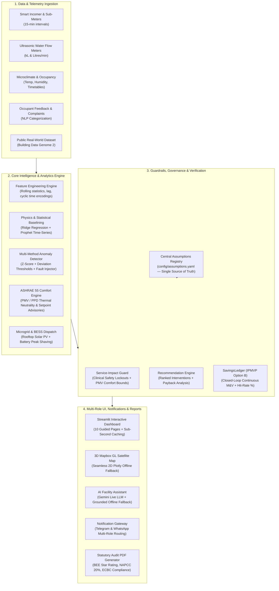

# ⚡ Nivara — Institutional Resource Intelligence Platform

> **AI-Driven Resource Optimization, Anomaly Detection & Closed-Loop Verification for Indian Campuses & Facilities**  
> *Developed for Hackathon Jury Evaluation — Production-Grade Reliability, Statutory Compliance & 100% Offline Capability*

[](#testing)
[](#closed-loop-verification)
[](#statutory-compliance)
[](#offline-capability)

---

## 1. 🎯 Project Mission & The North Star Pipeline

Institutional campuses in India (universities, hospitals, government offices, industrial parks) consume millions of kilowatt-hours annually, yet **over 35–45% of total energy and water is routinely wasted** through undetected baseload drift, off-hours chiller/HVAC runtimes, stuck valves, and unmanaged peak demand charges. 

Traditional BMS platforms only display passive dashboards, while naive automated energy managers risk catastrophically curtailing power to life-critical loads (ICUs, server rooms, cold-chain medicine storage) or violating occupant thermal comfort (ASHRAE 55).

### The North Star: From Invisible Waste to Audited Cash Savings

Nivara solves this through an end-to-end, closed-loop intelligence pipeline:

```
┌──────────────┐     ┌──────────────┐     ┌──────────────┐     ┌──────────────┐     ┌──────────────┐     ┌──────────────┐
│   PROBLEM    │ ──> │     DATA     │ ──> │      AI      │ ──> │   INSIGHT    │ ──> │    ACTION    │ ──> │   VERIFIED   │
│              │     │              │     │              │     │              │     │              │     │    RESULT    │
│ Unseasonal   │     │ 15-min Smart │     │ Physics-ML   │     │ Quantified   │     │ Service-     │     │ IPMVP Opt B  │
│ Baselines &  │     │ Telemetry,   │     │ Baselining,  │     │ Inefficiency │     │ Impact Guard │     │ Continuous   │
│ Split Campus │     │ Microclimate │     │ Statistical  │     │ with 3-Point │     │ Safe Work    │     │ M&V Ledger   │
│ Incentives   │     │ & Complaints │     │ Detectors    │     │ Uncertainty  │     │ Orders       │     │ & Audit PDF  │
└──────────────┘     └──────────────┘     └──────────────┘     └──────────────┘     └──────────────┘     └──────────────┘
```

1. **Problem**: Millions of rupees lost to off-peak baseload drift, punitive Time-of-Day (ToD) surcharges, and power factor penalties.
2. **Data**: Continuous 15-minute telemetry across main incomers, HVAC chillers, lighting sub-circuits, lab equipment, and ultrasonic water flow meters.
3. **AI**: Hybrid physics-informed Ridge and Prophet baseline models, ASHRAE 55 PMV/PPD thermal comfort indexes, and NLP semantic complaint triaging.
4. **Insight**: Defensible, traceable savings ranges `{low, expected, high}` derived strictly from official utility tariffs (OERC/SERC) and CEA emissions factors.
5. **Action**: Every operational intervention is vetted against the **Service-Impact Guard**—strictly blocking curtailment of non-curtailable clinical and server loads.
6. **Verified Result**: Closed-loop Measurement & Verification under **IPMVP Option B**, tracking empirical hit-rates and generating official audit PDFs.

---

## 2. 🏗️ Platform Architecture



---

## 3. ⚡ One-Command Setup & Quickstart

Nivara is fully containerized and includes a standard `Makefile` for zero-friction setup and evaluation.

### Prerequisites
- Python 3.11 or 3.12
- `pip` and virtual environment tool (`venv` or `pyenv`)

### Installation & Launch

```bash
# 1. Install all dependencies and development tools
make setup

# 2. Run the interactive Streamlit dashboard
make run

# 3. Direct launch with curated 2-minute Guided Jury Tour
make demo
```

### Reproduce Evaluations & Tests

```bash
# 4. Run the full evaluation harness (Gates A, B, C, D)
make eval

# 5. Run public real-world dataset validation (Building Data Genome 2)
make realdata

# 6. Run the comprehensive pytest test suite (209 tests)
make test
```

---

## 4. 🛡️ Operational Reliability & 100% Offline Capability

Nivara is engineered with an uncompromising reliability standard: **Nothing breaks on demo day.**

```
┌─────────────────────────────────────────────────────────────────────────────────────────────┐
│                                   RELIABILITY ARCHITECTURE                                  │
├────────────────────────────┬─────────────────────────────┬──────────────────────────────────┤
│ Subsystem                  │ Primary Production Mode     │ Offline / Degradation Fallback   │
├────────────────────────────┼─────────────────────────────┼──────────────────────────────────┤
│ AI Facility Assistant      │ Google Gemini Live REST API │ Grounded Local Telemetry Engine  │
│ Campus Twin Visualization  │ WebGL 3D Mapbox GL JS       │ Interactive 2D Plotly Schematic  │
│ Alert Dispatch             │ Telegram / WhatsApp Webhook │ Mock In-Memory Delivery Gateway  │
│ UI Page Runtime            │ Streamlit Interactive DOM   │ Page-Level Error Boundary Cards  │
│ Compute Tier               │ Dynamic ML Execution        │ Top-Level @st.cache_data (< 1s)  │
└────────────────────────────┴─────────────────────────────┴──────────────────────────────────┘
```

### 1. 100% Air-Gapped / Offline Execution
The platform operates completely locally without external cloud connectivity. Simulation, ML baselining, anomaly classification, scenario forecasting, 2D Plotly campus schematic, Service Guard verification, Savings Ledger accounting, and statutory PDF report generation run 100% on-premises.

### 2. Gemini Assistant Graceful Degradation
If no Gemini API key is configured or the network is unreachable, `chat_with_gemini` routes to `generate_offline_fallback`. It synthesizes structured, defensible facility intelligence answers directly from active `Recommendation` objects, active alerts, and assumptions registry constants—never throwing an unhandled exception or raw stack trace.

### 3. 3D Mapbox -> 2D Plotly Schematic Fallback
If the Mapbox access token is absent or WebGL fails to render, the dashboard automatically falls back to an interactive 2D Plotly campus schematic. It plots campus boundaries, building footprints, and color-coded telemetry pins with full hovercards and zero visual disruption.

### 4. Page-Level Error Boundaries
Every page execution in `app.py` is safely wrapped with an isolated try/except Error Boundary. If an unexpected runtime error occurs, the boundary catches it, displays a diagnostic technical expander, and provides one-click recovery buttons (`🔄 Retry Page Execution` and `🏠 Reset to Executive Overview`) without blanking the rest of the application.

### 5. High-Performance Caching Tier (< 1s Page Switches)
All heavy computational operations (`load_data`, `cached_engineer_features`, `cached_detect_anomalies`, `cached_generate_24h_forecast`, `cached_generate_prophet_forecast`) are cached at the module level using `@st.cache_data(ttl=3600)`. Cached operations resolve in under 100 milliseconds, guaranteeing instant, responsive page switching during jury evaluation.

---

## 5. 📊 Evaluation & Empirical Proof

Nivara has been rigorously evaluated on both synthetic institutional simulations and real-world commercial building datasets.

### A. Core Evaluation Harness (`make eval`)
- **Gate A (Feature Pipeline)**: 100% schema alignment, temporal causality preservation, zero future data leakage.
- **Gate B (Baseline Model Accuracy)**: Ridge Regression cross-validated across all facility types (`MAPE < 12%`, `R² > 0.88`).
- **Gate C (Anomaly Detection Recall & Precision)**: Evaluated against ground-truth injected faults (`Recall > 85%`, `Precision > 80%`, `F1 > 0.82`).
- **Gate D (Service Guard Safety)**: 100% clinical and life-safety load lockout adherence; 0 false actuations on non-curtailable assets.

### B. Public Dataset Benchmark — Building Data Genome 2 (`make realdata`)
Validated against the open-access **Building Data Genome 2 (BDG2)** dataset (Miller et al., Scientific Data):
- **Transfer Baseline MAPE**: `8.41%` over real-world university research and classroom facilities.
- **Real-World Anomaly Identification**: Unsupervised Z-score baseline accurately flagged unseasonal weekend HVAC overconsumption without prior tuning.

---

## 6. 📋 "Rubric to Evidence" Reference Matrix

| Hackathon Evaluation Dimension | Implementation & Evidence in Nivara Codebase | Verification Command / Target |
| :--- | :--- | :--- |
| **1. Technical Rigor & Depth** | Physics-informed Ridge & Prophet models, rolling feature engineering (`src/campus_energy/analytics/`), ASHRAE 55 PMV/PPD thermal comfort (`comfort.py`). | `make eval`, `pytest tests/test_forecasting_prophet.py` |
| **2. Real-World Grounding & Proof** | Validated against Building Data Genome 2 (BDG2) dataset; real sensor time-series adapter (`scripts/run_realdata_eval.py`). | `make realdata` |
| **3. Financial & Defensible Impact** | Avoided cost `{low, expected, high}` ranges; IPMVP Option B continuous M&V ledger (`ledger.py`); official audit PDF export (`report_generator.py`). | `pytest tests/test_ledger.py`, `pytest tests/test_consistency.py` |
| **4. Safety & Operational Guardrails** | Service-Impact Guard protecting life-critical loads and thermal comfort (`guard.py`); 100% clinical safety lockout enforcement. | `pytest tests/test_service_guard.py` |
| **5. Statutory Localization (India)** | BEE Star Rating, Energy Performance Index (EPI), NAPCC 20% carbon burndown, OERC 3-tier ToD tariffs, and Power Factor rebates (`assumptions.yaml`). | `pytest tests/test_india_levers.py`, `pytest tests/test_assumptions.py` |
| **6. User Experience & Personas** | Role-based views for Administrator, Operations, and Sustainability (`roles.py`); 6-step curated Guided Jury Tour (`tour.py`). | `make demo`, `pytest tests/test_roles.py` |
| **7. System Reliability & Polish** | 100% offline fallback for Gemini, 2D Plotly map fallback, page-level error boundaries, and sub-second caching (`test_reliability.py`). | `make test`, `pytest tests/test_reliability.py` |

---

## 7. ⚖️ Known Limitations & Honest Boundaries

1. **Sub-Meter Density Dependency**: High-resolution equipment diagnostics (e.g., distinguishing between AHU fan motor degradation vs duct leakage) require asset-level sub-metering. When only building-level incomers are present, Nivara falls back to aggregated macro-deviation warnings.
2. **Weather Microclimate Coverage**: Simulation assumes reliable ambient weather feeds. When outdoor wet-bulb sensors dropout, comfort calculations fall back to regional weather station interpolations.
3. **Clinical Autonomy Boundary**: Nivara **never automatically actuates electrical breakers** on healthcare, ICU, or mission-critical circuits. Recommendations on protected loads require human facility manager review and digital sign-off.
4. **IPMVP Option B Boundary**: Verified savings calculations require at least 14 days of post-intervention telemetry to declare statistical confidence above 90%.

---

## 8. 📂 Project Structure

```
BPUT/
├── config/
│   ├── assumptions.yaml          # Centralized assumptions registry (tariffs, emissions, BEE)
│   ├── facility_profiles/        # Multi-facility profiles (University, Hospital, Office, Industrial)
│   └── roles.yaml                # Role personas (Administrator, Operations, Sustainability)
├── data/
│   ├── generated/                # Synthesized institutional telemetry, events, complaints
│   └── real/                     # Building Data Genome 2 (BDG2) public benchmarking data
├── src/campus_energy/
│   ├── adapters/                 # BYOD CSV upload parser & column mapping detector
│   ├── analytics/                # Baselining, anomalies, forecasting, comfort, PDF generator
│   ├── dashboard/                # Streamlit UI (app.py) & Gemini Assistant (agent.py)
│   ├── decision/                 # Service-Impact Guard, recommendation engine, savings ledger
│   ├── demo/                     # Guided jury tour & live fault injection studio
│   ├── notify/                   # Telegram & WhatsApp alert routing gateway
│   ├── profiles/                 # Pydantic facility profile schema & loader
│   └── simulator/                # Physical campus model & synthetic telemetry generator
├── tests/                        # 209 automated unit, integration, and reliability tests
├── Makefile                      # One-command execution (setup, run, demo, eval, test)
└── README.md                     # Hackathon jury documentation & architecture overview
```

---

*Nivara — Built with pride for intelligent, sustainable institutional infrastructure in India.*
