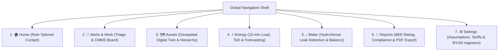
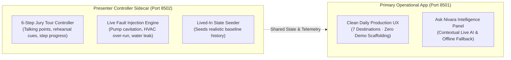

# Nivara — Platform Architecture & Operational Systems Guide

> **Document Classification:** Master Architecture & Systems Reference  
> **Target Audience:** Hackathon Juries, Institutional Registrars, Operations Directors, Energy Auditors, and Technical Reviewers  
> **Platform:** Nivara — Institutional Resource Intelligence Platform  
> **Format:** Pure Conceptual Architecture & Functional Workflows (No Code Snippets)

---

## 1. Executive Summary & Core Purpose

**Nivara** is an autonomous resource and energy intelligence platform engineered specifically for large institutional campuses across India, including universities, district hospitals, government collectorates, and industrial estates.

In traditional institutional management, facilities waste between 35% and 45% of their total utility budget due to undetected baseload drift, off-hours chiller over-runs, underground water leaks, unmanaged Time-of-Day electricity surcharges, and low power factor penalties. Conventional Building Management Systems (BMS) function merely as passive telemetry displays that report what happened in the past without providing actionable, risk-vetted interventions.

Nivara operates as an end-to-end, closed-loop decision-support and continuous verification system. It moves beyond passive graphing by ingesting high-frequency sensor streams, isolating inefficiencies through physics-informed machine learning, strictly vetting every proposed action against mission-critical clinical safety and human thermal comfort rules, dispatching structured maintenance tasks, and empirically verifying financial and environmental returns against international measurement-and-verification standards.

---

## 2. The North Star Closed Loop: From Waste to Audited Cash

Every subsystem within Nivara is built around an unbroken seven-stage chain of causality:

### Stage 1: The Problem
Institutional facilities suffer silent financial hemorrhage from equipment left running during unoccupied nights, cooling towers drifting from optimal setpoints, distribution leaks occurring during early morning hours, and peak electrical demand spikes that trigger permanent tariff penalties.

### Stage 2: Data Ingestion & Quality Scoring
Telemetry flows from smart electrical incomers, chiller sub-circuits, lab equipment meters, ultrasonic water flow sensors, weather stations, and occupant complaint logs. Before any processing occurs, a Data Quality Engine evaluates the incoming stream against completeness, sensor staleness, physical boundary limits, and three-phase electrical balance rules.

### Stage 3: Physics-Informed Artificial Intelligence
The analytics tier combines deterministic engineering physics with predictive machine learning. Dual forecasting models project campus electrical demand 24 hours into the future, multi-layer consensus algorithms identify anomalous energy deviations, thermal neutrality algorithms quantify human comfort, and nocturnal water balance models identify sub-surface distribution pipe bursts.

### Stage 4: Explainable Diagnostics
Instead of generating generic warning popups, the platform synthesizes structured diagnostic insights. It explicitly contrasts observed sensor telemetry against expected baseline levels, identifies which physical variables triggered the anomaly, and estimates financial loss ranges based on official state electricity regulatory tariffs.

### Stage 5: Service-Impact Guard
Before any energy-saving recommendation reaches human operators, it must pass a mandatory safety evaluation. The Service-Impact Guard acts as an immutable safety layer that strictly blocks any operational curtailment of life-critical healthcare loads (such as hospital ICUs, surgical suites, and vaccine cold-chain refrigeration) and prevents cooling cutbacks that would violate international indoor thermal comfort thresholds during active working hours.

### Stage 6: Action & CMMS Work Order Dispatch
Guarded recommendations are automatically converted into Computerized Maintenance Management System (CMMS) work orders. Each order receives a dynamically calculated priority score, an assigned maintenance craft, a live Service Level Agreement countdown timer, and automated dispatch over operational channels including Telegram and Email.

### Stage 7: Closed-Loop Continuous Verification
Once a maintenance technician resolves an issue, the platform initiates post-repair tracking under the International Performance Measurement and Verification Protocol (IPMVP Option B). By comparing actual post-repair telemetry against an isolated counterfactual model, Nivara empirically computes verified financial savings, carbon abatement, and forecasting hit-rate percentages.

---

## 3. High-Level Architectural Layers

The platform is structured into five distinct operational tiers:

```mermaid
flowchart TD
    subgraph TIER_1 ["1. Ingestion & Quality Assurance Tier"]
        I1["High-Density Electrical Telemetry (15-min Intervals)"]
        I2["Ultrasonic Water Flow Streams (Volume & Flow Rate)"]
        I3["Microclimate, Wet-Bulb & Timetable Context"]
        I4["Occupant Sentiment & Maintenance Tickets"]
        I5["Bring-Your-Own-Data (BYOD) Ingestion Console"]
        I6["Data Quality Engine (DQE 5-Rule Scorecard)"]
    end

    subgraph TIER_2 ["2. Analytics, Physics & Forecasting Tier"]
        A1["Dual Load Forecaster (Ridge Regression & Meta Prophet)"]
        A2["Empirical Uncertainty Envelopes (80% Prediction Intervals)"]
        A3["Multi-Layer Anomaly Consensus (Rules, Z-Score, Isolation Forest)"]
        A4["ASHRAE 55 Thermal Comfort Engine (PMV & PPD Indices)"]
        A5["HydroSense Minimum Night Flow (MNF) Water Leak Model"]
        A6["Unsupervised NLP Complaint Clustering (K-Means Triaging)"]
    end

    subgraph TIER_3 ["3. Governance, Tariffs & Safety Tier"]
        G1["Centralized Assumptions Registry (Single Source of Truth)"]
        G2["State Electricity Tariff Engine (OERC Two-Part HT Schedule)"]
        G3["Service-Impact Guard (Clinical Lockout & Comfort Bounds)"]
        G4["Decarbonization Roadmap & Three-Point Savings Engine"]
    end

    subgraph TIER_4 ["4. Execution & Verification Tier"]
        E1["CMMS Maintenance Work Order Management Board"]
        E2["Multi-Factor Priority Scoring & SLA Countdown Timers"]
        E3["Multi-Channel Notification Gateway (Telegram & SMTP)"]
        E4["IPMVP Option B Continuous M&V Savings Ledger"]
    end

    subgraph TIER_5 ["5. Enterprise Presentation & Presentation Tier"]
        U1["Primary Operational Tool (7 Job-Oriented Destinations)"]
        U2["Role-Tailored Portals (Operations, Sustainability, Administration)"]
        U3["Interactive 3D Campus Digital Twin (with 2D Vector Fallback)"]
        U4["Ask Nivara Contextual Intelligence Panel (Live AI & Offline Fallback)"]
        U5["Statutory Executive Audit PDF Report Generator (ReportLab)"]
        U6["Decoupled Presenter Controller Sidecar (Port 8502)"]
    end

    TIER_1 --> TIER_2
    TIER_2 --> TIER_3
    TIER_3 --> TIER_4
    TIER_4 --> TIER_5
```

---

## 4. Deep-Dive: Core Subsystems & How They Work

### 4.1 Ingestion & The Data Quality Engine (DQE)
Telemetry is ingested from sub-meters situated across campus distribution transformers, central chiller plants, lighting circuits, and specialized department equipment. 

To handle external data imports from legacy facility management tools, the Bring-Your-Own-Data adapter applies heuristic column matching to ingest external CSV telemetry without requiring manual schema realignment.

Before raw data enters analytical models, the Data Quality Engine runs five automated integrity audits:
1. **Completeness Audit:** Measures missing reading ratios and assigns quality flags.
2. **Temporal Consistency Audit:** Verifies strict chronological ordering, uniform 15-minute time deltas, and absence of timestamp gaps.
3. **Physical Validity Audit:** Flags impossible sensor readings (such as negative power, voltage spikes exceeding tolerance, or impossible power factors).
4. **Sensor Staleness Audit:** Detects frozen telemetry values indicative of disconnected hardware transceivers.
5. **Electrical Energy Balance Audit:** Cross-verifies total power against three-phase voltage and current to guarantee that power equals the square root of three times voltage times current times power factor.

If data quality drops below acceptable thresholds, the system dynamically penalizes analytical confidence scores and prompts operators for inspection.

---

### 4.2 Baselining, Dual Forecasting & Uncertainty
Nivara implements dual load-forecasting models that project institutional demand over a 24-hour horizon:

1. **Physics-Informed Ridge Regression:** Models the relationship between electrical power demand and exogenous variables, including ambient dry-bulb temperature, relative humidity, time-of-day cyclic rhythms, and campus timetable occupancy schedules.
2. **Meta Prophet Time-Series Forecaster:** Models multi-scale seasonality, daily patterns, weekend load depressions, and institutional holiday calendars.
3. **Calibrated Prediction Intervals:** Rather than presenting an overconfident single-point projection, the forecasting engine produces an 80% empirical prediction envelope around the forecast curve. This envelope establishes a defensible operating band that allows facility directors to plan contingency margins during heatwaves or high-demand exam periods.
4. **Counterfactual Scenario Simulation:** Operators can interactively adjust policy sliders to evaluate prospective operational strategies:
   - Ambient temperature shifts (modeling extreme weather stress).
   - Off-hours cooling cutbacks (quantifying savings from earlier HVAC shutoffs).
   - Occupancy shifts (modeling exam weeks or administrative breaks).
   - Rooftop solar photovoltaic additions (modeling renewable self-consumption).
   - Lighting efficiency retrofits (modeling facility-wide LED conversion).

All prospective savings are reported in standardized three-point ranges (conservative, expected, and optimistic) with explicit decision-support caveats.

---

### 4.3 Anomaly Detection & Diagnostic Explainability
Rather than relying solely on static thresholds, Nivara utilizes a triple-engine consensus approach:
1. **Physics and Engineering Rule Detectors:** Identifies physical system violations, such as unseasonal equipment operation, pump operation without downstream fluid flow, and active baseload consumption during scheduled unoccupied hours.
2. **Dynamic Statistical Z-Score Detectors:** Evaluates historical moving windows to detect gradual drift and uncharacteristic power draw relative to comparable days of the week.
3. **Unsupervised Isolation Forest:** Detects multi-dimensional telemetry anomalies that elude single-variable rules by identifying rare combinations of occupancy, temperature, and electrical draw.

When an anomaly triggers an alert, the explainability subsystem translates raw numerical deviations into plain-language diagnostic summaries. It presents the expected baseline draw, the observed telemetry, the net variance, ambient conditions at the time of detection, and a feature attribution table categorizing contributing variables as triggering factors or normal baseline conditions.

---

### 4.4 ASHRAE 55 Thermal Comfort Modeling
A frequent failure of automated energy management is aggressive cooling curtailment that causes indoor spaces to become uncomfortably warm, leading to occupant complaints and unauthorized manual overrides.

Nivara integrates the international standard for Thermal Environmental Conditions for Human Occupancy (ASHRAE 55 and ISO 7730 Fanger Model). Using indoor zone temperature, relative humidity, air velocity, clothing insulation, and occupant metabolic rate, the engine calculates:
- **Predicted Mean Vote (PMV):** Quantifying indoor thermal sensation along a scale from cold to neutral to hot.
- **Predicted Percentage of Dissatisfied (PPD):** Estimating the proportion of room occupants likely to experience thermal discomfort.

The system ensures that proposed energy curtailments maintain indoor environments within the standard comfort envelope (PMV between negative 0.5 and positive 0.5), preventing tenant dissatisfaction while optimizing chiller efficiency.

---

### 4.5 HydroSense Nocturnal Water Leak Detection
Water distribution in large Indian institutions represents a major unmonitored utility cost. Nivara incorporates an acoustic and volumetric water intelligence module adhering to international water loss standards (AWWA M36 and British Standard BS EN 12255).

The engine conducts automated **Minimum Night Flow (MNF)** analysis during early morning hours (between 01:00 AM and 05:00 AM), a window when campus occupancy is zero and legitimate water consumption is near zero. By establishing a statistical baseline of essential night consumption, the engine detects:
- Constant baseline offsets indicative of underground distribution pipe fractures.
- Intermittent nocturnal flow spikes indicative of stuck gravity flush valves in institutional restrooms.
- Elevated flow rates indicating storage sump overflows or unthrottled booster pumps.

Detected leaks are quantified in liters per minute, accumulated volumetric loss, and financial cost based on local municipal water tariffs, generating targeted plumbing work orders before minor leaks cause structural damage.

---

### 4.6 Statutory Indian Tariff & Power Factor Optimization
Utility billing for High Tension (HT) commercial consumers in India involves complex multi-component tariff schedules. Nivara integrates the state electricity regulatory commission framework (modeled on the OERC HT commercial schedule):

1. **Two-Part Tariff Structure:** Computes active energy consumption charges alongside monthly sanctioned contract demand charges.
2. **Contract Demand Floor Enforcement:** Utility agreements penalize institutions whose maximum recorded demand falls below 80% of sanctioned demand by billing for the minimum threshold regardless of actual consumption. Nivara monitors demand trends to prevent unnecessary capacity billing.
3. **Time-of-Day (ToD) Pricing Bands:**
   - **Evening Peak Window (18:00 to 22:00 IST):** Imposes a +20% surcharge, penalizing off-hours chiller runs during peak state grid demand.
   - **Night Off-Peak Window (00:00 to 06:00 IST):** Offers a -15% incentive rebate, encouraging off-peak water pumping and battery storage charging.
   - **Normal Day Window (06:00 to 18:00 IST):** Applies standard commercial rates.
4. **Power Factor Penalties & Rebates:**
   - Evaluates campus power factor across all incomers.
   - Computes financial surcharges when power factor drops below 0.90 (a 1.0% surcharge per 0.01 drop).
   - Computes utility rebate credits when power factor exceeds 0.95 (a 0.5% incentive rebate per 0.01 increase).
   - Automatically sizes and estimates simple capital payback periods for Automatic Power Factor Correction (APFC) capacitor banks.

---

### 4.7 Service-Impact Guard & Clinical Safety Lockouts
Automated energy saving cannot come at the expense of human safety or critical institutional missions. The **Service-Impact Guard** acts as an immutable safety layer embedded between the recommendation engine and the operational dispatch queue.

Every prospective intervention is evaluated against three non-negotiable safety rules:
1. **Life-Safety and Healthcare Protection:** Institutional facilities often house mission-critical loads. In healthcare environments, circuits feeding Intensive Care Units (ICUs), operation theaters, neo-natal ventilators, and vaccine cold-chain refrigeration units are classified as permanently protected. The Service-Impact Guard strictly intercepts and blocks any curtailment proposal targeting these assets.
2. **Occupancy Comfort Protection:** Interventions that reduce cooling during scheduled classes, lectures, or office meetings are blocked if they cause the thermal comfort index to breach acceptable boundaries.
3. **Safe Alternative Synthesis:** When an intervention is blocked, the engine does not merely reject the action; it automatically synthesizes a safe alternative, such as rescheduling non-critical auxiliary ventilation or adjusting pre-cooling setpoints before occupants arrive.

---

### 4.8 NLP Semantic Complaint Clustering
To bridge the gap between physical sensor telemetry and human occupant experience, Nivara ingests informal complaints submitted by students, hospital visitors, and office staff.

Using natural language vectorization and unsupervised machine learning (TF-IDF coupled with K-Means clustering), the system groups unstructured complaint texts into operational categories (such as cooling inadequacy, lighting failure, plumbing leakage, or electrical tripping). This allows facility directors to correlate physical equipment anomalies with ground-level occupant sentiment in real time.

---

### 4.9 Continuous Verification (IPMVP Option B) & Savings Ledger
A primary challenge in institutional energy management is proving that proposed interventions actually generated the financial savings claimed.

Nivara implements the **International Performance Measurement and Verification Protocol (IPMVP Option B)**:
- When a work order is dispatched and marked resolved, the platform isolates the asset and begins a continuous verification period.
- Post-repair consumption is continuously measured and compared against a counterfactual baseline model projecting what the asset would have consumed had no repair occurred.
- The difference represents empirically verified savings in kilowatt-hours, avoided utility expenditure, and carbon emissions avoided.
- A rolling Savings Ledger tracks the historical accuracy of system recommendations, publishing forecast hit-rate percentages (the proportion of completed repairs where realized savings matched predictions within a plus-or-minus 20% margin).

---

## 5. The 7 Operational Destinations

Nivara organizes its user experience around **7 job-oriented operational destinations**, providing an uncluttered, role-tailored environment for daily use:

### Destination 1: 🏠 Home (Role-Tailored Operational Cockpits)
When users log into Nivara, they arrive at an operational cockpit configured specifically for their institutional mandate:
- **Operations Lead:** Focuses immediately on morning triage: active critical equipment exceptions, unresolved anomaly alerts, open maintenance work orders, and technician dispatches.
- **Sustainability Officer:** Focuses on environmental compliance: national Bureau of Energy Efficiency (BEE) Star Rating, Energy Performance Index (EPI), monthly greenhouse gas budget burn-down, and carbon avoidance roadmaps.
- **Administrator:** Focuses on institutional governance: multi-facility portfolio health matrix, billing expenditure risks, contract demand exposure, and edge device health across the estate.

### Destination 2: 🚨 Alerts & Work (Operational Triage & CMMS Execution)
The primary execution center linking problem identification to physical repair:
- **Triage Inbox:** A filterable table of active anomalies classified by severity, equipment category, and financial loss rate.
- **Diagnostic Explainability Cards:** Interactive drawers detailing the exact detection source, baseline context, and contributing variables.
- **CMMS Work Orders Board:** Maintenance cards tracking task status across their lifecycle (proposed, approved, dispatched, in progress, resolved, and verified). Includes live SLA timers and quick-resolve action triggers.

### Destination 3: 🗺️ Assets (Geospatial Digital Twin & Hierarchy)
Provides physical and geographic context for every monitored device:
- **Geospatial Campus Map:** An interactive 3D satellite visualization displaying extruded building geometries, zone polygons, and color-coded telemetry pins that pulse when equipment faults occur. Automatically switches to a 2D vector schematic when running in air-gapped environments without external map tile servers.
- **Campus Hierarchy Explorer:** An expandable tree view organizing equipment from campus to building, floor, zone, and individual sub-circuit.
- **Asset Detail Profiles:** Historical power consumption traces, rolling average baselines, day-of-week operating heatmaps, and peer benchmarking charts comparing equipment against identical machines in sibling buildings.

### Destination 4: ⚡ Energy (Load Telemetry, Tariffs & Forecasting)
The electrical analysis and forward planning module:
- **Load Profiles:** 15-minute telemetry curves across main incomers, transformers, and sub-circuits with power factor tracking.
- **Dual Predictive Forecaster:** Side-by-side Ridge and Prophet forecasting with empirical prediction intervals.
- **What-If Scenarios:** Interactive policy controls modeling heatwaves, cooling cutbacks, occupancy changes, rooftop solar additions, and LED retrofits.
- **Microgrid & Storage Dispatch:** Simulates behind-the-meter solar generation and battery energy storage system charge/discharge cycles to shave peak evening tariff charges.

### Destination 5: 💧 Water (HydroSense Leak Detection & Balance)
The hydrological management module:
- **Water Balance Accounting:** Tracks total volume and municipal utility expenditure across campus blocks.
- **Nocturnal Leak Detection:** Visualizes diurnal flow curves, highlighting the 01:00 AM to 05:00 AM Minimum Night Flow window.
- **Plumbing Remediation Queue:** Actionable leak alert cards detailing lost volume, flow loss rates in liters per minute, and repair protocols.

### Destination 6: 📑 Reports (Statutory Compliance & Audit Dossiers)
The regulatory governance and executive reporting module:
- **Cross-Facility Benchmarking Matrix:** A standardized comparison across diverse institutional profiles (University, Hospital, Government Office, and Industrial Estate) evaluating energy intensity, occupant density, and compliance status.
- **Statutory Audit Checklists:** Chapter-by-chapter verification against the Energy Conservation Building Code (ECBC 2017) and Bureau of Energy Efficiency star rating standards.
- **One-Click Executive Audit PDF:** Generates a publication-grade audit document summarizing executive key performance indicators, active anomalies, verified savings ledgers, and assumptions citations.

### Destination 7: ⚙️ Settings (Assumptions, Tariffs, Roles & Ingestion)
The administrative configuration module:
- **Central Assumptions Registry:** Provides visibility into the 49 standardized constants governing tariffs, emission factors, and engineering thresholds.
- **Bring-Your-Own-Data Console:** An automated CSV upload interface with automated column mapping and data quality scorecards.
- **User and Facility Context Management:** User switching and access permission controls.
- **Notification Endpoints:** Configuration of Telegram bot webhooks and SMTP email dispatch endpoints.

---

## 6. Companion Intelligence & Presentation Architecture

### 6.1 Ask Nivara Contextual Intelligence Panel
Embedded across all destinations as a collapsible drawer, Ask Nivara acts as an intelligent facility companion:
- **Context-Aware Reasoning:** Ingests the active facility context, active alerts, and recent telemetry to provide immediate natural language guidance.
- **Grounded Offline Fallback:** When external cloud connectivity is unavailable, the assistant seamlessly routes queries to an offline mathematical reasoning engine that extracts structured insights directly from active recommendation and alert objects.
- **Conversational Action Parsing:** Converts conversational recommendations into structured task proposals ready for human approval and CMMS work order dispatch.

### 6.2 Decoupled Presenter Controller (Port 8502)
To preserve the credibility of the primary operational product, all demonstration scaffolding, jury tour controls, and live fault injection triggers are completely decoupled from the production interface:
- **Port 8501 (Production Application):** Presents a clean, quiet daily operational tool with zero demo toggles, tour banners, or performance latency badges.
- **Port 8502 (Presenter Controller):** Provides a synchronized sidecar interface containing the 6-step jury presentation script, talking points, audience state reset buttons, and instant fault injectors (triggering simulated pump cavitation, chiller over-runs, or distribution water leaks in real time).

---

## 7. Operational Reliability & Air-Gapped Readiness

Nivara is designed under a strict engineering rule: **the system must function reliably in fully disconnected, secure, or air-gapped environments without cloud dependencies**:

| Subsystem | Primary Online Operation | Degraded / Air-Gapped Fallback |
| :--- | :--- | :--- |
| **Conversational Intelligence** | Google Gemini Live API | Grounded Local Decision Engine |
| **Campus Visualization** | 3D WebGL Mapbox GL Satellites | Interactive 2D Plotly Vector Schematic |
| **Notification Gateway** | Live Telegram Webhook & SMTP | In-Memory Delivery & Local Audit Logging |
| **Analytical Baselining** | Dual Ridge & Meta Prophet Models | Deterministic Physics & Seasonal Naive Fallback |
| **Report Generation** | In-Memory ReportLab PDF Generator | Client-Side CSV & Structured JSON Exports |
| **UI Execution Tier** | Dynamic Streamlit Component DOM | Module-Level Caching with Error Boundaries |

Every core capability—including telemetry ingestion, anomaly detection, Service Guard evaluation, CMMS dispatch, and IPMVP verification—executes entirely within the local computational environment, guaranteeing zero downtime and complete data sovereignty.