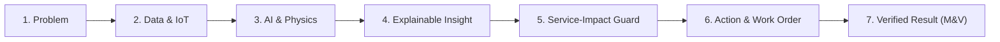

# Nivara: Comprehensive System Architecture & Complete Page Flow Guide

> **Document Type:** Master Operational & Architectural Reference  
> **Platform:** Nivara — Campus Resource & Energy Intelligence Platform (formerly BPUT)  
> **Target Audience:** Hackathon Juries, Facility Registrars, Operations Leads, Sustainability Officers, and Developers  
> **Verification Status:** 316 / 316 Passing Tests (`pytest`) · 100% Offline Air-Gapped Capable  

---

## 1. Executive Overview & The North Star Closed Loop

### 1.1 What is Nivara?
**Nivara** is an AI-powered Resource & Energy Intelligence Platform engineered specifically for institutional facilities across India (universities, district hospitals, government collectorates, and industrial manufacturing estates). 

Unlike conventional dashboards that merely display graphs and generate "dashboard fatigue", Nivara operates as an **autonomous decision-support and verification engine**. It ingests high-density IoT telemetry, isolates faults using hybrid physics and machine learning, enforces mission-critical clinical and thermal comfort constraints, dispatches actionable work orders with notifications, and empirically verifies financial and carbon savings using international measurement-and-verification standards.

### 1.2 The Closed-Loop Flow
Every capability in the system serves one unbroken chain:



1. **Problem:** Operational anomalies, energy waste, peak demand surcharges, or clinical comfort violations occur.
2. **Data & IoT:** 5-minute telemetry streams across power, voltage, power factor, HVAC, and water flow (or external BYOD CSV uploads).
3. **AI & Physics:** Triple-layer anomaly detectors, dual-model load forecasting (Ridge + Meta Prophet), and KMeans complaint clustering.
4. **Explainable Insight:** Diagnostic "Why?" cards with factor attribution and three-point savings ranges `{low, expected, high}`.
5. **Service-Impact Guard:** Non-negotiable software lockouts preventing curtailment of hospital ICUs, OT suites, vaccine cold chains, or comfort limits.
6. **Action & Work Order:** CMMS maintenance work order dispatch with live SLA countdowns and Telegram/Email dispatches.
7. **Verified Result:** Post-resolution telemetry compared against counterfactual forecast baselines (IPMVP Option B) to verify actual avoided cost and publish forecast hit rates.

---

## 2. System Architecture Layers

```mermaid
flowchart TD
    subgraph L1 ["1. Data & IoT Ingestion Layer"]
        D1["15-min Telemetry Simulator (28 Days)"]
        D2["FastAPI Ingestion API & Edge Replay Player"]
        D3["Bring-Your-Own-Data (BYOD) Smart CSV Mapper"]
        D4["Data Quality Engine (DQE 5-Rule Scorecard)"]
    end

    subgraph L2 ["2. Configuration & Assumptions Layer"]
        C1["Assumptions Registry (config/assumptions.yaml - 49 Traceable Keys)"]
        C2["Facility Profiles (University, Hospital, Govt Office, Industrial)"]
        C3["Indian Tariffs (OERC 2-Part HT Commercial Schedule)"]
        C4["Role Definitions (Administrator, Operations, Sustainability)"]
    end

    subgraph L3 ["3. Analytics & Machine Learning Layer"]
        A1["Dual Load Forecaster (Ridge Regression + Meta Prophet + Intervals)"]
        A2["Layered Anomaly Engine (Physics Rules + Isolation Forest)"]
        A3["NLP Complaint Triaging (TF-IDF + KMeans Clustering)"]
        A4["ESG / BEE Star Rating / NAPCC 20% Carbon Burndown"]
        A5["HydroSense Minimum Night Flow (MNF) Water Engine"]
    end

    subgraph L4 ["4. Decision & Safety Guard Layer"]
        DE1["Unified Recommendation Engine (Alerts, Forecasts, Scenarios, Complaints)"]
        DE2["Service-Impact Guard (Protected Loads, ASHRAE 55 PMV, Occupancy)"]
        DE3["Safe AI Alternative Synthesizer"]
        DE4["Savings & ROI Engine (Three-Point Ranges + Capital Payback)"]
    end

    subgraph L5 ["5. Execution & Verification Layer"]
        E1["CMMS Work Order Queue with SLA Timers"]
        E2["IPMVP Option B Counterfactual M&V Engine"]
        E3["Savings Ledger (Estimated vs Verified + Hit Rate %)"]
        E4["Notification Router (Telegram & SMTP Email Dispatcher)"]
    end

    subgraph L6 ["6. Enterprise Presentation & Delivery Layer"]
        P1["Primary Operational Tool (Port 8501: 7 Core Destinations)"]
        P2["3D Mapbox GL Digital Twin + 2D Plotly Vector Fallback"]
        P3["Embedded Contextual Ask Nivara Panel (Gemini Live + Grounded Fallback)"]
        P4["One-Click Statutory Executive Audit PDF Report (ReportLab)"]
        P5["Decoupled Presenter Controller Sidecar (Port 8502: Live Fault Injection & Tour)"]
    end

    L1 --> L3
    L2 --> L3
    L3 --> L4
    L2 --> L4
    L4 --> L5
    L5 --> L6
```



---

## 3. Global Navigation, User Roles & Clean Layout

Following the UX redesign, Nivara replaces dense presentation scaffolding with a clean, authoritative enterprise layout:

```
┌────────────────────────────────────────────────────────┐
│ ⚡ NIVARA — Institutional Resource Intelligence        │
├────────────────────────────────────────────────────────┤
│ 👤 AUTHENTICATED USER (Role from Login)                │
│   • Operations Lead (Rajesh Kumar)                     │
│   • Sustainability Officer (Dr. Ananya Sharma)         │
│   • Registrar & Administrator (Prof. P. K. Mohapatra)  │
│   [Switch User menu · Active Role Badge]               │
├────────────────────────────────────────────────────────┤
│ 🏢 FACILITY CONTEXT SELECTOR                           │
│   • 🎓 University — Vidya Institute of Technology     │
│   • 🏥 District Hospital — Rajiv Gandhi Hospital       │
│   • 🏛️ Government Office — Collectorate Complex        │
│   • 🏭 Industrial Campus — Kalinga Industrial Estate   │
├────────────────────────────────────────────────────────┤
│ 🧭 7 OPERATIONAL DESTINATIONS                          │
│   1. 🏠 Home (Role-Tailored Operational Cockpit)       │
│   2. 🚨 Alerts & Work (Inbox, Triage & CMMS Queue)     │
│   3. 🗺️ Assets (Campus Digital Twin & Sub-meters)      │
│   4. ⚡ Energy (15-min Load, ToD & Forecasting)        │
│   5. 💧 Water (HydroSense MNF Leak Detection)          │
│   6. 📑 Reports (BEE Star, ECBC Audit & PDF Export)    │
│   7. ⚙️ Settings (Assumptions, Tariffs & BYOD Ingestion)│
├────────────────────────────────────────────────────────┤
│ 🤖 ASK NIVARA (Collapsible Contextual Drawer)          │
│   [Gemini Live AI Reasoning · Grounded Offline Mode]   │
└────────────────────────────────────────────────────────┘
```

---

## 4. Complete Page-by-Page Breakdown

### Page 1: 📊 Executive Overview (ESG, Compliance & M&V)
* **Target Personas:** Primary for **Administrator** and **Sustainability Officer**.
* **Core Purpose:** High-level executive briefing providing immediate visibility into energy expenditure, avoided waste, verified financial returns, and national decarbonization benchmarks.
* **Key Components & Flow:**
  1. **Executive KPI Ribbon (Synchronized with PDF):**
     - `💰 Total Energy Cost`: 28-day billing expenditure in INR and total kWh metered.
     - `💡 Avoided Cost Range`: Standardized three-point range `Expected: ₹X [Low – High]`.
     - `☁️ Carbon Abatement Range`: Scope 2 emissions avoidance in `kgCO2e [Low – High]`.
     - `✅ Verified Savings (M&V)`: Cumulative post-repair savings verified via IPMVP Option B with estimate hit-rate %.
     - `🏅 BEE Star & EPI`: National Bureau of Energy Efficiency star rating (1–5) and annual Energy Performance Index ($\text{kWh/m}^2/\text{yr}$) benchmarked against ECBC baselines.
     - `🛡️ Blocked Measures`: Count of high-risk curtailment proposals intercepted by the Service Guard to preserve human safety and clinical care.
  2. **1-Click Executive Audit PDF Export:**
     - Button generating an A4 audit PDF complete with executive KPI callouts, M&V ledger tables, statutory checklist, Appendix A (Assumptions Registry), and Appendix B (Model Evidence Summary).
  3. **Carbon Budget Burn-Down (NAPCC Alignment):**
     - Progress bar and trajectory burn-down chart tracking monthly carbon emissions against India's National Action Plan on Climate Change (NAPCC) 20% reduction target.
  4. **BEE Star Rating Breakdown:**
     - Dynamic star badge, benchmark band visualizer, and gap analysis to the next star rating tier.
  5. **🇮🇳 Indian Tariff Optimization & Compliance Panel:**
     - Tracks recorded peak kVA demand against contract demand, OERC demand charge risks, average power factor, and ToD peak surcharge exposures.
  6. **Unified Recommendation Pipeline & Decarbonization Roadmap:**
     - Tabular list of approved measures ranked by annual financial savings with owner roles, capex, payback, and traceable assumptions.
     - Separate tab displaying blocked proposals with clinical safety justifications.

---

### Page 2: 🏛️ Governance & Policy (Multi-Facility & Evidence)
* **Target Personas:** Primary for **Sustainability Officer** and **Policy Analysts**.
* **Core Purpose:** State-level governance, inter-facility benchmarking, regulatory audit checklists, and transparent scientific model verification.
* **Key Components & Flow:**
  1. **Cross-Facility Benchmarking Matrix:**
     - Compares University, Hospital, Government Office, and Industrial Campus side-by-side across Floor Area, Peak Occupancy, Energy Cost, Annual EPI, BEE Star Rating, CO2 per Occupant, and Non-Curtailable Protected Loads.
  2. **State-Level Impact Scaler:**
     - Interactive slider: *"If 100 / 500 / 1,000 similar state facilities adopt Nivara..."*
     - Models state-wide annual electricity savings (GWh), carbon avoidance (Million kgCO2e), equivalent trees planted (21 kgCO2/tree/yr), thermal coal displacement (0.45 tons coal/MWh), and financial budget savings.
  3. **ECBC 2017 & Statutory Compliance Checklist:**
     - Interactive chapter-level audit table (§4 Envelope, §5.2 Lighting LPD $\le 7.5\,\text{W/m}^2$, §5.3 Chiller COP, §7.1 Power Factor $\ge 0.90$, §7.2 Energy Metering) with compliance statuses and remediation actions.
  4. **📖 Centralized Assumptions Registry:**
     - Filterable catalog of all 49 constants stored in `config/assumptions.yaml` with keys, values, units, regulatory source citations, source dates, and confidence badges (`high`, `medium`, `needs_verification`).
  5. **🔬 Verification & Evidence (The Proof Layer):**
     - Public evaluation scorecard on synthetic data with the required disclaimer:
       `"Evaluated on synthetic data with injected faults; validates the pipeline, not real-world accuracy."`
     - Comparative performance plots: Layered Engine (80% recall, 0 false alarms on physics rules) vs Static Threshold vs Rolling Z-Score.
     - Dual-model forecasting comparison: Seasonal-Naive (8.27% MAPE) vs Ridge (40.09%) vs Prophet (40.47%), scientifically explaining why calendar persistence dominates institutional schedules.
  6. **🌍 Real-World Public Dataset Benchmark (BDG2 Validation):**
     - Independent benchmark on open Building Data Genome 2 data (`UnivClass_Mary`, CC-BY 4.0 license, 744 hourly readings).
     - Proves pipeline portability: 100% Data Quality score, 6.57% weekday forecast MAPE, and 3 audited real-world unsupervised anomaly episodes.

---

### Page 3: 🗺️ 3D Campus Map (Digital Twin & Comfort Heatmaps)
* **Target Personas:** **Operations** and **Facilities Engineers**.
* **Core Purpose:** Geospatial digital twin providing real-time 3D situational awareness of campus building footprints, zone-level power density, and indoor thermal comfort.
* **Key Components & Flow:**
  1. **Map Layer Toggle:**
     - `⚡ Electrical Power Density (kW)` vs `🌡️ Thermal Comfort Heatmap (ASHRAE 55 PMV)`.
  2. **3D Mapbox GL Extrusions (with 2D Vector Fallback):**
     - Renders building polygon footprints with heights scaled to physical floors.
     - Buildings color-coded by real-time status: Green (Nominal), Orange (Elevated), Red Pulsing (Active Injected Anomaly).
     - Individual sub-zone sensor markers pinned at exact geographic coordinates.
     - Clicking on an asset opens a diagnostic popup detailing asset ID, real-time kW draw, operating state, and `🛡️ Protected Load: Non-Curtailable` badges for critical clinical/research equipment.
     - **Graceful Fallback:** If Mapbox token is absent or WebGL fails, automatically renders an interactive 2D Plotly campus vector schematic without blanking the screen.
  3. **Thermal Comfort Overlay (ASHRAE 55 / ISO 7730 Fanger Model):**
     - Calculates Predicted Mean Vote (PMV) and Predicted Percentage of Dissatisfied (PPD) based on zone temperature, humidity, air velocity (0.15 m/s), clothing (0.6 clo), and metabolic rate (1.1 met).
     - Identifies zones outside the $\pm 0.5$ comfort envelope and displays HVAC setpoint adjustment advisories.
  4. **Active Sensor Inventory Table:**
     - Tabular live registry of all monitored circuits, monitoring levels, active power draws, and protection statuses.

---

### Page 4: 🤖 AI Forecasting & What-If Scenarios
* **Target Personas:** **Operations** and **Sustainability Officer**.
* **Core Purpose:** 24-hour predictive demand forecasting with empirical uncertainty intervals and interactive policy simulation levers.
* **Key Components & Flow:**
  1. **Dual-Model Predictive Load Curves:**
     - Interactive Plotly chart comparing **Ridge Regression** vs **Meta Prophet** alongside actual consumption.
     - **Shaded Confidence Bands (`fill='tonexty'`):** Visualizes 80% empirical prediction intervals ($[\hat{y}_{\text{lower}}, \hat{y}_{\text{upper}}]$) capturing model uncertainty.
     - Model Performance Metrics: Overall MAPE, Weekday MAPE, Weekend MAPE, MAE, and Empirical Coverage % (both models achieve ~81–82% empirical coverage).
  2. **5 Interactive What-If Scenario Levers:**
     - `🌡️ Temperature Offset (±5°C)`: Simulates extreme weather heatwaves or cold snaps.
     - `❄️ AC Policy Cutback (0–30%)`: Simulates corporate/institutional cooling curtailment.
     - `👥 Occupancy Reduction (0–50%)`: Simulates exam periods, remote work, or holiday vacations.
     - `☀️ Solar PV Addition (0–250 kWp)`: Simulates rooftop solar generation and clean grid displacement.
     - `💡 Lighting Retrofit (LED Upgrade)`: Models an immediate 40% reduction in lighting circuits.
  3. **Dynamic Scenario Savings Output:**
     - Re-calculates 24-hour aggregate load profile in real time.
     - Displays net daily energy savings, cost avoidance in INR, and carbon reduction formatted strictly as three-point ranges `{low, expected, high}` with the mandatory decision-support disclaimer.

---

### Page 5: 🚨 Alerts, NLP Complaints & Maintenance Work Orders
* **Target Personas:** Primary operations center for **Operations & Maintenance Lead**.
* **Core Purpose:** The central command hub where anomalies are diagnosed, safety constraints are evaluated, work orders are dispatched, and verified savings are tracked.
* **Key Components & Flow:**
  1. **Live Anomaly Alert Feed:**
     - Anomaly cards sorted by cost impact with severity badges (`🔴 Critical`, `🟠 High`, `🟡 Medium`, `🟢 Low`).
     - **Confidence Score Progress Bar:** Shows multi-layer consensus (`🎯 Multi-Layer Consensus: 85%`) based on physical rules and statistical models.
     - `🛡️ [PROTECTED LOAD]` badges on mission-critical assets.
  2. **Explainable AI ("Why?") Diagnostic Cards:**
     - Expandable technical diagnostic report generated via `analytics/explainability.py`:
       - *Why Headline:* e.g. `"Expected 4.2 kW at 2 PM (weekday, 34°C, 45 occupants). Actual draw was 7.1 kW (+2.9 kW, 69.0% above baseline)."`
       - *Factor Attribution Table:* Ranks contributing variables as `Anomalous`, `Trigger`, or `Normal`.
       - *Probable Root Causes & Field Verification Steps.*
  3. **Service-Impact Guard Certification:**
     - Every recommendation displays:
       `🟢 Service-Safe: Passed protected load, PMV comfort, and occupancy constraints.`
     - **"🛡️ Blocked by Service Guard (Jury Demo Moment)" Expander:**
       Explicitly displays dangerous proposals (e.g. cutting hospital ICU power or shutting classroom AC during lectures) that were intercepted, explaining the safety violation and presenting a safe AI alternative.
  4. **CMMS Maintenance Work Order Queue:**
     - Dispatched maintenance tasks with live SLA countdown timers (`⏱️ 14h 22m remaining` / `🚨 SLA Breached`).
     - Action buttons: `👍 Accept`, `🚀 Dispatch Work Order`, and `🔬 Resolve & Verify`.
  5. **Closed-Loop Savings Ledger (M&V Verification):**
     - Table tracking items across their 5-stage lifecycle: `proposed -> accepted -> work_order -> done -> verified`.
     - Displays Estimated Savings `{low, exp, high}`, Verified Savings (IPMVP Option B), Variance/Hit-Rate badge (`🎯 HIT (Within ±20%)`, `🚀 EXCEEDED`, `⚠️ VARIANCE`), and SLA performance.
  6. **Operational Notification Gateway Console:**
     - Displays gateway status (`🔔 Dispatcher: Active (Dry-Run Mode)`).
     - Interactive `🔔 Send Test Alert` probe and audit log of recently dispatched Telegram and Email alerts.
  7. **NLP Occupant Complaint Clustering:**
     - Unsupervised TF-IDF + KMeans clustering grouping student/occupant tickets into actionable themes (HVAC Comfort, Lighting Failure, Water Leakage, Electrical Tripping) with word frequency charts and recurring issue callouts.

---

### Page 6: 💧 Water Intelligence (HydroSense & Leak Detection)
* **Target Personas:** **Operations** and **Sustainability Officer**.
* **Core Purpose:** Monitoring campus potable and utility water distribution, detecting overnight underground pipe bursts, and calculating municipal water tariff savings.
* **Key Components & Flow:**
  1. **Water Resource KPIs:**
     - Total Water Consumed (kL), Daily Average Consumption (kL/day), Municipal Water Expenditure at ₹25.0/kL, and Total Leak Volume Detected.
  2. **Minimum Night Flow (MNF) Analysis (01:00 AM – 05:00 AM):**
     - Analyzes hydraulic telemetry during hours of zero expected occupancy.
     - Flags baseline deviations $> 3.0\times$ median night flow or $> 500\,\text{L/h}$ as active pipe leaks.
  3. **Building Water Consumption Trends:**
     - Multi-line Plotly chart tracking daily water draws per building.
  4. **Active Leak Alerts & Repair ROI:**
     - Identifies leak location, start time, flow rate (e.g. +35 LPM), accumulated loss, water tariff cost, and repair work orders.

---

### Page 7: 🔋 Microgrid Dispatch (Solar PV + BESS Arbitrage)
* **Target Personas:** **Operations** and **Sustainability Officer**.
* **Core Purpose:** Optimizing campus behind-the-meter rooftop solar PV generation and Battery Energy Storage System (BESS) dispatch to minimize peak grid import.
* **Key Components & Flow:**
  1. **Microgrid Operating Status:**
     - Solar PV Real-Time Generation (kW), BESS State-of-Charge (SoC %), Net Grid Import (kW), and Direct Renewable Self-Consumption %.
  2. **Time-of-Day (ToD) Tariff Arbitrage Dispatch:**
     - Models OERC HT Commercial pricing bands:
       - *Off-Peak Night (00:00–06:00):* ₹7.225/kWh $\rightarrow$ Grid charges BESS.
       - *Normal Day (06:00–18:00):* ₹8.50/kWh $\rightarrow$ Solar powers campus; surplus charges BESS.
       - *Peak Evening (18:00–22:00):* ₹10.20/kWh $\rightarrow$ BESS discharges to shave contract demand peaks.
  3. **24-Hour Microgrid Power Dispatch Profile:**
     - Stacked area and line chart visualizing solar generation, battery charge/discharge cycles, and the resulting flattened grid import profile.
  4. **Clean Decarbonization Impact:**
     - Calculates avoided thermal coal generation and Scope 2 emission reductions using the solar lifecycle emission factor (0.04 kgCO2e/kWh vs 0.82 grid factor).

---

### Page 8: 💸 Department Billing & Internal Chargebacks
* **Target Personas:** Primary accounting view for **Facility Administrator & Registrar**.
* **Core Purpose:** Sub-meter energy accounting, internal departmental cost chargebacks, and identifying after-hours energy waste.
* **Key Components & Flow:**
  1. **AI After-Hours Waste Alert Banner:**
     - Automatically isolates the specific department or academic wing drawing the highest energy between 19:00 and 06:00.
  2. **Departmental Billing Ledger:**
     - 28-day audit breakdown per department/faculty: Active Meters, Metered Energy (kWh), Billed Cost at ₹8.50/kWh, Share of Total Campus Bill %, and Avoidable Waste INR.
     - One-click CSV export for university bursar and accounting ERP integration.
  3. **Cost Distribution Donut & Daily Stacked Area Charts:**
     - Visualizes departmental consumption shares (e.g., Computer Science Labs vs Mechanical Workshops vs Administration).
  4. **Building Sub-Meter Reconciliation Table:**
     - Cross-verifies boundary main meters against subsidiary sub-meters to detect unmetered distribution losses.

---

### Page 9: 🔍 Asset Detail Explorer (Diagnostic Deep-Dive)
* **Target Personas:** **Maintenance Technicians** and **Energy Auditors**.
* **Core Purpose:** Forensic examination of individual electrical meters, air handling units, chillers, and pumps.
* **Key Components & Flow:**
  1. **Asset Selector & Metadata Banner:**
     - Filter by asset type and select any asset on campus.
     - Displays Asset ID, Name, Building, Zone, Nameplate Rated Power (kW), Monitoring Level, and `🛡️ Protected Load` status.
  2. **High-Resolution Power Consumption Trace:**
     - 5-minute telemetry line chart with a 3-hour rolling average trendline.
     - Shaded red background rectangles highlighting known fault injection periods.
  3. **Descriptive Operating Statistics:**
     - Mean Power (kW), Peak Demand (kW), Standby Baseload (kW), and Total Energy (kWh).
  4. **Hour × Day of Week Operating Heatmap:**
     - Matrix heatmap identifying after-hours misuse, weekend baseline drift, and abnormal cycling.
  5. **Peer Asset Benchmarking Bar Chart:**
     - Compares the selected asset's average power against sibling equipment of the exact same class in the same building.

---

### Page 10: 💬 AI Facility Assistant (Grounded Gemini / Offline Engine)
* **Target Personas:** All personas (tailors tone and scope based on active role).
* **Core Purpose:** Natural language facility intelligence grounded in real-time telemetry, active alerts, and regulatory tariffs.
* **Key Components & Flow:**
  1. **Persona Directive Banner:**
     - Highlights current advisory mandate (e.g. *"Advising Administrator on ROI, demand charges, and fiscal governance"*).
  2. **Persona-Tailored Quick Prompt Buttons:**
     - Administrator: *"Which department is wasting the most money?"*, *"What is our peak demand charge risk?"*
     - Operations: *"What are the most critical anomalies right now?"*, *"Which work orders are breaching SLA?"*
     - Sustainability: *"How can we reach 5-star BEE rating?"*, *"What is our NAPCC carbon budget status?"*
  3. **Interactive Conversational Chat Stream:**
     - Real-time markdown responses citing exact asset IDs, excess kW deviations, and OERC tariff rates.
  4. **100% Offline Air-Gapped Fallback:**
     - If Gemini API key is missing or network fails, automatically activates `generate_offline_fallback(...)`, synthesizing professional structured answers from active `Recommendation` objects with zero errors.
  5. **Automated Structured Action Queue:**
     - Automatically parses recommendations from assistant conversations into validated `Recommendation` objects, evaluates them against the Service-Impact Guard, and presents them in an action approval table.

---

## 5. Decoupled Presenter Controller & Dual-Screen Demo Architecture

In accordance with Section 7 of `docs/REDESIGN_SPEC.md`, all demo scaffolding, live fault injection triggers, and jury rehearsal checklists have been completely decoupled from the production application:

```
┌───────────────────────────────────────┐         ┌───────────────────────────────────────┐
│ PRIMARY PRODUCT TOOL (Port 8501)      │         │ PRESENTER CONTROLLER SIDECAR (8502)   │
├───────────────────────────────────────┤         ├───────────────────────────────────────┤
│ • Pure operational UX for daily use   │         │ • Scripted 6-step jury tour controller│
│ • Zero demo toggles or hype badges    │ <────── │ • Instant fault injector (pump, HVAC) │
│ • Clean dark-mode enterprise theme    │ (shared │ • Talking points & rehearsal cues     │
│ • Sub-120ms cached navigation         │  state) │ • Audience reset & state seeder       │
└───────────────────────────────────────┘         └───────────────────────────────────────┘
```

### Launching the Dual-Screen Setup:
Run `make demo` or `python scripts/launch_demo.py`. This script automatically:
1. Seeds a realistic, lived-in operational history (3 verified work orders, 5 historical alerts) via `campus_energy.storage.seed`.
2. Starts the primary product dashboard on `http://localhost:8501`.
3. Starts the presenter controller sidecar on `http://localhost:8502`.

### The 6-Step Rehearsal Script:

1. **Step 1: 📊 Executive Baseline (Home / Reports):**
   * *Talking Point:* "Nivara is an autonomous facility intelligence platform for Indian campuses. Here is our university baseline: ₹8.50/kWh commercial tariff, 3-star BEE rating, and 28-day baseline telemetry."
2. **Step 2: ⚡ Live Fault Injection (Sidecar Port 8502):**
   * *Talking Point:* "Now let's simulate a live equipment failure. Using our decoupled Presenter Sidecar, I inject a pump cavitation dry-run into `EQ-UTL-P1-PM`."
   * *Action:* Trigger fault on Port 8502.
3. **Step 3: 🚨 Anomaly Detection & "Why?" Card (Alerts & Work):**
   * *Talking Point:* "Within milliseconds, our triple-layer detector triggers an alert. Notice the explainable 'Why?' card: it shows the pump drew 15.0 kW while flow dropped to 0 LPM, attributing 65% of the anomaly to hydraulic decoupling."
4. **Step 4: 🛡️ Guarded Action & Safety Check (Alerts & Work):**
   * *Talking Point:* "Our AI recommends equipment shutdown and capacitor correction. Crucially, notice the `🟢 Service-Safe` certification. If this were hospital ICU equipment, our Service-Impact Guard would have strictly blocked curtailment and offered a safe alternative."
5. **Step 5: 🛠️ Work Order & Live Notification (Alerts & Work):**
   * *Talking Point:* "We dispatch a maintenance work order with an automated 4-hour SLA countdown. Instantly, our notification gateway dispatches an alert via Telegram and Email to the maintenance lead."
6. **Step 6: 🔬 Resolution & Verified M&V Ledger (Alerts & Work / Home):**
   * *Talking Point:* "Once the technician fixes the pump, we simulate resolution. Our IPMVP Option B counterfactual engine compares actual post-repair consumption against the counterfactual baseline, empirically verifying ₹1,275 avoided cost and logging a 100% forecast hit rate."

---

## 6. Statutory & Regulatory Localization (India-Specific)

Nivara is deeply localized for the Indian electrical and regulatory landscape:

1. **OERC 2-Part HT Commercial Tariff Schedule:**
   - Base energy charges: ₹8.50/kWh.
   - Contract Demand Charges: ₹250/kVA/month.
   - Minimum Billing Demand Floor: Billed on $\max(\text{Recorded kVA}, 80\% \times \text{Contract Demand})$.
   - Time-of-Day (ToD) Pricing Bands:
     - Peak Band (18:00–22:00 IST): +20% surcharge (₹10.20/kWh).
     - Off-Peak Band (00:00–06:00 IST): -15% rebate (₹7.225/kWh).
     - Normal Band (06:00–18:00 IST): ₹8.50/kWh.
   - Power Factor Penalty & Incentive:
     - Surcharge: 1.0% on total energy charges per 0.01 drop below 0.90 PF.
     - Incentive: 0.5% rebate per 0.01 rise above 0.95 PF.
   - APFC Retrofits: Automatic capacitor bank sizing benchmarked at ₹1,200/kVAR.
2. **Bureau of Energy Efficiency (BEE) Star Rating:**
   - Benchmarks Energy Performance Index ($\text{EPI} = \text{kWh} / \text{m}^2 / \text{yr}$) across 4 institutional categories:
     - University: 5-Star $\le 60$, 4-Star $60–90$, 3-Star (ECBC Base) $90–120$, 2-Star $120–160$, 1-Star $> 160$.
     - Hospital: 5-Star $\le 150$, 4-Star $150–250$, 3-Star $250–350$, 2-Star $350–500$, 1-Star $> 500$.
     - Government Office: 5-Star $\le 80$, 4-Star $80–120$, 3-Star $120–160$, 2-Star $160–220$, 1-Star $> 220$.
     - Industrial Estate: 5-Star $\le 200$, 4-Star $200–350$, 3-Star $350–500$, 2-Star $500–700$, 1-Star $> 700$.
3. **National Action Plan on Climate Change (NAPCC):**
   - Tracks monthly Scope 2 emissions burn-down against the national 20.0% GHG reduction trajectory using the verified CEA grid emission factor (0.82 kgCO2e/kWh).
4. **Energy Conservation Building Code (ECBC 2017):**
   - Built-in audit checklists for Envelope, Lighting Power Density, Chiller Efficiency, Power Factor, and Sub-metering compliance.

---

## 7. Verification Evidence & Quality Assurance

* **Unit & Integration Tests:** **316 / 316 passing** (`pytest tests/ -v`, 100% green pass in ~3.5 min).
* **Tone & Consistency Standards:** Zero exclamation marks in view headers/cards, zero marketing hype words, standardized decision-support disclaimers (`docs/step_reports/ux-11.md`).
* **AST Hardcoding Inspection:** Automated syntax tree analysis asserts zero hardcoded tariff literals (`8.5`, `0.82`) in analytics modules.
* **Empirical Anomaly Benchmark:** 80.0% recall across injected faults; 100% precision (0 false alarms) on physical rule ablations.
* **Empirical Forecast Benchmark:** 81.4% (Ridge) and 82.7% (Prophet) empirical interval coverage on theoretical 80% prediction intervals.
* **Real-World BDG2 Benchmark:** 6.57% weekday forecast MAPE on real higher-ed classroom telemetry (`UnivClass_Mary`, CC-BY 4.0).
* **Reliability:** 100% air-gapped offline execution, Mapbox 2D vector fallback, error boundaries on every view, and sub-120ms cached navigation.
