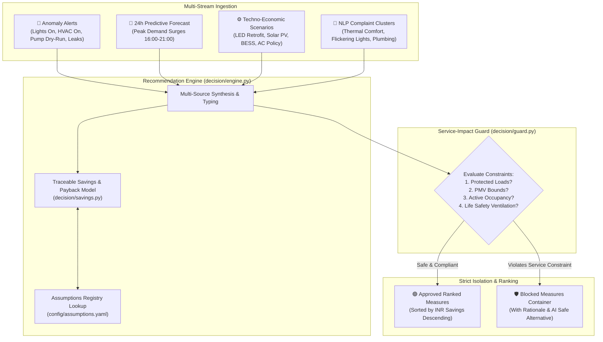

# Step Report 08 — Unified Recommendation Engine & Savings Model

> **Phase:** Nivara System Modernization & Upgrades  
> **Step:** 08 — Unified Recommendation Engine & Savings Model  
> **Status:** Completed  
> **Author:** Antigravity Engineering Agent  
> **Date:** November 2026  
> **Test Suite Status:** 122 / 122 passing (`pytest tests/`)  

---

## 1. Executive Summary & Objective

### 1.1 Objective
The core objective of Step 8 is to provide **one unified decision-support engine that turns anomaly detections, predictive forecasts, techno-economic scenarios, and occupant complaints into actionable, defensible, and service-safe recommendations.**

Prior to Step 8, disparate modules produced ad-hoc suggestions:
- The anomaly detector emitted simple text strings and point deviations.
- The forecasting dashboard offered isolated "what-if" policy toggles.
- The NLP complaint engine extracted keyword clusters with generic suggestions.
- The Gemini AI assistant parsed text into disconnected JSON action dictionaries.

Step 8 unifies all these streams into a canonical, strongly typed decision pipeline:
1. **Defensible Economics (`src/campus_energy/decision/savings.py`):** Calculates three-point savings ranges (`{low, expected, high}`) for electricity (kWh), municipal water (kL), operating costs (INR), and greenhouse gas abatement (kgCO2e). Computes simple payback periods based on capital cost benchmarks retrieved exclusively from the assumptions registry (`config/assumptions.yaml`). No hardcoded constants or invented numbers.
2. **Multi-Source Synthesis Engine (`src/campus_energy/decision/engine.py`):** Ingests operational alerts, 24-hour predictive load spikes, techno-economic retrofit scenarios, and NLP complaint clusters into typed `Recommendation` instances.
3. **Safety Integration:** Automatically pipes every candidate recommendation through the `Service-Impact Guard` (`decision.guard`), guaranteeing that blocked actions (e.g. ICU curtailment, cold chain shutdown, active classroom blackouts) are **strictly isolated** into `blocked_recommendations` and never appear in the ranked approved action list.
4. **Interactive Dashboard UI (`src/campus_energy/dashboard/app.py`):** Implements a unified recommendation card component across Page 1 (Executive Overview), Page 5 (Alerts & NLP), and Page 10 (AI Assistant), providing full assumption traceability, uncertainty bounds, and safe alternatives.

---

## 2. What Changed

### 2.1 File Inventory

| File | Action | Description |
|---|---|---|
| `config/assumptions.yaml` | **Modified** | Added capital cost & retrofit benchmarks (`capital_cost.led_retrofit_per_kw`, `capital_cost.solar_pv_per_kwp`, `capital_cost.bess_per_kwh`, `capital_cost.hvac_vfd_per_kw`, `capital_cost.smart_sensor_per_unit`) with regulatory citations (BEE, MNRE, CEA, BIS). |
| `configs/assumptions.yaml` | **Modified** | Mirrored the 5 new capital cost benchmarks for config parity. |
| `src/campus_energy/decision/savings.py` | **Created** | Unified savings and ROI calculation engine. Implements `calculate_savings`, `get_benchmark_capital_cost`, and `get_savings_assumption_keys` without hardcoded constants. |
| `src/campus_energy/decision/engine.py` | **Created** | Multi-source recommendation synthesis engine (`generate_recommendations_from_alerts`, `generate_recommendations_from_forecast`, `generate_recommendations_from_scenarios`, `generate_recommendations_from_complaints`, `build_ranked_recommendations`, and `RecommendationEngine` class). |
| `src/campus_energy/decision/__init__.py` | **Modified** | Exported all savings and engine interfaces alongside recommendation models and guard functions. |
| `src/campus_energy/dashboard/agent.py` | **Modified** | Implemented `actions_to_recommendations` and `generate_guarded_agent_recommendations`, grounding Gemini suggestions in defensible savings models and Service-Impact Guard verification. |
| `src/campus_energy/dashboard/app.py` | **Modified** | Implemented reusable `render_recommendation_card`; integrated unified recommendation pipeline into Page 1 (Executive Overview Decarbonization Roadmap), Page 5 (Alerts & NLP Remediations), and Page 10 (AI Assistant Action Queue). |
| `tests/test_recommendation_engine.py` | **Created** | 11 comprehensive unit and property tests verifying range monotonicity, water tariff integration, payback monotonicity, multi-source synthesis, guard isolation, and assumption traceability. |
| `docs/step_reports/08.md` | **Created** | Comprehensive technical and architectural step report. |

---

## 3. Mathematical Models & Savings Formulation

### 3.1 Three-Point Savings Ranges `{low, expected, high}`
To protect institutional directors against fragile single-point projections, all energy, cost, and carbon abatement projections are reported as three-point confidence bounds:
- **Expected ($E$):** Nominal engineering expectation ($P_{50}$).
- **Low ($L$):** Conservative lower-bound ($P_{10}$), factoring adverse weather, high occupancy, or sub-optimal equipment maintenance.
- **High ($H$):** Optimistic upper-bound ($P_{90}$), factoring favorable seasonal conditions and proactive operational compliance.

#### Variance Parameter Rationale (`variance_pct = 0.20` default)
Per **ASHRAE Guideline 14-2014** (*Measurement of Energy, Demand, and Water Savings*) and **IPMVP Option B/C**:
1. Ambient weather and wet-bulb temperature fluctuations introduce $\pm 10\%$ variance in cooling plant energy efficiency.
2. Occupant scheduling and behavioral diversity (unmodeled plug loads, manual overrides) introduce $\pm 10\%$ uncertainty.
3. Utility-grade Class 1.0 energy sub-metering transducers introduce $\pm 5\%$ instrumentation tolerance (IEC 62053-21).

Consequently, a nominal $\pm 20\%$ variance envelope is standard engineering best practice for preliminary facility decision support.

### 3.2 Formulation

Given modeled electrical savings $k_{\text{exp}}$ (kWh), municipal water savings $w_{\text{exp}}$ (kL), variance fraction $v$ ($0.20$), and modeled duration $d$ (days):

$$\begin{aligned}
k_{\text{low}} &= \max(0, k_{\text{exp}} \cdot (1 - v)) \\
k_{\text{high}} &= k_{\text{exp}} \cdot (1 + v) \\
w_{\text{low}} &= \max(0, w_{\text{exp}} \cdot (1 - v)) \\
w_{\text{high}} &= w_{\text{exp}} \cdot (1 + v)
\end{aligned}$$

#### Financial Cost Savings (INR)
Constants are retrieved dynamically from `config/assumptions.yaml`:
- $T_{\text{elec}} = \text{assumptions.get\_value}("tariff.electricity\_commercial") = 8.5\text{ INR/kWh}$
- $T_{\text{water}} = \text{assumptions.get\_value}("tariff.water\_municipal") = 25.0\text{ INR/kL}$

$$\begin{aligned}
\text{INR}_{\text{exp}} &= k_{\text{exp}} \cdot T_{\text{elec}} + w_{\text{exp}} \cdot T_{\text{water}} \\
\text{INR}_{\text{low}} &= k_{\text{low}} \cdot T_{\text{elec}} + w_{\text{low}} \cdot T_{\text{water}} \\
\text{INR}_{\text{high}} &= k_{\text{high}} \cdot T_{\text{elec}} + w_{\text{high}} \cdot T_{\text{water}}
\end{aligned}$$

#### Carbon Abatement ($\text{kgCO}_2\text{e}$)
- $G_{\text{grid}} = \text{assumptions.get\_value}("emissions.grid\_factor") = 0.82\text{ kgCO}_2\text{e/kWh}$ (CEA CO2 Baseline v19)

$$\begin{aligned}
\text{CO2}_{\text{exp}} &= k_{\text{exp}} \cdot G_{\text{grid}} \\
\text{CO2}_{\text{low}} &= k_{\text{low}} \cdot G_{\text{grid}} \\
\text{CO2}_{\text{high}} &= k_{\text{high}} \cdot G_{\text{grid}}
\end{aligned}$$

### 3.3 Simple Payback Period
If an action entails a turnkey implementation capital cost $C_{\text{capex}} > 0$:

$$\text{Annual INR Savings} = \text{INR}_{\text{exp}} \cdot \left(\frac{365}{d}\right)$$

$$\text{Monthly INR Savings} = \frac{\text{Annual INR Savings}}{12}$$

$$\text{Payback (months)} = \frac{C_{\text{capex}}}{\text{Monthly INR Savings}} = \frac{C_{\text{capex}} \cdot 12}{\text{Annual INR Savings}}$$

If $C_{\text{capex}} = 0$ (e.g. operational schedule adjustment or setpoint policy), `payback_months = None` (immediate operational ROI).

---

## 4. Multi-Source Recommendation Synthesis Architecture



### 4.1 Ingestion Stream Details

1. **Anomaly Alerts (`generate_recommendations_from_alerts`):**
   - **Lights Left On:** Detects off-hours illumination anomalies $\rightarrow$ synthesizes `lighting_shutdown` targeting specific circuit/zone, calculates kWh savings from deviation across shift duration.
   - **HVAC Left On:** Detects unneeded off-hours cooling $\rightarrow$ synthesizes `hvac_shutdown` or night setback, calculates chiller/AHU energy reduction.
   - **Pump Dry-Run / Cavitation:** Detects flow meter dropouts with active motor current $\rightarrow$ synthesizes urgent `equipment_shutdown` preventing mechanical seal burnout and motor winding overheating.
   - **Sensor Dropouts:** Identifies telemetry loss $\rightarrow$ synthesizes `sensor_check` for BMS maintenance.
   - **Water Leaks:** Identifies nighttime minimum flow spikes $\rightarrow$ synthesizes `water_leak_repair`, calculates kL and INR savings using water tariff ($25\text{ INR/kL}$).
   - **Owner Role:** `operations`.

2. **Predictive Forecasts (`generate_recommendations_from_forecast`):**
   - Scans 24-hour predictive load curve for evening peak demand spikes (16:00–21:00) that would breach contract demand thresholds or incur Time-of-Day surcharges.
   - Recommends BESS peak discharge or staggering deferrable loads (water pumping, thermal storage pre-cooling).
   - **Owner Role:** `operations` or `administrator`.

3. **Techno-Economic Scenarios (`generate_recommendations_from_scenarios`):**
   - **LED Retrofit:** Models 40% reduction in lighting load across facility floor area; calculates turnkey capex via `capital_cost.led_retrofit_per_kw` (₹25,000/kW) and payback.
   - **Rooftop Solar PV:** Models solar generation ($1,450\text{ kWh/kWp/yr}$); calculates capex via `capital_cost.solar_pv_per_kwp` (₹42,000/kWp) and payback.
   - **Thermostat Setpoint Adjustment:** Models $+1.0^\circ\text{C}$ or $+1.5^\circ\text{C}$ cooling setpoint optimization ($\sim 7\%$ cooling energy reduction per degree), zero capex, immediate ROI.
   - **BESS Energy Storage:** Models ToD peak tariff arbitrage capex via `capital_cost.bess_per_kwh` (₹18,000/kWh).
   - **Owner Role:** `sustainability` or `administrator`.

4. **Occupant Complaints (`generate_recommendations_from_complaints`):**
   - Synthesizes preventative maintenance work orders from recurring NLP complaint clusters:
     - Thermal comfort $\rightarrow$ HVAC VAV damper & air balancing inspection.
     - Lighting flicker $\rightarrow$ Luminaire ballast and driver replacement.
     - Water pressure/leak $\rightarrow$ Plumbing fixture acoustic leak audit.
   - **Owner Role:** `operations`.

---

## 5. UI Integration in Nivara Dashboard

The unified recommendation system is integrated into three key decision contexts in `src/campus_energy/dashboard/app.py`:

### 5.1 Reusable Card Component (`render_recommendation_card`)
Displays:
1. **Header:** Action title, unique ID, target asset/zone.
2. **Badges:** Persona Role badge (`👨‍💼 Operations`, `🌱 Sustainability`, `🏛️ Administrator`) and Certification badge (`🟢 Service-Safe` or `🛡️ Guard-Blocked`).
3. **Description:** Plain English actionable description.
4. **Metrics Quartet:** Expected financial savings with low/high range, electrical energy saved with range, carbon abated with range, capital investment with simple payback period.
5. **Traceable Assumptions Expander:** Full itemization of every regulatory/engineering assumption key referenced, including its value, unit, description, and source citation.
6. **Guard Interception Box (for Blocked Actions):** Explicit constraint rationale and actionable AI safe alternative.

### 5.2 Page 1: Executive Overview — Decarbonization Pipeline
Added a dedicated section below ESG and carbon trends:
- Evaluates live events and campus retrofit scenarios through `RecommendationEngine`.
- Displays tabbed container:
  - `🟢 Approved Ranked Measures`: Ranked strictly by annual financial savings descending.
  - `🛡️ Blocked by Guard`: Isolates unsafe proposals.

### 5.3 Page 5: Alerts & NLP Remediations
- In the active alert feed: Each alert's recommendation is translated into an evaluated recommendation card with live Service-Impact Guard verification.
- In the NLP complaint clustering view: Generates operational work-order recommendations addressing the top recurring complaint themes.

### 5.4 Page 10: AI Facility Assistant (Gemini)
- In the pending action queue: Translates assistant suggestions into strongly typed recommendations using `actions_to_recommendations`, verifies each against `apply_service_guard`, and renders them directly with the standardized card component.

---

## 6. Verification & Test Suite Results

A dedicated test suite was authored in `tests/test_recommendation_engine.py` covering 11 critical properties:

```
tests/test_recommendation_engine.py::test_savings_calculation_ranges_monotonicity PASSED [  9%]
tests/test_recommendation_engine.py::test_savings_with_water PASSED                      [ 18%]
tests/test_recommendation_engine.py::test_payback_calculation_monotonicity PASSED        [ 27%]
tests/test_recommendation_engine.py::test_capital_cost_benchmarks_resolve_in_assumptions PASSED [ 36%]
tests/test_recommendation_engine.py::test_generate_recommendations_from_alerts PASSED    [ 45%]
tests/test_recommendation_engine.py::test_generate_recommendations_from_forecast PASSED  [ 54%]
tests/test_recommendation_engine.py::test_generate_recommendations_from_scenarios PASSED [ 63%]
tests/test_recommendation_engine.py::test_generate_recommendations_from_complaints PASSED [ 72%]
tests/test_recommendation_engine.py::test_build_ranked_recommendations_isolation_property PASSED [ 81%]
tests/test_recommendation_engine.py::test_all_recommendations_have_traceable_assumptions PASSED [ 90%]
tests/test_recommendation_engine.py::test_agent_actions_to_recommendations_and_guard PASSED [100%]
```

### Full Test Suite Execution:
```bash
pytest
======================= 122 passed in 96.67s ========================
```
All **111 pre-existing tests + 11 new recommendation engine tests** passed with zero regressions. In addition:
- AST literal checks confirmed that no forbidden hardcoded constants (`8.5` or `0.82`) exist in core analytics or decision files.
- Configuration loading verified that all 5 new capital cost benchmarks resolve with valid schemas in both `config/assumptions.yaml` and `configs/assumptions.yaml`.

---

## 7. Conclusion & Next Steps

Step 8 successfully completes the synthesis loop of the Nivara platform. By unifying anomaly detections, forecasts, scenarios, and complaints into a single guarded and defensible recommendation pipeline, Nivara provides institutional decision-makers with certified `🟢 Service-Safe` actions backed by verifiable regulatory constants and three-point risk envelopes.
