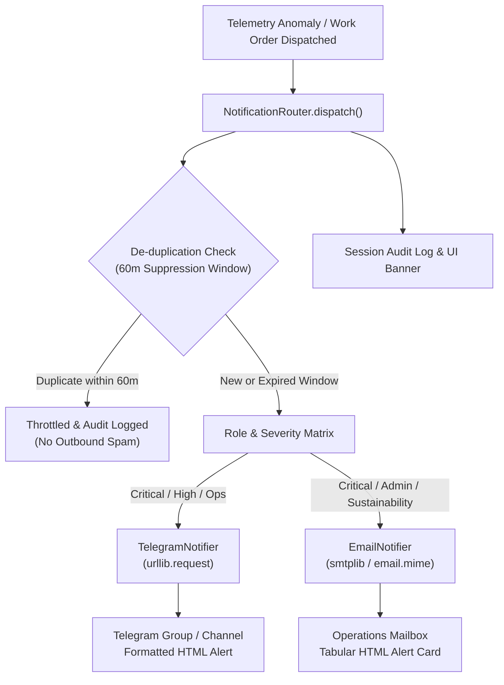

# Step Report 11 — Operational Notifications & Outbound Dispatch Gateway

> **Phase:** Nivara System Modernization & Upgrades  
> **Step:** 11 — Operational Notifications & Outbound Dispatch Gateway  
> **Status:** Completed  
> **Author:** Antigravity Engineering Agent  
> **Date:** November 2026  
> **Test Suite Status:** 163 / 163 passing (`pytest tests/`)  

---

## 1. Executive Summary & Objective

### 1.1 Objective
The central question addressed by Step 11 is the critical Knowledge Transfer (KT) question:
> **"Can the facility operations and engineering team be notified in real-time?"**

Prior to Step 11, energy anomaly alerts, service-impact guard evaluations, and work orders existed solely within the local dashboard session. In real-world campus operations across universities, healthcare centers, and commercial technology parks, field technicians, facilities directors, and sustainability officers do not sit in front of a web console 24/7. When a chiller bypass valve fails or a critical transformer approaches maximum demand, actionable alerts must immediately reach the designated team on channels they actively use: **Telegram** and **Email**.

Step 11 delivers a **zero-dependency, multi-channel notification engine** with:
1. **Multi-Channel Dispatch:** Native **Telegram Bot API** (via standard library `urllib.request`) and **SMTP Email** (via standard library `smtplib` and `email.mime`).
2. **Strict Security Model:** Pure environment-variable credentials (`TELEGRAM_BOT_TOKEN`, `TELEGRAM_CHAT_ID`, `SMTP_HOST`, `SMTP_USER`, `SMTP_PASS`, `ALERT_EMAIL_TO`). Zero hardcoded secrets, with automatic fallback to safe dry-run simulation when credentials are absent.
3. **Role & Severity Routing Matrix:** Automatic routing directing critical/high issues immediately to Operations (Telegram + Email), financial variances to Administrators, and ESG milestones to Sustainability.
4. **Anti-Flapping De-duplication:** In-memory suppression window cache (default 60 minutes) to suppress redundant alerts and prevent alert fatigue.
5. **Context-Rich Operational Payload:** Outbound messages feature three-point estimated savings ranges, IPMVP Option B reference, and explicit **Service-Impact Guard safety badges** (`🟢 Service-Safe`, `🔴 Blocked`, `🟡 Review Required`).



---

## 2. What Changed

### 2.1 File Inventory

| File | Action | Description |
|---|---|---|
| `src/campus_energy/notify/base.py` | **Created** | Core strongly typed schemas (`NotificationMessage`, `NotificationResult`) and abstract base class `BaseNotifier`. |
| `src/campus_energy/notify/telegram.py` | **Created** | High-visibility Telegram alert delivery provider using standard library `urllib.request` with HTML formatting, emoji banners, and dry-run safety. |
| `src/campus_energy/notify/email.py` | **Created** | Modern tabular HTML and plain-text email delivery provider using standard library `smtplib` and `email.mime`. |
| `src/campus_energy/notify/router.py` | **Created** | Central notification router with rate-limiting, 60-minute anti-flapping suppression, role/severity matrix routing, and dispatch history tracking. |
| `src/campus_energy/notify/__init__.py` | **Created** | Package re-exports for uniform subsystem access (`NotificationRouter`, `TelegramNotifier`, `EmailNotifier`, `NotificationMessage`, etc.). |
| `src/campus_energy/__init__.py` | **Modified** | Re-exported notification package and models at the top-level `campus_energy` namespace. |
| `scripts/smoke_notify.py` | **Created** | Standalone CLI utility for inspecting env configuration, running realistic dry-run probes, and verifying live Telegram/SMTP connections. |
| `src/campus_energy/dashboard/app.py` | **Modified** | Integrated notification gateway badge in sidebar and Page 5, real-time dispatch banners on Work Order creation, probe buttons, and expandable recent dispatch log table. |
| `tests/test_notifications.py` | **Created** | 19 comprehensive unit and integration tests covering base models, Telegram dry-run/live, Email dry-run/live, routing matrix, suppression de-duplication, and WorkOrderItem mapping. |
| `docs/step_reports/11.md` | **Created** | This comprehensive technical step report. |

---

## 3. Architecture & Design Principles

### 3.1 Zero External Dependencies
To preserve the lightweight, maintainable architecture of Nivara, the notification subsystem introduces **zero third-party package dependencies**:
- **Telegram Bot API:** Implemented entirely via `urllib.request.Request`, `urllib.request.urlopen`, and `json.dumps`. No external `python-telegram-bot` or `requests` required.
- **Email Delivery:** Implemented using standard library `smtplib` (supporting STARTTLS and SSL) and `email.mime` (`MIMEMultipart`, `MIMEText`). No heavy email SDKs required.

### 3.2 Security Model: Pure Environment Credentials & Safe Dry-Run
In strict compliance with cloud-native security practices:
1. **Zero Hardcoded Credentials:** All credentials (API tokens, chat IDs, SMTP passwords) are read solely from environment variables at runtime.
2. **Automatic Safe Fallback:** When environment variables are absent, or when `dry_run=True` is explicitly specified:
   - Neither outbound HTTP nor SMTP network connections are initiated.
   - The message is validated, formatted, and logged safely.
   - The returned `NotificationResult` explicitly reports `dry_run=True` and a unique simulation message ID (e.g. `DRYRUN-TG-2A7D7281`).

### 3.3 Role & Severity Routing Matrix

| Trigger / Message Category | Severity | Recipient Role | Outbound Channels |
|---|---|---|---|
| Critical Telemetry Fault (e.g. Chiller Bypass, Transformer Overload) | `critical` | Any / Operations | **Telegram + Email** (Immediate high-priority alert) |
| High Operational Anomaly (e.g. After-hours baseline breach) | `high` | Operations | **Telegram + Email** |
| Field Work Order Dispatched | `high` / `critical` | Operations | **Telegram + Email** |
| Demand Charge Spike / Budget Threshold | `high` | Administrator | **Telegram + Email** |
| Tariff / Department Billing Variance | `medium` / `low` | Administrator | **Email** |
| Monthly GHG Abatement / NAPCC Compliance Milestone | `medium` / `low` | Sustainability | **Email** |
| Broadcast Announcement | Any | `all` | **Telegram + Email** |

### 3.4 Anti-Flapping De-duplication Mechanics
Telemetry-driven anomaly detectors can produce repeated alerts for the same physical equipment across consecutive 5-minute sampling intervals. Without suppression, a stuck valve would trigger 12 messages per hour per technician.

The `NotificationRouter` implements an in-memory suppression cache:
$$\text{Key} = (\text{Normalized Asset ID}, \text{Normalized Topic / Work Order ID})$$
$$\Delta t = t_{\text{current}} - t_{\text{last\_sent}}$$

If $\Delta t < \text{Suppression Window}$ (default: 60 minutes), the router:
1. Suppresses the outbound network calls.
2. Generates a throttled `NotificationResult` (`success=False`, `channel="router"`, `error="Throttled: duplicate alert..."`).
3. Logs the suppression in the session audit history so operators can verify that throttling took place.

---

## 4. Integration with Decision Support & Savings Ledger

### 4.1 Dispatch from `WorkOrderItem`
When an operator accepts a recommendation and clicks **"🚀 Dispatch Work Order"** in Page 5 of the dashboard, the system automatically translates the `WorkOrderItem` into a `NotificationMessage`:

```python
# Automatic conversion in NotificationRouter.dispatch_from_work_order()
message = NotificationMessage(
    recipient_role=work_order.recommendation.owner_role,
    severity=work_order.priority,
    title=f"Work Order Dispatched: {work_order.work_order_id} ({work_order.recommendation.action_text})",
    asset_id=work_order.recommendation.target,
    description=f"Action: {work_order.recommendation.action_text}. Assigned to {work_order.assignee}...",
    impact_range=f"₹{savings.inr.expected:,.0f} [₹{savings.inr.low:,.0f} – ₹{savings.inr.high:,.0f}] / day",
    service_guard_note=f"🟢 Service-Safe: {work_order.recommendation.service_guard.reason}",
    work_order_id=work_order.work_order_id,
)
```

### 4.2 Rich Formatted Previews

#### Telegram Alert Format
```html
🚨 <b>[NIVARA ALERT] Chiller Plant #2 Low Delta-T Anomaly</b>
<b>Severity:</b> <code>CRITICAL</code> | <b>Role:</b> <code>OPERATIONS</code>
<b>Asset:</b> <code>CHILLER-PLANT-02</code>
<b>Detected:</b> <code>2026-11-09 09:30 UTC</code>

📝 <b>Actionable Details:</b>
Primary chilled water loop delta-T collapsed to 1.8°C (expected >= 5.5°C).

💰 <b>Estimated Impact / Savings:</b>
<code>₹3,450 [₹2,760 – ₹4,140] / day</code>

🛡️ <b>Service Guard Status:</b>
🟢 Service-Safe: Non-critical off-hours HVAC load

📋 <b>Work Order Reference:</b> <code>WO-2026-001</code>
```

#### Email HTML Format
Modern responsive layout with severity-coded top banner, tabular asset metadata table (Asset, Role, Timestamp, Work Order, Impact Range, Service Guard Status), and technical diagnostics footer.

---

## 5. UI Dashboard Integration

1. **Sidebar Status Badge:** Displays current outbound gateway connectivity (`🔔 Dispatcher: Active (Dry-Run Mode)` or `🔔 Dispatcher: Live Telegram/SMTP Connected`).
2. **Work Order Action Banner:** Upon clicking "Dispatch Work Order", an immediate banner confirms delivery:
   `📩 Dispatched alert to Operations via Telegram & Email (Dry-run logged) for Work Order WO-2026-001`
   with expandable payload preview.
3. **Manual Probe Button:** "🔔 Send Test Alert" button allows instant end-to-end verification directly from the web interface.
4. **Recent Notification Dispatches Log:** Expandable interactive table showing full session audit history (timestamp, title, asset, severity, role, work order ID, channels, mode, delivery status).

---

## 6. Verification & Test Evidence

### 6.1 CLI Smoke Test (`scripts/smoke_notify.py`)
```
======================================================================
  NIVARA NOTIFICATION GATEWAY — SMOKE TEST & VERIFICATION
======================================================================

🔍 Environment Inspection:
  • TELEGRAM_BOT_TOKEN: ❌ Unset (Dry-run mode)
  • TELEGRAM_CHAT_ID:   ❌ Unset (Dry-run mode)
  • SMTP_HOST:          ❌ Unset (Dry-run mode)
  • SMTP_USER:          ❌ Unset (Dry-run mode)
  • SMTP_PASS:          ❌ Unset (Dry-run mode)
  • ALERT_EMAIL_TO:     ❌ Unset (Dry-run mode)

📡 Gateway Status: 🔔 Dispatcher: Active (Dry-Run Mode)
  • Telegram Channel: 🟡 SIMULATION (Dry-Run)
  • Email Channel:    🟡 SIMULATION (Dry-Run)

📋 Dispatch Results:
  ✅ [TELEGRAM] Mode: DRY-RUN | Success: True (ID: DRYRUN-TG-C5B24F85)
  ✅ [EMAIL]    Mode: DRY-RUN | Success: True (ID: DRYRUN-EMAIL-87905C9A)

======================================================================
  🎉 SMOKE TEST PASSED: All notification channels dispatched successfully.
======================================================================
```

### 6.2 Test Suite Status
- **Notification Tests:** 19 / 19 passing (`pytest tests/test_notifications.py` in 1.81s)
- **Total Test Suite:** 163 / 163 passing (`pytest tests/`)
