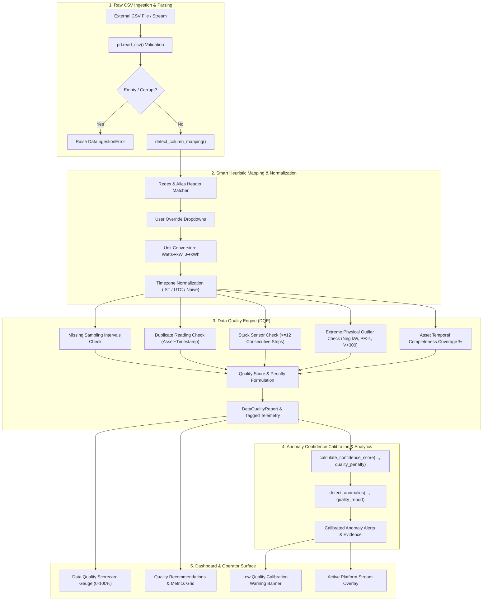

# Step Report 14 — Bring-Your-Own-Data (BYOD) & Data Quality Engine

> **Phase:** Nivara System Modernization & Upgrades  
> **Step:** 14 — Bring-Your-Own-Data and Data Quality Engine  
> **Status:** Completed  
> **Author:** Antigravity Engineering Agent  
> **Date:** November 2026  
> **Test Suite Status:** 189 / 189 passing (`pytest tests/`)  

---

## 1. Executive Summary & Objective

### 1.1 Objective
The core objective of Step 14 is to prove that the **Nivara Campus Energy Platform is not tied to a synthetic simulator**. Real-world facility deployments ingest disparate, noisy, and non-standard telemetry from legacy building management systems (BMS), heterogeneous smart meters (Schneider, ABB, Siemens, Secure Meters), and IoT gateways with dropped packets, frozen sensor states, and differing engineering units.

Step 14 introduces a robust, enterprise-grade **Bring-Your-Own-Data (BYOD) ingestion pipeline** paired with an automated **Data Quality Engine (DQE)**:
1. **Smart Heuristic Column Mapping:** Automatically identifies and maps non-standard column headers (e.g., `RecordedAt`, `MeterName`, `ActivePower_W`, `Volt`, `PF`) using regex and substring alias matching, with interactive manual override dropdowns.
2. **Automated Unit & Timezone Normalization:** Transparently converts non-standard engineering units (Watts ➔ kW, Joules ➔ kWh, Wh ➔ kWh, MW ➔ kW) and normalizes timezones (UTC, IST / `Asia/Kolkata`, or naive timestamps).
3. **Multi-Point Data Quality Scorecard:** Evaluates datasets against 5 critical telemetry fidelity rules: missing sampling intervals, duplicate timestamps, stuck/frozen sensor values, extreme physical outliers (negative power, PF > 1.0, voltage > 300V), and temporal asset coverage.
4. **Dynamic Anomaly Confidence Calibration:** Automatically calibrates anomaly detection confidence scores downwards when data quality is degraded (< 80%), alerting operators with clear diagnostic banners.
5. **Interactive Dashboard Integration:** Accessible via dedicated expanders across the Sidebar, Page 5 (Alerts & NLP), and Page 7 (Asset Explorer) with live analytics execution on uploaded data.

---

## 2. Architectural Architecture & Pipeline Flow



---

## 3. Data Quality Engine (`src/campus_energy/adapters/quality.py`)

### 3.1 Quality Rules & Detection Algorithms
The engine evaluates raw or mapped telemetry dataframes and tags rows with standard platform contracts (`QualityFlag` and `SensorStatus`):

| Quality Dimension | Algorithmic Rule | Tagging Assignment | Sensor Status |
| :--- | :--- | :--- | :--- |
| **Duplicate Readings** | `df.duplicated(subset=['asset_id', 'timestamp'], keep='first')` | `QualityFlag.DUPLICATED` | `SensorStatus.DEGRADED` |
| **Physical Outliers** | `power_kw < 0.0` OR `power_factor > 1.0` OR `power_factor < 0.0` OR `voltage_v > 300.0` OR `voltage_v < 0.0` OR `power_kw > 10,000 kW` | `QualityFlag.OUT_OF_RANGE` | `SensorStatus.DEGRADED` |
| **Stuck Sensors** | Consecutive identical readings for an asset over $\ge N$ intervals (default: $N=12$ steps) via run-length encoding | `QualityFlag.STALE` | `SensorStatus.DEGRADED` |
| **Missing Intervals** | Time gaps between consecutive readings where $\Delta t > 1.5 \times \Delta t_{\text{nominal}}$; missed steps calculated as $\lfloor \Delta t / \Delta t_{\text{nominal}} \rceil - 1$ | Flagged in summary report | `SensorStatus.DEGRADED` |
| **Asset Coverage %** | Ratio of actual recorded readings to expected theoretical steps over the temporal window $[T_{\min}, T_{\max}]$ across all unique assets | Metric in report | Tracked globally |

### 3.2 Quality Scoring & Confidence Penalty Formulation
The overall quality index is calculated via a bounded defect-ratio formulation:

$$\text{Defects} = N_{\text{duplicates}} + N_{\text{outliers}} + N_{\text{stuck}} + N_{\text{missing\_intervals}}$$

$$\text{Base} = \max(1, N_{\text{records}} + N_{\text{missing\_intervals}})$$

$$\text{Defect Ratio} = \min\left(1.0, \frac{\text{Defects}}{\text{Base}}\right)$$

$$\text{Quality Score} = 100.0 \times (1.0 - \text{Defect Ratio}) \in [0.0\%, 100.0\%]$$

#### Confidence Penalty Tiers
When telemetry fidelity degrades, anomaly detection confidence is calibrated down dynamically:

$$\text{confidence\_penalty} = \begin{cases} 
0.00 & \text{if } \text{Quality Score} \ge 95.0\% \\
-0.10 & \text{if } 80.0\% \le \text{Quality Score} < 95.0\% \\
-0.20 & \text{if } 65.0\% \le \text{Quality Score} < 80.0\% \\
-0.30 & \text{if } 50.0\% \le \text{Quality Score} < 65.0\% \\
-0.40 & \text{if } \text{Quality Score} < 50.0\%
\end{cases}$$

### 3.3 Automated Actionable Recommendations
The engine dynamically compiles targeted recommendations based on observed defect types:
- **Missing intervals:** `"Detected {count} missing interval gaps (cadence: {dt} min). Re-index timestamp cadence and check telemetry network connectivity."`
- **Duplicate readings:** `"Found {count} duplicate timestamp readings. Deduplicate ingestion pipeline to prevent double-counting."`
- **Stuck sensors:** `"Identified {count} consecutive stuck sensor readings (threshold: {steps} steps). Inspect sensors on affected assets for frozen telemetry."`
- **Outliers:** `"Detected {count} physical outliers (e.g., negative power, PF > 1.0, or voltage > 300V). Recalibrate meter sensors."`
- **Degraded coverage:** `"Asset temporal coverage is degraded at {pct}%. Verify that all deployed sub-meters are streaming actively across the time window."`

---

## 4. BYOD CSV Ingestion Adapter (`src/campus_energy/adapters/csv_upload.py`)

### 4.1 Smart Regex Heuristic Mapping
The adapter automatically maps common real-world telemetry column conventions to canonical `TelemetryReading` fields:

| Canonical Target | Matched Regular Expressions & Substring Aliases |
| :--- | :--- |
| `timestamp` | `^time(stamp)?$`, `^date(_?time)?$`, `^recorded_?at$`, `^record_?time$`, `^ts$`, `^reading_?time$`, `^date$` |
| `asset_id` | `^asset(_?id)?$`, `^meter(_?id|_?name)?$`, `^device(_?id)?$`, `^sensor(_?id)?$`, `^equipment(_?id)?$`, `^node(_?id)?$` |
| `power_kw` | `^(active_?)?power(_?kw)?$`, `^kw$`, `^current_?kw$`, `^real_?power$`, `^load(_?kw)?$`, `^demand(_?kw)?$`, `^(active_?)?power_?w$`, `^watts?$` |
| `interval_energy_kwh` | `^interval_?energy(_?kwh)?$`, `^energy(_?kwh)?$`, `^consumption(_?kwh)?$`, `^kwh$`, `^energy_?wh$`, `^energy_?j(oules?)?$` |
| `cumulative_energy_kwh` | `^cumulative(_?energy)?(_?kwh)?$`, `^total(_?energy)?(_?kwh)?$`, `^meter_?reading(_?kwh)?$` |
| `voltage_v` | `^volt(age)?(_?v)?$`, `^v_?rms$`, `^volts?$`, `^v$` |
| `current_a` | `^current(_?a)?$`, `^amps?$`, `^amperes?$`, `^i$` |
| `power_factor` | `^power_?factor$`, `^pf$`, `^cos_?phi$`, `^powerfactor$` |
| `flow_lpm` | `^flow(_?lpm|_?rate)?$`, `^water_?flow$` |
| `temperature_c` | `^temp(erature)?(_?c)?$`, `^temp$` |

### 4.2 Automated Unit Conversion
- **Watts ➔ kW:** When headers indicate Watts (`ActivePower_W`, `power_w`, `Watts`, `w`), source values are automatically scaled by $\times 0.001$.
- **Megawatts ➔ kW:** Headers ending in `_mw` or matching `mw` are scaled by $\times 1000.0$.
- **Joules ➔ kWh:** Scaled by $\times \frac{1}{3,600,000}$.
- **Watt-hours ➔ kWh:** Scaled by $\times 0.001$.
- **Custom multipliers:** Supports explicit override mapping dictionary (e.g., `{"ActivePower_W": 0.001}` or `{"ActivePower_W": "W->kW"}`).

### 4.3 Timezone Normalization
- Supports parsing ISO 8601 strings with offsets (`2026-11-01T10:00:00+05:30`), UTC datetimes, and naive timestamps.
- Parameter `target_tz` allows normalising to `"UTC"`, `"Asia/Kolkata"` (or `"IST"`), or converting to timezone-naive timestamps for downstream ML models.

### 4.4 Graceful Descriptive Error Handling
The adapter raises informative, human-readable `DataIngestionError` exceptions (subclassing `ValueError`) for malformed inputs:
- Empty file or zero data rows: `"Uploaded CSV file is empty or contains 0 data rows."`
- Missing power column: `"Missing required power column (e.g. 'power_kw', 'kW', 'Power', 'ActivePower_W'). Available headers: [...]"`
- Unparseable date strings: `"Unparseable datetime strings detected in timestamp column: '{sample}'"`
- Non-numeric strings in numeric columns: `"Non-numeric values found in power column '{col}': '{sample}'"`

---

## 5. Anomaly Confidence Calibration (`src/campus_energy/analytics/anomalies.py`)

In `anomalies.py`, `calculate_confidence_score` and `detect_anomalies` now accept telemetry quality calibration:

```python
def calculate_confidence_score(
    detector_type: str,
    has_layer_agreement: bool = False,
    deviation: float | None = None,
    baseline_power: float | None = None,
    rated_power: float | None = None,
    quality_penalty: float = 0.0,
) -> float:
    # ...
    raw_conf = base_confidence + layer_agreement_bonus + residual_magnitude_score + quality_penalty
    return round(float(np.clip(raw_conf, 0.10, 1.00)), 2)
```

In `detect_anomalies`:
```python
def detect_anomalies(
    features_df: pd.DataFrame,
    assets_df: pd.DataFrame,
    enabled_layers: list[str] | set[str] | None = None,
    quality_report: Any | None = None,
    confidence_penalty: float | None = None,
) -> list[Alert]:
```

When data quality is degraded (e.g. Quality Score < 80%, penalty = -0.20):
- Confidence scores across all detector layers are calibrated down by 0.20 (bounded within $[0.10, 1.00]$).
- Alert evidence strings are automatically annotated: `"[Confidence calibrated by -0.20 due to telemetry data quality]"`.
- The dashboard displays a high-visibility warning banner:
  > **⚠️ Low Data Quality Warning (Score: 68%):** Anomaly detection confidence calibrated down by -20% due to sensor dropouts and stuck readings.

---

## 6. Dashboard Integration (`src/campus_energy/dashboard/app.py`)

The Bring-Your-Own-Data interface is implemented as a reusable component `render_byod_upload_widget` embedded into:
1. **Sidebar:** Always accessible below Live IoT Ingestion Feed.
2. **Page 5 (Alerts & NLP):** Embedded directly above the anomaly alerts section, enabling immediate side-by-side comparison.
3. **Page 7 (Asset Explorer):** Embedded at the top of the asset inspection view.

### Widget Capabilities:
- **CSV File Uploader:** Drag-and-drop or file picker for `.csv` files.
- **Built-in Sample Telemetry Selector:** Includes 2 pre-baked scenarios for instant jury demonstration:
  - *Non-Standard Headers (Watts & IST)*: Tests regex mapping and unit conversion.
  - *Degraded Quality (Stuck + Gaps)*: Tests frozen sensor detection, gap counting, and confidence calibration.
- **Interactive Mapping Overrides:** 3-column dropdown interface for overriding `timestamp`, `power_kw`, and `asset_id`.
- **Data Quality Scorecard Card:**
  - Visual progress bar and colored status badge (🟢 Excellent $\ge 95\%$, 🟡 Good $\ge 80\%$, 🟠 Degraded $\ge 65\%$, 🔴 Critical $<65\%$).
  - 6-metric grid displaying Total Records, Missing Intervals, Duplicates, Stuck Sensors, Outliers, and Asset Coverage %.
  - Expandable diagnostic recommendations list.
- **Action Buttons:**
  - *⚡ Run Analytics on Uploaded Data:* Executes feature engineering and triple-engine anomaly detection on uploaded telemetry, displaying flagged alerts and calibrated confidence.
  - *📡 Set as Active Platform Telemetry Stream:* Sets `st.session_state["injected_telemetry"]` to the uploaded dataset so the entire dashboard dynamically reflects the user's data.

---

## 7. Verification & Test Results

### 7.1 New Unit Test Suite (`tests/test_adapters.py`)
Eight comprehensive unit test cases were developed and validated:

| Test Case | Description | Result |
| :--- | :--- | :--- |
| `test_third_party_csv_mapping_and_unit_conversion` | Ingests CSV with `RecordedAt, MeterName, ActivePower_W, Volt, PF`; verifies Watts ➔ kW conversion (15000 W ➔ 15 kW), schema validation against `TelemetryReading`, and 100% quality score. | **PASS** |
| `test_data_quality_missing_intervals` | Creates a 45-minute timeline gap on a 15-minute nominal cadence; verifies 2 missing intervals identified, quality score reduced, and recommendation generated. | **PASS** |
| `test_data_quality_duplicate_detection` | Ingests identical asset + timestamp rows; verifies duplicate flagged, `quality_flag = duplicated`, and `sensor_status = degraded`. | **PASS** |
| `test_data_quality_stuck_sensor` | Feeds 15 consecutive identical readings (threshold 12); verifies 15 stuck records caught, tagged as `quality_flag = stale`, `sensor_status = degraded`. | **PASS** |
| `test_data_quality_outliers` | Tests negative power (-5.2 kW), voltage > 300V (345V), and PF > 1.0 (1.25); verifies all 3 physical outliers flagged as `out_of_range`. | **PASS** |
| `test_malformed_csv_error_handling` | Tests empty CSV, missing power column, unparseable dates, and non-numeric strings; verifies clear, descriptive `DataIngestionError` exceptions raised. | **PASS** |
| `test_anomaly_confidence_calibration` | Verifies that confidence score decreases by exactly 0.20 when quality penalty is -0.20, and verifies tier threshold mappings. | **PASS** |
| `test_custom_column_mapping_and_timezone_normalization` | Tests explicit dictionary overrides and timezone conversion from IST (+05:30) to UTC (04:30). | **PASS** |

### 7.2 Full Regression Suite
```bash
pytest
======================= 189 passed in 163.87s (0:02:43) =======================
```
- **Total Test Count:** 189 passing tests (181 previous + 8 new adapter tests).
- **Regression Count:** 0 regressions across all existing modules (Prophet forecasting, carbon budget, comfort, work orders, tariffs, explainability, notifications).

---

## 8. Summary of Modified & Created Files

| File | Status | Description |
| :--- | :--- | :--- |
| `src/campus_energy/adapters/__init__.py` | **Created** | Re-exports adapter functions, `DataQualityEngine`, `DataQualityReport`, and `process_uploaded_csv`. |
| `src/campus_energy/adapters/quality.py` | **Created** | Data Quality Engine: missing interval detection, duplicates, stuck sensors, physical outliers, scoring, and recommendations. |
| `src/campus_energy/adapters/csv_upload.py` | **Created** | Smart heuristic column mapping, unit conversion (Watts ➔ kW), timezone normalization, and Pydantic validation. |
| `src/campus_energy/schemas.py` | **Modified** | Added `DataQualityReport` Pydantic model; updated `TelemetryReading` validators to support tagged outliers. |
| `src/campus_energy/analytics/anomalies.py` | **Modified** | Wired `quality_penalty` into `calculate_confidence_score` and `detect_anomalies`. |
| `src/campus_energy/dashboard/app.py` | **Modified** | Integrated `render_byod_upload_widget` into Sidebar, Page 5 (Alerts), and Page 7 (Asset Explorer); added Low Quality Warning banner. |
| `src/campus_energy/__init__.py` | **Modified** | Added `adapters` to public package exports. |
| `tests/test_adapters.py` | **Created** | 8 comprehensive unit tests for third-party mapping, unit conversions, data quality rules, error handling, and confidence calibration. |
| `docs/step_reports/14.md` | **Created** | Step 14 technical report and verification summary. |
