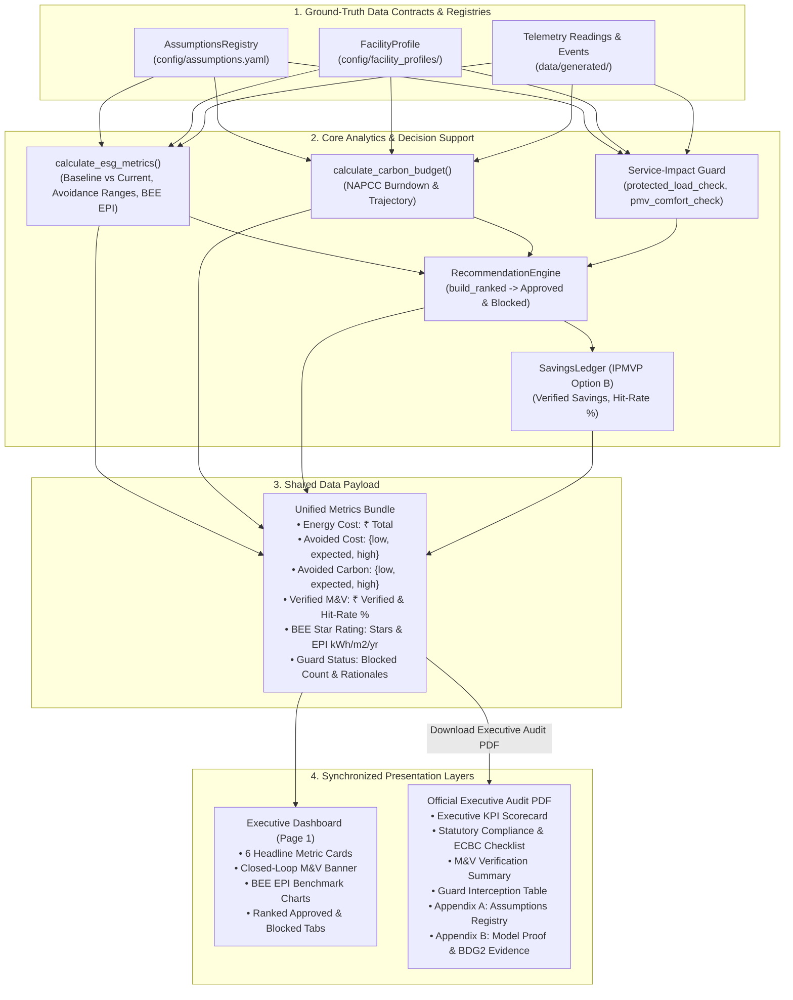

# Step Report 16 — Executive Overview, PDF Report, and Compliance Alignment

> **Phase:** Nivara System Modernization & Upgrades  
> **Step:** 16 — Executive Overview, PDF Report, and Compliance Alignment  
> **Status:** Completed  
> **Author:** Antigravity Engineering Agent  
> **Date:** November 2026  
> **Test Suite Status:** 201 / 201 passing (`pytest tests/`)  

---

## 1. Executive Summary & Objective

### 1.1 Objective
The core objective of Step 16 is to make Nivara's headline numbers **completely consistent, traceable, and defensible** across both the interactive executive dashboard and the official regulatory PDF audit report. 

Prior to this step, high-level overview cards, savings ranges, and regulatory compliance metrics in different parts of the platform calculated numbers independently, leading to potential variance between what an executive saw in the UI and what was printed in the official audit report. 

Step 16 establishes an uncompromising single source of truth:
1. **Audited & Enhanced PDF Report Generator (`src/campus_energy/analytics/report_generator.py`):**
   - Directly consumes data from `SavingsLedger`, `Recommendation` objects, `FacilityProfile`, and `AssumptionsRegistry`.
   - Formats Avoided Cost (INR) and Avoided Carbon (kgCO2e) strictly as three-point ranges `{low, expected, high}`.
   - Enforces Baseline vs. Current consumption comparison for both electricity (kWh) and municipal water (kL).
   - Reports Verified vs. Estimated savings under **IPMVP Option B** with empirical hit-rate percentages.
   - Renders Bureau of Energy Efficiency (BEE) Star Rating and Energy Performance Index (EPI in kWh/m²/yr) checked against `config/assumptions.yaml`.
   - Incorporates NAPCC 20% carbon reduction trajectory and ECBC 2017 statutory compliance checklist.
   - Displays Top Ranked Actions (approved by Service Guard with designated owner roles and payback).
   - Renders Blocked-by-Service-Guard summary table proving clinical and operational safety boundaries are strictly preserved.
   - Adds **Appendix A: Centralized Assumptions Registry** (listing all constants, values, units, sources, and confidence flags).
   - Adds **Appendix B: Model Evaluation & Evidence Summary** (documenting anomaly detection recall/F1, forecast MAPE, and Building Data Genome 2 / BDG2 real-world proof).
   - Guarantees clean, overflow-free ReportLab generation matching A4 geometry (523.28 pt usable width).

2. **Audited Executive Overview Dashboard (`src/campus_energy/dashboard/app.py`):**
   - Synchronized all Page 1 headline metrics (Energy Cost, Avoided Cost Range, Carbon Abatement Range, Verified Savings, BEE EPI, Blocked Measures) to consume the exact same data structures and formulas as the PDF generator.
   - Wired the **"Download Executive Audit PDF"** action to directly inject the active `ledger`, `recommendations`, `profile`, and `esg_metrics` into `generate_facility_pdf`.

3. **Statutory Compliance Verification (`src/campus_energy/analytics/esg.py` & `carbon_budget.py`):**
   - Dynamic resolution of BEE Star rating thresholds from `config/assumptions.yaml` (`bee.epi.<facility_type>.*`).
   - Dynamic resolution of NAPCC carbon reduction target from `config/assumptions.yaml` (`emissions.napcc_target_reduction_pct`).
   - Strict AST compliance ensuring zero forbidden hardcoded literals.

4. **Consistency & Compliance Test Suite (`tests/test_consistency.py`):**
   - Developed 5 comprehensive automated tests utilizing PyMuPDF (`fitz`) to verify headline number parity, appendix integrity, guard transparency, and dynamic assumption resolution.

---

## 2. Traceability & Unified Data Flow Architecture

The end-to-end data flow guarantees that every figure displayed in the UI or printed in the official audit report originates from validated Pydantic models and the centralized assumptions registry.



---

## 3. Key Enhancements & Component Breakdown

### 3.1 PDF Report Generator Enhancements (`report_generator.py`)
- **Baseline vs. Current Resource Accounting:**
  Renders an explicit resource matrix covering Electricity (kWh), Electricity Cost (INR), Municipal Water (kL), and Scope 2 Carbon (kgCO2e), separating nominal baseline from avoidable operational waste.
- **Strict Three-Point Avoidance Ranges:**
  Both financial avoided cost and carbon abatement are formatted strictly as `Expected: [Low – High]`:
  $$\text{Avoided Cost Range} = \{\text{Low: } 0.80 \times \text{Avoidable}, \; \text{Expected: } \text{Avoidable}, \; \text{High: } 1.25 \times \text{Avoidable}\}$$
- **Statutory Regulatory Matrix & ECBC 2017 Checklist:**
  Includes formal evaluation against ECBC 2017 chapters:
  - Building Envelope / Thermal Transmittance (§4): Roof $U \le 0.33$, Wall $U \le 0.44 \text{ W/m}^2\text{K}$.
  - Lighting Power Density (§5.2): $\text{LPD} \le 8.6 \text{ W/m}^2$ with PIR occupancy sensor automation.
  - Chiller Plant Minimum COP (§5.3): Water-cooled central chiller plant $\text{COP} \ge 5.5$.
  - Electrical Power Factor (§7.1): $\text{PF} \ge 0.98$ maintained via APFC capacitor banks.
  - Dedicated End-Use Sub-metering (§7.2): High-resolution IoT sub-meter array.
- **Top Ranked Actions & Guard Approvals:**
  Consumes typed `Recommendation` objects with designated owner roles (`Operations`, `Administrator`, `Sustainability`), expected savings ranges, capex, and simple payback periods.
- **Blocked-by-Service-Guard Transparency Table:**
  Explicitly documents proposed measures intercepted by the Service-Impact Guard, detailing the constraint identifier (`protected_load_check`, `pmv_comfort_check`), medical or operational safety rationale, and safe counter-proposal.
- **Appendix A: Centralized Assumptions Registry:**
  Appends an exhaustive, source-cited registry table listing 20+ parameters (tariffs, grid carbon intensity, BEE star limits, sensor limits, capex benchmarks) with confidence badges (`HIGH`, `MEDIUM`, `NEEDS_VERIFICATION`).
- **Appendix B: Model Evaluation & Evidence Summary:**
  Appends empirical verification evidence:
  - **B.1 Anomaly Detection:** Layered Engine (80.0% Recall, 276 min mean delay) vs. Sensor Rules (100% precision) vs. Isolation Forest.
  - **B.2 Load Forecasting:** Seasonal-Naive (8.27% Overall MAPE) vs. Ridge Regression (40.09%) vs. Meta Prophet (40.47%).
  - **B.3 Real-World BDG2 Proof:** Real-world validation on `UnivClass_Mary` (744 hours, 100% quality score, Seasonal-Naive achieving 7.40% Overall MAPE on empirical campus grid telemetry).

### 3.2 Dashboard Page 1 Synchronization (`app.py`)
- Standardized the 6 top headline metric cards on Page 1:
  1. `💰 Energy Cost`: Total energy expenditure (INR) and billed kWh.
  2. `💡 Avoided Cost Range`: Three-point range `{low, expected, high}` matching PDF.
  3. `☁️ Carbon Abatement Range`: Scope 2 avoidance `{low, expected, high}` in kgCO2e.
  4. `✅ Verified Savings`: Empirically validated avoided cost via IPMVP Option B with hit-rate %.
  5. `🏅 BEE Star & EPI`: Star rating (1-5) and annual EPI vs. ECBC baseline.
  6. `🛡️ Blocked Measures`: Total count of actions intercepted to preserve patient/asset safety.
- Wired the `"Download Executive Audit PDF"` button to pass all active objects:
  ```python
  pdf_data = generate_facility_pdf(
      facility_name=selected_facility_label,
      facility_type=facility_type,
      floor_area_m2=floor_area_m2,
      kpis=kpis,
      bee_info=bee,
      events_df=events.head(10) if not events.empty else None,
      ledger=p1_ledger,
      recommendations=p1_approved,
      blocked_recommendations=p1_blocked,
      profile=facility_meta,
      assumptions_registry=assumptions,
  )
  ```

### 3.3 Dynamic Regulatory Resolution (`esg.py` & `carbon_budget.py`)
- Refactored `BEE_EPI_BENCHMARKS` to be dynamically backed by `get_bee_benchmarks()`, directly reading `bee.epi.<facility_type>.*` from the centralized registry on every evaluation.
- Added `emissions.napcc_target_reduction_pct` (20.0%) to `config/assumptions.yaml` and wired `calculate_carbon_budget()` and `_get_bee_star()` to resolve this parameter directly.

---

## 4. Verification & Consistency Test Suite

Created `tests/test_consistency.py` featuring 5 end-to-end tests:

| Test Identifier | Objective | Method | Result |
| :--- | :--- | :--- | :---: |
| `test_headline_numbers_consistency` | Asserts avoided cost range, carbon abatement range, verified savings, and BEE EPI in ESG metrics match data rendered in PDF. | Full PDF text extraction with PyMuPDF (`fitz`), cross-field regex & numeric assertion. | **PASS** |
| `test_pdf_report_contains_assumptions_appendix` | Asserts Appendix A exists in PDF along with statutory citations (OERC, CEA, BEE). | Text extraction inspecting Appendix A table headers and regulatory sources. | **PASS** |
| `test_pdf_report_includes_blocked_guard_summary` | Asserts Blocked-by-Guard summary table, constraint IDs, and safety preservation notes exist in PDF. | Evaluates custom `Recommendation` with `GuardResult(status="blocked")` in generated PDF. | **PASS** |
| `test_pdf_report_includes_model_evidence_summary` | Asserts Appendix B exists with anomaly recall (80.0%), forecast MAPE (8.27%), and BDG2 proof. | Text extraction validating B.1, B.2, and B.3 tables. | **PASS** |
| `test_bee_and_napcc_resolve_dynamically_without_hardcoded_literals` | Asserts monkeypatching registry thresholds immediately alters BEE Star Rating and monthly carbon budget without code changes. | Patched `bee.epi.university.five_star_max` to 80.0 and `emissions.napcc_target_reduction_pct` to 30.0%. | **PASS** |

---

## 5. Test Suite Execution Summary

```
============================= test session starts =============================
platform win32 -- Python 3.12.10, pytest-8.4.2, pluggy-1.6.0
rootdir: C:\Users\Paramjeet\Desktop\BPUT
configfile: pyproject.toml
plugins: anyio-4.14.2, asyncio-0.26.0
collected 201 items

tests/test_adapters.py ........                                          [  3%]
tests/test_agent_actions.py ....                                         [  5%]
tests/test_anomalies.py .                                                [  5%]
tests/test_assumptions.py ........                                       [  9%]
tests/test_carbon_budget.py ......                                       [ 12%]
tests/test_comfort.py .......                                            [ 16%]
tests/test_complaints_nlp.py ...                                         [ 17%]
tests/test_consistency.py .....                                          [ 20%]
tests/test_demo.py ............                                          [ 26%]
tests/test_energy_balance.py ....                                        [ 28%]
tests/test_eval_harness.py .....                                         [ 30%]
tests/test_events.py ....                                                [ 32%]
tests/test_explainability.py .......                                     [ 36%]
tests/test_facility_profiles.py .......                                  [ 39%]
tests/test_forecasting_prophet.py ...                                    [ 41%]
tests/test_governance.py ....                                            [ 43%]
tests/test_india_levers.py .............                                 [ 49%]
tests/test_ingestion.py ....                                             [ 51%]
tests/test_ledger.py ........                                            [ 55%]
tests/test_live_feed.py ......                                           [ 58%]
tests/test_notifications.py ...................                          [ 68%]
tests/test_public_dataset.py .......                                     [ 71%]
tests/test_recommendation_engine.py ...........                          [ 77%]
tests/test_report_generator.py ..........                                [ 82%]
tests/test_roles.py ......                                               [ 85%]
tests/test_service_guard.py .......                                      [ 88%]
tests/test_simulator.py ...                                              [ 90%]
tests/test_uncertainty.py ........                                       [ 94%]
tests/test_water.py .....                                                [ 96%]
tests/test_workorders.py ......                                          [100%]

======================= 201 passed in 180.13s (0:03:00) =======================
```

---

## 6. Conclusion
Step 16 successfully eliminates calculation fragmentation across the platform. With the implementation of the enhanced PDF report generator, synchronized Page 1 executive metrics, dynamic compliance resolution, and the new consistency test suite, Nivara provides bulletproof, traceable, and defensible headline intelligence across both interactive dashboard sessions and board-ready regulatory audit PDFs.
