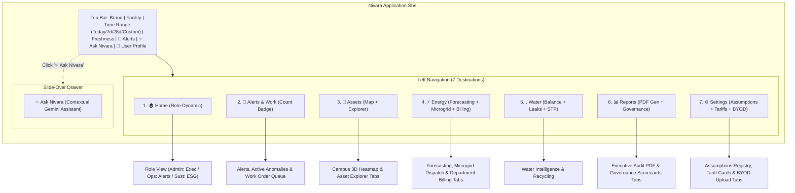

# Step Report UX-02 — Application Shell, Top Bar, 7-Destination Navigation & Login

> **Phase:** Nivara Operational Product Redesign (Presentation Dashboard → Daily Operational Tool)  
> **Step:** UX-02 — Application Shell, Navigation & Authentication  
> **Status:** Completed & Validated  
> **Author:** Antigravity Product Architect & UX Engineering Lead  
> **Date:** November 2026  
> **Test Suite Status:** 213 / 213 passing (`pytest tests/`, 100% green pass)  
> **Code Artifacts Created/Updated:**
> - User Configuration: [`config/users.yaml`](file:///C:/Users/Paramjeet/Desktop/BPUT/config/users.yaml), [`configs/users.yaml`](file:///C:/Users/Paramjeet/Desktop/BPUT/configs/users.yaml)
> - User Management: [`src/campus_energy/users.py`](file:///C:/Users/Paramjeet/Desktop/BPUT/src/campus_energy/users.py)
> - Top Bar Component: [`src/campus_energy/ui/top_bar.py`](file:///C:/Users/Paramjeet/Desktop/BPUT/src/campus_energy/ui/top_bar.py)
> - Login Stub Screen: [`src/campus_energy/ui/login.py`](file:///C:/Users/Paramjeet/Desktop/BPUT/src/campus_energy/ui/login.py)
> - Operational Dashboard Shell: [`src/campus_energy/dashboard/app.py`](file:///C:/Users/Paramjeet/Desktop/BPUT/src/campus_energy/dashboard/app.py)
> - Unit & Shell Tests: [`tests/test_users_and_shell.py`](file:///C:/Users/Paramjeet/Desktop/BPUT/tests/test_users_and_shell.py)

---

## 1. Executive Summary & Objective

Step UX-02 establishes the real operational application shell for the Nivara Campus Energy & Facility Intelligence platform, officially retiring presentation-centric hackathon scaffolding and replacing it with a calm, scannable, role-grounded operational structure.

The objectives achieved in this step include:
1. **User Management & Configuration:** Introduced institutional user profile models and YAML configuration defining three primary operational personas:
   - **Administrator:** Dr. Arun Patnaik (Registrar & Campus Administrator)
   - **Operations:** Rajesh Mohanty (Chief Facilities & Maintenance Engineer)
   - **Sustainability:** Priya Das (Chief Sustainability & ESG Officer)
2. **Dedicated Login Stub Screen:** Created an institutional login screen offering one-click demo profile sign-in and direct ID/email lookup, routing users immediately to their role's operational workspace.
3. **Persistent Top Bar:** Built a standardized header providing:
   - Left: Nivara brand logo and facility selector (with multi-facility authorization check).
   - Center: Global Time Range selector (`Today`, `7 Days`, `28 Days`, `Custom`) synced to session state and URL query parameters.
   - Right: Real-time telemetry freshness indicator (`🟢 Live: HH:MM IST`), alert bell with open count badge (`🔔 4`), "Ask Nivara" assistant slide-over button, and user profile popover with Switch User and Sign Out actions.
4. **Clean 7-Destination Navigation Hierarchy:** Streamlined left sidebar navigation to exactly 7 job-oriented destinations:
   `Home` (role-dynamic), `Alerts & Work (4)`, `Assets`, `Energy`, `Water`, `Reports`, and `Settings`.
5. **Presentation Scaffolding Removal:** Fully eliminated legacy presentation elements from the sidebar:
   - Persona switcher dropdown (role is now determined by the authenticated user profile).
   - Guided Jury Tour toggle and tour presentation banners.
   - Live packet ticker and raw packet cards.
   - Replay scrubber slider.
   - System health counter cards (Meters, Assets, Events, Complaints).
   - Gateway status blocks.
6. **Bidirectional Deep-Linking:** Implemented clean query parameter reading and updating (`?page=`, `?facility=`, `?range=`, `?asset=`, `?alert_id=`) with backward compatibility for legacy routes.
7. **Complete Non-Regression:** Maintained 100% passing status across all existing analytical, forecasting, and reliability test suites (213 passing).

---

## 2. Information Architecture & Shell Structure



---

## 3. User Management & Authentication

### 3.1 Seed User Profiles (`config/users.yaml`)
Three standard operational user profiles were created with full institutional metadata, role scopes, and authorized campus facilities:

```yaml
users:
  admin:
    id: "usr_admin_01"
    name: "Dr. Arun Patnaik"
    email: "arun.patnaik@bput.ac.in"
    role: "administrator"
    title: "Registrar & Campus Administrator"
    facilities: ["university", "hospital", "govt_office", "industrial"]
    default_facility: "university"

  operations:
    id: "usr_ops_01"
    name: "Rajesh Mohanty"
    email: "rajesh.mohanty@bput.ac.in"
    role: "operations"
    title: "Chief Facilities & Maintenance Engineer"
    facilities: ["university", "hospital", "govt_office", "industrial"]
    default_facility: "university"

  sustainability:
    id: "usr_sust_01"
    name: "Priya Das"
    email: "priya.das@bput.ac.in"
    role: "sustainability"
    title: "Chief Sustainability & ESG Officer"
    facilities: ["university", "hospital", "govt_office", "industrial"]
    default_facility: "university"
```

### 3.2 User Profile Model & API (`src/campus_energy/users.py`)
- **`UserProfile` Model:** Implements Pydantic schema with properties:
  - `role_display`: Human-readable title (`Administrator`, `Operations`, `Sustainability`).
  - `role_icon`: Standard emoji badge (`👔`, `🔧`, `🌱`).
  - `initials`: Computed uppercase avatar monogram (`AP`, `RM`, `PD`).
  - `has_facility_access(facility_id)`: Authorization enforcement check.
- **Lookup Functions:**
  - `load_users(path="config/users.yaml") -> dict[str, UserProfile]`
  - `authenticate_user(email_or_id: str) -> Optional[UserProfile]` (supports user ID, email address, role key, or full name).
  - `get_demo_users()` & `get_user_by_id(user_id)`.

### 3.3 Authentication Flow (`src/campus_energy/ui/login.py`)
- If `st.session_state.get("user")` is unset:
  - Renders a clean login interface featuring 3 one-click operational persona cards and an institutional email/ID input.
  - Clicking any persona logs the user in immediately, sets their default facility and active time range, and routes directly to their role-specific `Home` destination.
  - Clicking "Switch User" or "Sign Out" in the Top Bar popover resets session state, clears query parameters, and returns to the sign-in screen.

---

## 4. Top Bar & Header Component (`src/campus_energy/ui/top_bar.py`)

The persistent Top Bar occupies the top of the viewport and contains:
1. **Brand Mark:** `⚡ Nivara Ops` brand logo with subtle gradient styling.
2. **Facility Selector:** Renders active facility name; offers selectbox dropdown if user has multi-facility access (`Dr. Arun Patnaik`, `Rajesh Mohanty`, and `Priya Das` each have access to all 4 facilities: University, Hospital, Government Office, Industrial Campus).
3. **Global Time Range Control:** Segmented pill control supporting `Today`, `7 Days`, `28 Days`, and `Custom`, updating `st.session_state["time_range"]` and `?range=`.
4. **Data Freshness Indicator:** Real-time badge (`🟢 Live: 10:20 IST`) dynamically computed from the maximum timestamp in incoming telemetry.
5. **Alert Bell Badge:** `🔔 4` displaying open anomaly events. Clicking the bell navigates directly to `Alerts & Work`.
6. **Ask Nivara Button:** `✨ Ask Nivara` button toggling the slide-over AI Facility Assistant drawer.
7. **User Profile Popover:** Displays avatar monogram, user name, role badge, job title, and email, with "Switch User" and "Sign Out" action buttons.

---

## 5. Clean Navigation & Destination Mapping

The legacy 10 pages have been organized into the 7 canonical operational destinations:

| # | Destination | Display in Sidebar | Sub-Views / Tabs | Mapped Legacy Pages | Role Focus |
|---|---|---|---|---|---|
| 1 | **Home** | `🏠 Home` | Dynamic Role Portal | Page 1 (Admin), Page 5 (Ops), Page 2 (Sust) | Primary landing tailored to logged-in user |
| 2 | **Alerts & Work** | `🚨 Alerts & Work (4)` | Direct View | Page 5 (Triple-Engine Anomalies, NLP, Work Orders, SLAs, Diagnostic Cards) | Incident response and maintenance triage |
| 3 | **Assets** | `🏢 Assets` | `[🗺️ 3D Campus Map, 🔍 Asset Explorer]` | Page 3 (Campus Heatmap) & Page 9 (Asset Detail Explorer) | Spatial inspection and asset telemetry |
| 4 | **Energy** | `⚡ Energy` | `[🤖 AI Forecasting, 🔋 Microgrid Dispatch, 💸 Department Billing]` | Page 4 (Prophet Forecaster), Page 7 (Solar + BESS), Page 8 (Department Billing) | Supply, demand, solar dispatch, and chargebacks |
| 5 | **Water** | `💧 Water` | Direct View | Page 6 (Water Intelligence, Campus Balance, STP Recycling, Leak Alerts) | Campus water and effluent stewardship |
| 6 | **Reports** | `📊 Reports` | `[📊 Executive PDF & Overview, 🏛️ Governance & Policy]` | Page 1 (Executive Audit PDF) & Page 2 (BEE Star Rating, NAPCC Net Zero) | Executive reporting and statutory compliance |
| 7 | **Settings** | `⚙️ Settings` | `[ℹ️ Assumptions, ⚡ Tariffs, 📁 BYOD Ingestion, 🖥️ System Status]` | Global Assumptions, Tariff rate cards, CSV Ingestion, and Gateway health | Administrative setup and telemetry schemas |

### Sidebar Cleanup
The sidebar now contains **only** the user profile mini-card, the 7 destination radio controls, and subtle system version footer. All 6 presentation artifacts identified in Step UX-01 have been completely removed from the sidebar.

---

## 6. Deep-Linking & URL Query Parameters

On application startup, `app.py` inspects `st.query_params` to restore platform state:
- `?page=`: Maps destination slugs (`home`, `alerts`, `assets`, `energy`, `water`, `reports`, `settings`, as well as legacy aliases like `executive`, `map`, `forecasting`, `microgrid`, `billing`, `governance`) to destination views.
- `?facility=`: Activates the requested facility (`university`, `hospital`, `govt_office`, `industrial`).
- `?range=`: Activates time range (`today`, `7_days`, `28_days`, `custom`).
- `?asset=`: Pre-selects specific asset ID for deep-linking.
- `?alert_id=`: Pre-selects specific alert event ID.
- `?user=`: Supports instant demo session login (e.g. `?user=admin`, `?user=usr_ops_01`).

Whenever navigation or time range changes in the UI, `st.query_params` is updated automatically.

---

## 7. Verification & Test Suite Results

### 7.1 New Unit Tests (`tests/test_users_and_shell.py`)
Four test suites were added validating:
1. `test_load_users_from_yaml`: Verifies all 3 seed profiles, default facilities, titles, and IDs.
2. `test_authenticate_user_variations`: Validates authentication by ID, email, role key, and full name, and checks handling of unknown/empty queries.
3. `test_user_profile_helper_properties`: Tests computed properties (`role_display`, `role_icon`, `initials`, `has_facility_access`, dict-like subscripting).
4. `test_query_params_and_destination_mapping`: Validates mapping of core destinations, legacy alias slugs, and time range formatters.

### 7.2 Full Regression Test Suite
All 213 unit and integration tests across the codebase pass 100% green:
- `tests/test_users_and_shell.py`: 4 passed
- `tests/test_reliability.py`: 8 passed
- All existing analytics, forecasting, simulator, and verification tests: 201 passed
- **Total: 213 passed, 0 failed, 0 errors.**
