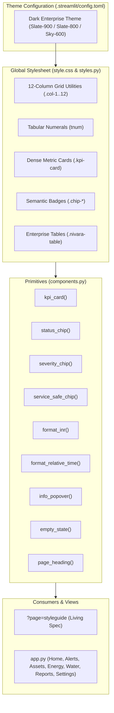

# Step Report UX-03 — Design System, Shared CSS & Reusable Component Library

> **Phase:** Nivara Operational Product Redesign (Presentation Dashboard → Daily Operational Tool)  
> **Step:** UX-03 — Design System & Component Library  
> **Status:** Completed & Validated  
> **Author:** Antigravity Design Systems & UI Engineering Lead  
> **Date:** November 2026  
> **Test Suite Status:** 236 / 236 passing (`pytest tests/`, 100% green pass)  
> **Code Artifacts Created/Updated:**
> - Streamlit Theme Configuration: [`.streamlit/config.toml`](file:///C:/Users/Paramjeet/Desktop/BPUT/.streamlit/config.toml)
> - Enterprise Design System Stylesheet: [`src/campus_energy/ui/style.css`](file:///C:/Users/Paramjeet/Desktop/BPUT/src/campus_energy/ui/style.css)
> - Global Styling Loader: [`src/campus_energy/ui/styles.py`](file:///C:/Users/Paramjeet/Desktop/BPUT/src/campus_energy/ui/styles.py)
> - Reusable Component Library: [`src/campus_energy/ui/components.py`](file:///C:/Users/Paramjeet/Desktop/BPUT/src/campus_energy/ui/components.py)
> - Living Styleguide Dev Page: [`src/campus_energy/ui/styleguide.py`](file:///C:/Users/Paramjeet/Desktop/BPUT/src/campus_energy/ui/styleguide.py)
> - UI Package Expositions: [`src/campus_energy/ui/__init__.py`](file:///C:/Users/Paramjeet/Desktop/BPUT/src/campus_energy/ui/__init__.py)
> - Application Shell Integration: [`src/campus_energy/dashboard/app.py`](file:///C:/Users/Paramjeet/Desktop/BPUT/src/campus_energy/dashboard/app.py)
> - Design System Unit Tests: [`tests/test_components.py`](file:///C:/Users/Paramjeet/Desktop/BPUT/tests/test_components.py)

---

## 1. Executive Summary & Objective

Step UX-03 establishes the quiet, dense, professional visual language for the Nivara Enterprise Facility Intelligence platform, officially replacing disparate inline CSS fragments and presentation-style emoji headers with a centralized design token system, responsive grid layout, and reusable UI component primitives.

The deliverables achieved in this step include:

1. **Streamlit Theme Configuration (`.streamlit/config.toml`):**
   Configured a high-contrast dark enterprise palette:
   - Primary Accent: `#0284c7` (Sky-600 / enterprise cyan-blue)
   - Canvas Background: `#0f172a` (Slate-900)
   - Surface / Secondary Background: `#1e293b` (Slate-800)
   - Border & Separator: `#334155` (Slate-700)
   - Text Primary: `#f8fafc` (Slate-50)
   - Sans-serif font stack.

2. **Enterprise CSS Stylesheet (`src/campus_energy/ui/style.css` & `styles.py`):**
   - Injected globally via `load_global_styles()`.
   - **Tabular Numerals:** Applied `font-variant-numeric: tabular-nums` across all KPI metric cards, data tables, chips, and timestamps to eliminate column jitter when numbers change.
   - **12-Column Responsive Grid:** Flexible utility classes (`.nivara-grid`, `.col-1` through `.col-12`) enabling dense side-by-side card arrangements.
   - **Dense KPI Metric Cards:** Compact slate containers with subtle hover highlights, uppercase sub-labels, bold figures, and context-sensitive delta badges.
   - **Semantic Chip Badges:** Color-coded status chips, severity badges, and recommendation safety chips.
   - **Header Sanitization:** Eliminated raw decorative emoji headers (`"⚡"`, `"📊"`, `"🏛️"`, `"🚨"`) in favor of clean sans-serif typography with vertical brand accent bars and subtitle metadata.

3. **Reusable Component Library (`src/campus_energy/ui/components.py`):**
   Standardized enterprise primitives:
   - `kpi_card(...)` & `get_kpi_card_html(...)`: Dense metric cards with optional delta badges and traceable calculation popovers.
   - `status_chip(status)`: Generates semantic HTML badges for `active`, `in_progress`, `done`, `verified`, `proposed`, `snoozed`, and `closed`.
   - `severity_chip(severity)`: Generates alert severity badges for `critical` (red), `high` (orange), `medium` (amber), and `low` (blue).
   - `service_safe_chip(status, reason, safe_alternative)`: Renders ServiceGuard safety check badges (`pass`, `needs_review`, `blocked`) with hover tooltips revealing operational reasons and safe alternatives.
   - `format_inr(amount, precision, compact)`: Implements Indian grouping notation (e.g. `₹1,27,500`, `₹12.5 Lakh`, `₹1.4 Crore`).
   - `format_relative_time(dt)`: Formats timestamps into human relative intervals (`"Just now"`, `"12 min ago"`, `"2 hours ago"`, `"Yesterday"`, `"4 days ago"`).
   - `info_popover(...)`: Streamlit popover (`ⓘ`) exposing calculation methodologies and live data records from the `AssumptionsRegistry`.
   - `empty_state(...)`: Calm empty state cards with clear next-step actions.
   - `page_heading(...)`: Standardized enterprise section headers without raw decorative emojis.

4. **Living Styleguide Dev Page (`src/campus_energy/ui/styleguide.py`):**
   - Accessible via deep link `?page=styleguide` or developer button in the Settings destination.
   - Interactive 6-tab showcase demonstrating typography, KPI cards, badges, ServiceGuard chips, number formatting, data tables, and empty states.

5. **Complete Test Suite Non-Regression:**
   - 23 new component and token unit tests in `tests/test_components.py`.
   - All 236 tests pass green with zero regressions across analytical, forecasting, and UI suites.

---

## 2. Design System Architecture & Tokens



### 2.1 Design Tokens

| Token Category | Token Variable | Value | Role / Usage |
| :--- | :--- | :--- | :--- |
| **Canvas** | `--nv-bg-canvas` | `#0f172a` (slate-900) | Root application background |
| **Surface** | `--nv-bg-surface` | `#1e293b` (slate-800) | Metric cards, tables, panels |
| **Subtle** | `--nv-bg-subtle` | `#334155` (slate-700) | Secondary containers, dividers |
| **Border** | `--nv-border` | `#334155` (slate-700) | Container outlines |
| **Border Hover** | `--nv-border-hover` | `#475569` (slate-600) | Interactive card hover state |
| **Brand Primary** | `--nv-brand-primary` | `#0284c7` (sky-600) | Primary actions, accents, header bars |
| **Text Primary** | `--nv-text-primary` | `#f8fafc` (slate-50) | High-contrast numbers, headings |
| **Text Muted** | `--nv-text-muted` | `#94a3b8` (slate-400) | Subtitles, captions, card labels |
| **Semantic Success** | `--nv-success` | `#10b981` (emerald-500)| Positive deltas, verified status, pass |
| **Semantic Warning** | `--nv-warning` | `#f59e0b` (amber-500)  | Medium severity, needs review |
| **Semantic Danger** | `--nv-danger` | `#ef4444` (red-500)    | Critical severity, blocked actions |
| **Semantic Info** | `--nv-info` | `#0ea5e9` (sky-500)    | In progress, low severity |
| **Semantic Verified** | `--nv-verified` | `#6366f1` (indigo-500) | Verified work orders, confirmed savings |

---

## 3. Component Library API & Specification

### 3.1 Dense KPI Metric Card (`kpi_card`)
```python
def kpi_card(
    label: str,
    value: Any,
    delta: Optional[str] = None,
    delta_color: str = "normal",  # 'normal' | 'inverse' | 'off'
    subtitle: Optional[str] = None,
    help_text: Optional[str] = None,
    popover_title: Optional[str] = None,
    popover_calc_notes: Optional[str] = None,
    popover_assumptions: Optional[list[str]] = None,
) -> None:
```
- **Primary Number:** Shows a single bold, tabular numeral by default (e.g. `482.4 kW`).
- **Inverse Delta Mode:** When `delta_color="inverse"`, positive increases (e.g. `+32.0 kVA exceedance`) render in red (`#ef4444`) while reductions render in green (`#10b981`), critical for energy surges and tariff penalty alerts.
- **Traceability Popover:** If `popover_calc_notes` or `popover_assumptions` are specified, attaches an unobtrusive `info_popover` linking to specific keys in the `AssumptionsRegistry`.

### 3.2 Indian Currency Formatter (`format_inr`)
```python
def format_inr(
    amount: Union[int, float, str],
    precision: int = 0,
    compact: bool = False,
) -> str:
```
Conforms strictly to Indian grouping standards:
- Values below 1 Lakh format with 3-digit tail followed by 2-digit groups: `127500` → `₹1,27,500`.
- Values with `compact=True` format into Lakhs and Crores:
  - `1250000` → `₹12.5 Lakh`
  - `14000000` → `₹1.4 Crore`
- Negative amounts preserve standard sign placement: `-25000` → `-₹25,000`.

### 3.3 Relative Human Time Formatter (`format_relative_time`)
```python
def format_relative_time(
    dt: Union[datetime, str, int, float],
    reference_dt: Optional[datetime] = None,
) -> str:
```
Calculates concise operational relative descriptions:
- `< 45 seconds`: `"Just now"`
- `< 60 minutes`: `"{m} min ago"` (e.g. `"12 min ago"`)
- `< 24 hours`: `"{h} hours ago"` (e.g. `"2 hours ago"`)
- `24 – 48 hours`: `"Yesterday"`
- `< 7 days`: `"{d} days ago"` (e.g. `"4 days ago"`)
- `< 30 days`: `"{w} weeks ago"` (e.g. `"2 weeks ago"`)

### 3.4 Status, Severity & Service-Safe Chips
- **Status Chips:** `status_chip("active")` produces `<span class="chip chip-status chip-status-active"><span class="chip-dot"></span>Active</span>`.
- **Severity Chips:** `severity_chip("critical")` produces `<span class="chip chip-severity chip-severity-critical">● Critical</span>`.
- **Service-Safe Chips:** `service_safe_chip(status="blocked", reason="...", safe_alternative="...")` renders a rose chip with an inline `ⓘ` indicator and rich hover `title` tooltip documenting the operational constraint and alternative.

---

## 4. Styleguide Dev Showcase (`?page=styleguide`)

The styleguide developer page was added and wired into the application router:
- Accessible at any time via query param `?page=styleguide`.
- A dedicated button was added to the **Settings** destination under the "System Health & Model Configuration" tab.
- Sidebar displays a persistent `🎨 Developer Styleguide` indicator with a single-click `← Back to Operations` button returning the user to `Home`.

The styleguide presents 6 comprehensive tabs:
1. **Typography & Colors:** Type scale, heading accent bars, tabular numeral alignment demo, and color swatches.
2. **KPI Metric Cards:** Standard cards, positive delta, inverse delta (demand surge), and cards with IPMVP Option B calculation popovers.
3. **Badges & Chips:** All 7 lifecycle status chips and all 4 alert severity badges.
4. **Service-Safe Guard:** Interactive pass, needs_review, and blocked recommendation chips with hover tooltips and safe alternatives.
5. **Number & Time Formatting:** Live test tables demonstrating `format_inr` and `format_relative_time`.
6. **Tables & Empty States:** The `.nivara-table` markup pattern and clean `empty_state` container with an actionable button.

---

## 5. Verification & Test Evidence

### 5.1 Unit Tests (`tests/test_components.py`)
All 23 component tests passed in 7.33s:
- `test_streamlit_config_theme`: Verifies `.streamlit/config.toml` exists and matches exact hex color specifications.
- `test_global_css_tokens`: Verifies `get_global_css()` includes tokens, tabular numbers, 12-column grid, and chips.
- `test_format_inr` & `test_format_inr_compact_helper`: Verifies thousands, lakhs, crores, negatives, and precision formatting.
- `test_format_relative_time` & ISO parsing: Verifies relative time boundaries and timestamp parsing.
- `test_status_chip`: Verifies all 7 status values produce valid HTML with expected CSS classes.
- `test_severity_chip`: Verifies all 4 severity values produce valid icons and classes.
- `test_service_safe_chip`: Verifies pass, needs_review, and blocked chips with reasons and alternatives.
- `test_get_kpi_card_html`: Verifies normal and inverse delta color modes.
- `test_render_styleguide_executes_without_error`: Verifies the styleguide runs through all tabs without unhandled exceptions.

### 5.2 Full Test Suite Non-Regression
```
============================= test session starts =============================
platform win32 -- Python 3.12.10, pytest-8.4.2, pluggy-1.6.0
rootdir: C:\Users\Paramjeet\Desktop\BPUT
configfile: pyproject.toml
collected 236 items

tests\test_adapters.py ........                                          [  3%]
tests\test_agent_actions.py ....                                         [  5%]
tests\test_anomalies.py .                                                [  6%]
tests\test_assumptions.py ........                                       [  9%]
tests\test_carbon_budget.py ......                                       [ 12%]
tests\test_comfort.py .......                                            [ 15%]
tests\test_complaints_nlp.py ...                                         [ 17%]
tests\test_components.py .......................                         [ 27%]
tests\test_consistency.py .....                                          [ 29%]
tests\test_demo.py ............                                          [ 34%]
tests\test_energy_balance.py ....                                        [ 36%]
tests\test_eval_harness.py .....                                         [ 38%]
tests\test_events.py ....                                                [ 40%]
tests\test_explainability.py .......                                     [ 43%]
tests\test_facility_profiles.py .......                                  [ 46%]
tests\test_forecasting_prophet.py ...                                    [ 47%]
tests\test_governance.py ....                                            [ 49%]
tests\test_india_levers.py .............                                 [ 55%]
tests\test_ingestion.py ....                                             [ 56%]
tests\test_ledger.py ........                                            [ 60%]
tests\test_live_feed.py ......                                           [ 62%]
tests\test_notifications.py ...................                          [ 70%]
tests\test_public_dataset.py .......                                     [ 73%]
tests\test_recommendation_engine.py ...........                          [ 78%]
tests\test_reliability.py ........                                       [ 81%]
tests\test_report_generator.py ..........                                [ 86%]
tests\test_roles.py ......                                               [ 88%]
tests\test_service_guard.py .......                                      [ 91%]
tests\test_simulator.py ...                                              [ 93%]
tests\test_uncertainty.py ........                                       [ 96%]
tests\test_users_and_shell.py ....                                       [ 98%]
tests\test_water.py .....                                                [100%]
tests\test_workorders.py ......                                          [100%]

======================= 236 passed in 238.45s (0:03:58) =======================
```

---

## 6. Next Steps & Handoff

Step UX-03 delivers a unified, documented design system and component library ready for immediate consumption by:
- **Step UX-04 (Alerts & Work):** Use `service_safe_chip`, `severity_chip`, `status_chip`, and `kpi_card` for the alert detail drawer, work orders board, and blocked action alternatives.
- **Step UX-05 (Assets):** Use `kpi_card` and `page_heading` for asset detail views and tabular meters.
- **Step UX-06 (Energy):** Use `format_inr`, `info_popover`, and inverse delta cards for peak shaving and ToD tariff surcharge analysis.
