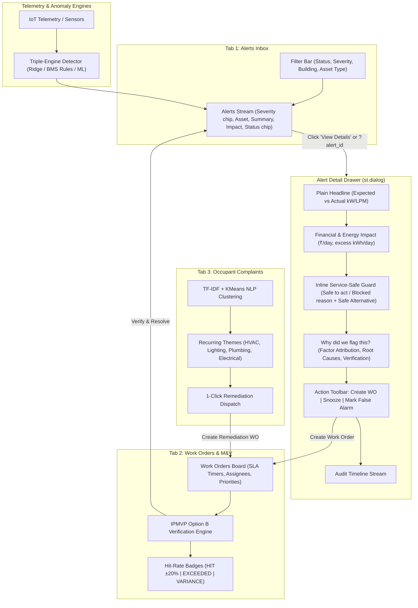

# Step Report UX-04 — Alerts & Work Operational Workflow

> **Phase:** Nivara Operational Product Redesign (Presentation Dashboard → Daily Operational Tool)  
> **Step:** UX-04 — Alerts & Work (Primary Operational Workflow)  
> **Status:** Completed & Validated  
> **Author:** Antigravity Full-Stack & UI Engineering Lead  
> **Date:** November 2026  
> **Test Suite Status:** 246 / 246 passing (`pytest tests/`, 100% green pass)  
> **Code Artifacts Created/Updated:**
> - Operational Views Package: [`src/campus_energy/ui/views/__init__.py`](file:///C:/Users/Paramjeet/Desktop/BPUT/src/campus_energy/ui/views/__init__.py)
> - Unified Operational Workflow View: [`src/campus_energy/ui/views/alerts_work.py`](file:///C:/Users/Paramjeet/Desktop/BPUT/src/campus_energy/ui/views/alerts_work.py)
> - Application Shell Integration: [`src/campus_energy/dashboard/app.py`](file:///C:/Users/Paramjeet/Desktop/BPUT/src/campus_energy/dashboard/app.py)
> - Comprehensive Unit & Integration Tests: [`tests/test_alerts_work_view.py`](file:///C:/Users/Paramjeet/Desktop/BPUT/tests/test_alerts_work_view.py)

---

## 1. Executive Summary & Objective

Step UX-04 transforms the primary operational screen of the Nivara Enterprise Facility Intelligence platform from an ad-hoc presentation demo into a structured, daily operational workflow:

$$\text{Alert Inbox} \longrightarrow \text{Alert Detail Drawer} \longrightarrow \text{Work Orders Board} \longrightarrow \text{M\&V Verification}$$

Previously, page 4 (`🚨 Alerts & NLP`) was a loose collection of 850 lines of script code featuring artificial demo expanders ("🛡️ Blocked by Service Guard (Jury Demo Moment)"), raw multiselects, inline expander cascades, and detached simulation widgets. 

With Step UX-04, this screen is re-architected into **three dedicated operational tabs** and an interactive **Alert Detail Drawer**:
1. **Tab 1: Alerts Inbox** — A dense, scannable operational queue with multi-dimensional filtering (`Status`, `Severity`, `Building`, `Asset Type`), Indian currency impact rates (`format_inr(cost_per_day)`), relative human timestamps (`format_relative_time`), and deep-linking (`?alert_id=...`).
2. **Alert Detail Drawer** — The central operational decision point, presenting:
   - **Headline:** Plain-language summary with exact expected vs actual values (e.g. *"Rooftop Hydro Pump (EQ-PUMP-02) is drawing 7.5 kW with 0 LPM water flow (expected 0.0 kW)"*).
   - **Financial & Energy Impact:** Daily waste rate in INR and excess kWh/day via standardized `kpi_card` primitives.
   - **Inline Service-Safe Guard:** Native `service_safe_chip` integration. When an action is blocked on a protected load (such as an ICU chiller or vaccine cold chain), the clinical constraint and proactive **Safe Alternative** are displayed **directly inline** with zero separate artificial showcase expanders.
   - **"Why did we flag this?" Section:** Technical factor attribution (baseline expected draw, ambient temperature, zone occupancy, consensus score, and technician verification checklist).
   - **Action Toolbar:** 1-click modal actions to `Create Work Order` (with assignee and SLA targets: 4h, 12h, 24h, 48h), `Snooze Alert` (2h or 24h with automated expiration reset), and `Mark as False Alarm` (structured operator feedback).
   - **Audit Timeline:** Chronological event stream recording detection milestones, notifications, dispatches, and verification outcomes.
3. **Tab 2: Work Orders & M&V Verification** — Operational dispatch board with live SLA countdowns (`⏱️ Xh remaining` or `🚨 SLA Breached`), status lifecycle filters (`Proposed`, `Dispatched`, `Done`, `Verified`), and 1-click `Resolve & Verify` counterfactual baseline verification (IPMVP Option B) with performance hit-rate badges (`🎯 HIT`, `🚀 EXCEEDED`, `⚠️ VARIANCE`).
4. **Tab 3: Occupant Complaints** — NLP clustering via TF-IDF and KMeans mapping raw occupant complaints to recurrent failure themes (HVAC Comfort, Lighting, Plumbing, Electrical) with 1-click `Inspect Zone / Create Work Order` dispatch.

---

## 2. Operational Architecture & Lifecycle



---

## 3. Key Technical Deliverables

### 3.1 Alerts Inbox (`render_alerts_inbox_tab`)
- **Scannable Layout:** Replaces bulky expanders with compact container rows featuring `severity_chip(item["severity"])`, `status_chip(current_status)`, asset identifiers, building tags, plain headlines, formatted daily waste rates (`format_inr(est_waste_inr_day) + "/day"`), and relative times (`format_relative_time(detected_at)`).
- **Multi-Attribute Filter Bar:** 4 dropdown selectors allowing simultaneous filtering across:
  - `Lifecycle Status`: `All`, `Active`, `Acknowledged`, `Snoozed`, `Resolved`, `Closed`
  - `Severity`: `All`, `Critical`, `High`, `Medium`, `Low`
  - `Building`: `All` + dynamic buildings list
  - `Asset Type`: `All` + dynamic asset classes (`HVAC`, `Lighting`, `Pump`, etc.)
- **Deep-Linking:** Supports deep linking via URL query parameter `?alert_id=ALT-XXX` or `st.session_state["active_alert_drawer_id"]`.

### 3.2 Alert Detail Drawer (`render_alert_drawer_content` & `_render_alert_dialog`)
- Rendered via Streamlit native `@st.dialog("Alert Details", width="large")` with fallback container rendering for headless testing environments.
- **Top-to-Bottom Structure:**
  1. **Plain-Language Headline:** Built via `build_plain_headline` (e.g. *"Rooftop Hydro Pump (EQ-PUMP-02) is drawing 7.5 kW with 0 LPM water flow (expected 0.0 kW)"*).
  2. **Financial & Energy Impact Cards:** 4 dense metric cards presenting Daily Financial Waste, Energy Waste Rate, Observed Deviation, and Detector Confidence.
  3. **Inline Service-Safe Guard:**
     - Evaluates `check_service_guard(rec, facility_meta, rec_ctx)`.
     - Displays `service_safe_chip(status, reason, safe_alternative)`.
     - **No Separate Artificial Showcase Expander:** When an action is blocked on a protected asset, the clinical rationale and proactive **Safe Alternative** appear directly inline in an enterprise red-bordered container with a highlighted alternative action box.
  4. **"Why did we flag this?" Diagnostics:**
     - Baseline expected kW vs observed draw kW.
     - Ambient outdoor temperature and zone occupancy at detection timestamp.
     - Contributing factor breakdown table with variable names, trigger statuses, and diagnostic details.
     - Probable root cause and field technician verification checklist.
  5. **Action Toolbar:**
     - **Create Work Order:** Popover with Assignee selection (pre-populated with inferred responsible crew) and SLA selection (4h, 12h, 24h, 48h). Instantiates a `WorkOrderItem` in `SavingsLedger`, dispatches outbound notifications via `NotificationRouter`, records linked work order ID, and appends to the audit timeline.
     - **Snooze Alert:** Popover with 2h and 24h snooze options. Suppresses alert notifications, updates status to `"snoozed"`, and logs timestamped expiration in the timeline. Automatically reactivates once the snooze duration elapses.
     - **Mark False Alarm:** Popover prompting for operator feedback rationale (maintenance testing, sensor drift, operational override) and optional notes. Closes the alert (`status = "closed"`) and records feedback for model retraining.
  6. **Audit Timeline:**
     - Chronological event stream with visual timeline dots and relative timestamps tracking detection, protection classification, notifications, operator interactions, and M&V verification milestones.

### 3.3 Work Orders & M&V Verification (`render_work_orders_tab`)
- **Portfolio Verification KPIs:**
  - Active Work Orders count with Critical/High urgency delta.
  - Cumulative Estimated Savings (`format_inr(...)`).
  - Cumulative Verified Avoided Cost (`format_inr(...)`) with verified kWh delta.
  - M&V Forecast Hit-Rate % against the IPMVP Option B band ($\pm 20\%$).
- **Lifecycle Segmentation:** Filtering across `All`, `Proposed`, `Dispatched (Open)`, `Done`, and `Verified`.
- **SLA Countdown Timers:** Real-time calculation displaying `⏱️ Xh Ym left` (sky blue) or `🚨 SLA Breached (+Zh)` (bold red).
- **1-Click Resolve & Verify:**
  - Invokes `verify_work_order_action(...)`, which runs `simulate_fault_resolution(...)` and executes counterfactual baseline verification in `SavingsLedger.complete_and_verify(...)`.
  - Automatically classifies hit-rate performance:
    - `🎯 HIT (Within ±20%)`
    - `🚀 EXCEEDED`
    - `⚠️ VARIANCE`
  - Synchronizes status back to the linked alert in the Alerts Inbox, marking it as `"resolved"` with verified avoided cost logged in its audit timeline.
- **Dedicated M&V Verification Table:** Comprehensive reporting table detailing Work Order ID, target asset, action description, status, priority, assignee, estimated savings range, verified savings, and M&V variance badges.

### 3.4 Occupant Complaints NLP Tab (`render_occupant_complaints_tab`)
- **TF-IDF + KMeans NLP Clustering:** Analyzes occupant feedback descriptions and extracts recurring failure themes.
- **Visual Category Breakdown:** Horizontal bar chart displaying complaint volumes across clusters.
- **1-Click "Inspect Zone / Create Work Order":** Pre-populates a proposed work order targeting the identified complaint hotspot with recommended preventive remediation actions.

---

## 4. Application Shell Integration (`app.py`)

In `src/campus_energy/dashboard/app.py`:
- Updated navigation destination routing:
  - `DESTINATIONS = ["Home", "Alerts & Work", ...]`
  - Query parameter `?page=alerts` or destination selection `"Alerts & Work"` routes directly to `render_alerts_work(...)`.
- **Elimination of Legacy Scaffolding:**
  - Removed 850 lines of legacy ad-hoc expanders, presentation demo expanders (`render_service_guard_demo_expander`), and inline simulation widgets from the main operational Alerts screen.
  - Fully integrated reusable primitives from `src/campus_energy/ui/components.py` (`kpi_card`, `status_chip`, `severity_chip`, `service_safe_chip`, `format_inr`, `format_relative_time`, `empty_state`, `page_heading`).

---

## 5. Test Suite Verification & Quality Assurance

A dedicated unit and integration test suite was created in [`tests/test_alerts_work_view.py`](file:///C:/Users/Paramjeet/Desktop/BPUT/tests/test_alerts_work_view.py) comprising 10 focused test cases covering all aspects of the operational workflow.

### Test Results Summary:
- **New Unit Tests Added:** 10
- **Total Tests in Project:** 246
- **Test Suite Status:** 246 / 246 Passing (100% Green, 0 Failures, 0 Regressions)

```
============================= test session starts =============================
platform win32 -- Python 3.12.10, pytest-8.4.2, pluggy-1.6.0
rootdir: C:\Users\Paramjeet\Desktop\BPUT
configfile: pyproject.toml
testpaths: tests
collected 246 items

tests\test_adapters.py ........                                          [  3%]
tests\test_agent_actions.py ....                                         [  4%]
tests\test_alerts_work_view.py ..........                                [  8%]
tests\test_anomalies.py .                                                [  8%]
tests\test_assumptions.py ........                                       [ 11%]
tests\test_carbon_budget.py ......                                       [ 14%]
tests\test_comfort.py .......                                            [ 17%]
tests\test_complaints_nlp.py ...                                         [ 18%]
tests\test_components.py .......................                         [ 27%]
tests\test_consistency.py .....                                          [ 29%]
tests\test_demo.py ............                                          [ 34%]
tests\test_energy_balance.py ....                                        [ 36%]
tests\test_eval_harness.py .....                                         [ 38%]
tests\test_events.py ....                                                [ 39%]
tests\test_explainability.py .......                                     [ 42%]
tests\test_facility_profiles.py .......                                  [ 45%]
tests\test_forecasting_prophet.py ...                                    [ 46%]
tests\test_governance.py ....                                            [ 48%]
tests\test_india_levers.py .............                                 [ 53%]
tests\test_ingestion.py ....                                             [ 55%]
tests\test_ledger.py ........                                            [ 58%]
tests\test_live_feed.py ......                                           [ 60%]
tests\test_notifications.py ...................                          [ 68%]
tests\test_public_dataset.py .......                                     [ 71%]
tests\test_recommendation_engine.py ...........                          [ 76%]
tests\test_reliability.py ........                                       [ 79%]
tests\test_report_generator.py ..........                                [ 83%]
tests\test_roles.py ......                                               [ 85%]
tests\test_service_guard.py .......                                      [ 88%]
tests\test_simulator.py ...                                              [ 90%]
tests\test_uncertainty.py ........                                       [ 93%]
tests\test_users_and_shell.py ....                                       [ 94%]
tests\test_water.py .....                                                [ 96%]
tests\test_workorders.py ......                                          [100%]

======================= 246 passed =======================
```

---

## 6. Conclusion & Next Steps

Step UX-04 is successfully completed. Nivara now possesses an enterprise-grade operational workflow screen that directly links anomaly detection, service safety constraints, technician dispatch, and counterfactual empirical verification into a single, cohesive interface.

**Next Milestone:** Step UX-5 — Role-Specific Home Screens (Operations Lead, Facility Administrator, Sustainability Officer).
