# Step Report UX-05 — Role-Specific Home Screens

> **Phase:** Nivara Operational Product Redesign (Presentation Dashboard → Daily Operational Tool)  
> **Step:** UX-05 — Role Homes (Operations, Administrator, Sustainability)  
> **Status:** Completed & Validated  
> **Author:** Antigravity Full-Stack & UI Engineering Lead  
> **Date:** November 2026  
> **Test Suite Status:** 259 / 259 passing (`pytest tests/`, 100% green pass)  
> **Code Artifacts Created/Updated:**
> - Operations Home View: [`src/campus_energy/ui/views/home_operations.py`](file:///C:/Users/Paramjeet/Desktop/BPUT/src/campus_energy/ui/views/home_operations.py)
> - Administrator Home View: [`src/campus_energy/ui/views/home_admin.py`](file:///C:/Users/Paramjeet/Desktop/BPUT/src/campus_energy/ui/views/home_admin.py)
> - Sustainability Home View: [`src/campus_energy/ui/views/home_sustainability.py`](file:///C:/Users/Paramjeet/Desktop/BPUT/src/campus_energy/ui/views/home_sustainability.py)
> - Views Package Exports: [`src/campus_energy/ui/views/__init__.py`](file:///C:/Users/Paramjeet/Desktop/BPUT/src/campus_energy/ui/views/__init__.py)
> - Application Navigation Router: [`src/campus_energy/dashboard/app.py`](file:///C:/Users/Paramjeet/Desktop/BPUT/src/campus_energy/dashboard/app.py)
> - Comprehensive Unit & Integration Tests: [`tests/test_role_homes.py`](file:///C:/Users/Paramjeet/Desktop/BPUT/tests/test_role_homes.py)

---

## 1. Executive Summary & Objective

Step UX-05 implements the core promise of the Nivara operational redesign: **distinct, quiet, dense Home screens tailored to what each persona actually needs on a Tuesday morning**.

Previously, when a user landed on the application, they encountered either a presentation-style executive overview crammed with proof-scorecards, benchmarks, and artificial demo moments, or they had to use a persona toggle that announced "this is a presentation demo."

With Step UX-05:
1. **Persona Authentication Directly Determines Landing Home:**
   - `operations` lead lands on the **Operations Home** (`render_home_operations`).
   - `administrator` / Registrar lands on the **Administrator Home** (`render_home_admin`).
   - `sustainability` officer lands on the **Sustainability Home** (`render_home_sustainability`).
2. **Exception-First & Dense 1080p Layouts:**
   - Every home screen fits neatly on a standard 1080p display without excessive vertical scrolling.
   - Normal operation is quiet; anomalies and exceptions are front and center.
3. **Actionable Click-Through Navigation:**
   - Every KPI, alert, decision card, and department link connects directly to the underlying detail view (`Alerts & Work`, `Energy > Department Billing`, or `Reports > Governance & Policy`) via `st.session_state` and URL query parameters (`?page=...&alert_id=...`).

---

## 2. Role Home Architecture & Specifications

```mermaid
flowchart TD
    Login["Authenticated User Profile"] --> Router{"Home Destination Router<br/>(chosen_dest == 'Home')"}

    Router -->|"role == 'operations'"| OpsHome["Operations Home (Section 5.2)"]
    Router -->|"role == 'administrator'"| AdminHome["Administrator Home (Section 5.3)"]
    Router -->|"role == 'sustainability'"| SustHome["Sustainability Home (Section 5.4)"]

    subgraph OpsElements["Operations Home Elements"]
        TodayStripOps["Today Strip: Load Now vs Expected | Open Alerts | WOs Due | Sensor Health"]
        NeedsAttn["Needs Attention Queue: Critical/High Alerts | SLA Timers | Stuck Sensors"]
        LoadChart["Load Today vs Forecast Chart + Anomaly Diamonds"]
        ActFeed["Recent Operational Activity Feed (10 Events)"]
        TodayStripOps --> NeedsAttn --> LoadChart --> ActFeed
    end

    subgraph AdminElements["Administrator Home Elements"]
        DemandBanner["Contract Demand Risk Banner: Peak kVA vs Contract kVA (Headroom)"]
        FinStrip["This Month Financial Strip: Billed Cost | Projected Bill | Budget Delta | Verified ROI"]
        Decisions["Decisions Waiting: Capital & Operational Measures (Approve / Decline)"]
        RealizedSav["Savings Realized: Verified INR | Avoided kWh | M&V Hit-Rate %"]
        DeptSpend["Spend by Department: Bar Chart + Sub-Meter Allocation Table"]
        DemandBanner --> FinStrip --> Decisions --> RealizedSav --> DeptSpend
    end

    subgraph SustElements["Sustainability Home Elements"]
        SustStrip["Environmental KPI Strip: Carbon Month | BEE Star | Annual EPI | Verified GHG Abatement"]
        NapccBanner["NAPCC Target Trajectory Status Banner (-4.2% below ceiling)"]
        CarbonChart["Scope 2 Emissions vs NAPCC 20% Net-Zero Ceiling Trajectory"]
        BeeCard["BEE Star & EPI Benchmark Card + Gap to Next Star"]
        VerifiedImpact["Verified Impact: Audited kgCO2e & kWh mapped to Work Orders"]
        ReportsShortcut["Statutory Compliance Calendar & Executive Audit PDF Export"]
        SustStrip --> NapccBanner --> CarbonChart --> BeeCard --> VerifiedImpact --> ReportsShortcut
    end

    OpsHome --- OpsElements
    AdminHome --- AdminElements
    SustHome --- SustElements
```



---

## 3. Screen Specifications & Implementation Details

### 3.1 Operations Home (`render_home_operations` / Section 5.2)
Designed specifically for the Chief Facilities Engineer (e.g. *Rajesh Mohanty*):
- **Today Strip (Exactly 4 Numbers):**
  1. *Load Now:* Current campus active draw in kW with delta versus Ridge baseline model (`+18.0 kW vs expected`, inverse delta color).
  2. *Open Alerts:* Count of active unresolved anomalies (`2 Critical / High`).
  3. *Work Orders Due Today:* Work orders requiring field action within 24h (`1 Overdue SLA` or `Queue Clean`).
  4. *Sensor Data Health:* Telemetry ingestion completeness (`99.8%`, `Nominal (0 Dropouts)`).
- **Needs Attention (Primary Screen Element):**
  - Prioritized table combining open critical/high alerts, work orders nearing or past SLA, and equipment/sensor dropouts.
  - Columns:
    - **Severity Chip:** Semantic badges (`severity_chip(sev)`).
    - **Asset ID:** Monospace asset tag (e.g. `EQ-CHILLER-01`).
    - **Headline / Issue:** Plain-language headline with expected vs actual values generated via `build_plain_headline(...)`.
    - **Impact:** Estimated daily waste in INR (`₹7,650/day waste`) or excess load (`+15.2 kW excess`).
    - **Age:** Human relative time formatted via `format_relative_time(...)`.
    - **Primary Action:** `"Open in Alerts & Work"` button that deep-links directly into the Alert Detail Drawer (`?page=alerts&alert_id=...`).
- **Load Today vs Forecast Chart:**
  - Single clean Plotly line chart: actual power vs Ridge forecast baseline with shaded 80% empirical confidence ribbon (`fill='tonexty'`).
  - Active anomalies marked as prominent red diamond markers directly on the load curve.
- **Recent Activity Feed:**
  - Compact chronological stream showing the last 10 operational events (Alerts raised, Work orders dispatched, Verified faults).

### 3.2 Administrator Home (`render_home_admin` / Section 5.3)
Designed specifically for the Campus Registrar & Administrator (e.g. *Dr. Arun Patnaik*):
- **Contract Demand Risk Status Banner:**
  - Prominent top status banner: *"Peak demand 412 kVA vs contract demand 450 kVA — Headroom +38 kVA (Nominal)"*.
  - Dynamically switches status and accent color to amber for tight headroom (< 25 kVA) or red for surcharge risk (exceeded contract demand).
- **This Month Financial Strip:**
  1. *Billed Electricity Cost:* Billed utility cost to date formatted via `format_inr(...)` (e.g. `₹3,82,500`).
  2. *Projected Month-End Bill:* Extrapolated 30-day bill including fixed and peak demand charges (e.g. `₹4,25,000`).
  3. *Budget Variance:* Percentage difference versus approved institutional budget (`-4.2% vs budget`).
  4. *Cumulative Verified ROI:* Total audited avoided cost (`format_inr(...)`) with M&V forecast hit-rate percentage.
- **Decisions Waiting Executive Sign-Off:**
  - Top capital and operational measures requiring executive authorization:
    - *Measure Title & Target Asset* (e.g. VFD retrofit, lighting automation, solar PV expansion).
    - *Expected Annual Savings:* Formatted in INR/yr (`format_inr(annual_savings)`).
    - *Simple Payback:* Amortization period in months.
    - *Service-Safe Chip:* Native `service_safe_chip` badge (`Safe to act`, `Needs review`, `Not recommended` with clinical protection notes).
    - *Action Buttons:* 1-click `✓ Approve` (dispatches to maintenance ledger), `✕ Decline` (dismisses measure), and `🔍 View Details` (opens alert drawer).
- **Realized Savings & M&V Performance:**
  - Audited IPMVP Option B performance showing verified savings, avoided kWh, and hit-rate percentage.
- **Spend by Department (Compact):**
  - Horizontal bar chart of departmental electricity expenditure and sub-meter allocation table.
  - Shortcut button: `"Open Department Billing & Chargebacks →"` navigating to `Energy > Department Billing`.

### 3.3 Sustainability Home (`render_home_sustainability` / Section 5.4)
Designed specifically for the Chief Sustainability & ESG Officer (e.g. *Priya Das*):
- **Environmental Headline Strip:**
  1. *Carbon This Month:* Cumulative Scope 2 emissions in t CO₂ with variance vs NAPCC budget ceiling (`-4.2% vs ceiling`).
  2. *BEE Star Rating:* Star rating (1–5) with star glyphs (`⭐⭐⭐⭐`) and ECBC compliance status.
  3. *Annual EPI:* Normalized Energy Performance Index in $\text{kWh/m}^2/\text{yr}$ vs ECBC baseline.
  4. *Verified GHG Abatement:* Audited carbon emissions avoided in $\text{kgCO}_2\text{e}$ with equivalent avoided energy.
- **NAPCC Trajectory Status Banner:**
  - Single clear status sentence: *"Monthly emissions tracking 4.2% below national NAPCC ceiling."* with remaining days countdown.
- **Scope 2 Carbon Trajectory Chart:**
  - Plotly line chart comparing actual cumulative daily emissions against the NAPCC 20% Net-Zero target ceiling and historical ECBC baseline.
- **BEE Star & EPI Benchmark Card:**
  - Visual star rating, current energy intensity, and quantified gap to the next star rating (e.g. *"12 kWh/m²/yr reduction required to reach 5-Star rating"*).
- **Verified Impact & Work Order Traceability:**
  - Audited list of completed maintenance work orders showing the exact equipment remediation, avoided kWh, and abated $\text{kgCO}_2\text{e}$.
- **Statutory Compliance & Export Shortcut:**
  - Institutional regulatory calendar (BEE Form 1 filing schedule, Discom energy audit).
  - One-click `"📄 Export Executive Audit PDF"` shortcut button generating the official institutional audit report.

---

## 4. Router Integration & Click-Through Mechanics

In `src/campus_energy/dashboard/app.py`:
- `chosen_dest == "Home"` evaluates `current_user.role` (or `selected_role_key`):
  ```python
  if chosen_dest == "Home":
      p_home_ledger = get_or_create_savings_ledger(facility_meta, events, tel)
      ...
      if selected_role_key == "operations":
          render_home_operations(...)
      elif selected_role_key == "sustainability":
          render_home_sustainability(...)
      else:
          render_home_admin(...)
      st.stop()
  ```
- **Click-Through Navigation:**
  - Clicking any action button on the Home screens updates `st.session_state["selected_nav_destination"]`, `st.session_state["selected_nav_page"]`, and URL query parameters (`st.query_params["page"]`, `st.query_params["alert_id"]`), triggering `st.rerun()` to seamlessly open the target view.

---

## 5. Test Suite Verification

Comprehensive test coverage was added in [`tests/test_role_homes.py`](file:///C:/Users/Paramjeet/Desktop/BPUT/tests/test_role_homes.py) covering 13 targeted unit and integration test cases:
1. `test_operations_today_strip_calculation` — Validates 4-number calculations and delta color mapping.
2. `test_operations_needs_attention_assembly` — Validates prioritization of critical alerts, SLA warnings, and stuck sensors.
3. `test_operations_load_today_vs_forecast_figure` — Validates Plotly chart traces and anomaly markers.
4. `test_operations_recent_activity` — Validates 10-event activity feed parsing.
5. `test_admin_financial_strip_calculation` — Validates billed cost, projection, and contract demand headroom status banner.
6. `test_admin_decisions_waiting_and_approvals` — Validates decision cards, payback calculations, and approval/decline state updates.
7. `test_admin_savings_realized` — Validates verified INR, avoided kWh, and hit-rate aggregation.
8. `test_admin_spend_by_department` — Validates department billing ledger and horizontal bar chart.
9. `test_sustainability_carbon_trajectory` — Validates Scope 2 burndown vs NAPCC ceiling and status sentence.
10. `test_sustainability_bee_star_and_epi` — Validates BEE star rating, annual EPI, and gap to next star rating.
11. `test_sustainability_verified_impact` — Validates audited GHG abatements and linked work orders.
12. `test_role_based_routing_profiles` — Validates `UserProfile.role` routing for all three personas.
13. `test_render_home_views_headless_smoke` — Verifies all three home render functions execute headlessly without unhandled exceptions.

```
============================= test session starts =============================
collected 259 items

tests/test_adapters.py ........                                          [  3%]
tests/test_agent_actions.py ....                                         [  4%]
tests/test_alerts_work_view.py ..........                                [  8%]
tests/test_anomalies.py .                                                [  9%]
tests/test_assumptions.py ........                                       [ 12%]
tests/test_carbon_budget.py ......                                       [ 15%]
tests/test_comfort.py .......                                            [ 17%]
tests/test_complaints_nlp.py ...                                         [ 19%]
tests/test_components.py .......................                         [ 28%]
tests/test_consistency.py .....                                          [ 30%]
tests/test_demo.py ............                                          [ 35%]
tests/test_energy_balance.py ....                                        [ 36%]
tests/test_eval_harness.py .....                                         [ 39%]
tests/test_events.py ....                                                [ 40%]
tests/test_explainability.py .......                                     [ 43%]
tests/test_facility_profiles.py .......                                  [ 46%]
tests/test_forecasting_prophet.py ...                                    [ 47%]
tests/test_governance.py ....                                            [ 49%]
tests/test_india_levers.py .............                                 [ 54%]
tests/test_ingestion.py ....                                             [ 56%]
tests/test_ledger.py ........                                            [ 59%]
tests/test_live_feed.py ......                                           [ 61%]
tests/test_notifications.py ...................                          [ 69%]
tests/test_public_dataset.py .......                                     [ 72%]
tests/test_recommendation_engine.py ...........                          [ 76%]
tests/test_reliability.py ........                                       [ 80%]
tests/test_report_generator.py ..........                                [ 84%]
tests/test_role_homes.py .............                                   [ 89%]
tests/test_roles.py ......                                               [ 91%]
tests/test_service_guard.py .......                                      [ 94%]
tests/test_simulator.py ...                                              [ 95%]
tests/test_uncertainty.py ........                                       [ 98%]
tests/test_users_and_shell.py ....                                       [ 99%]
tests/test_water.py .....                                                [ 99%]
tests/test_workorders.py ......                                          [100%]

============================= 259 passed in 143.20s =============================
```
