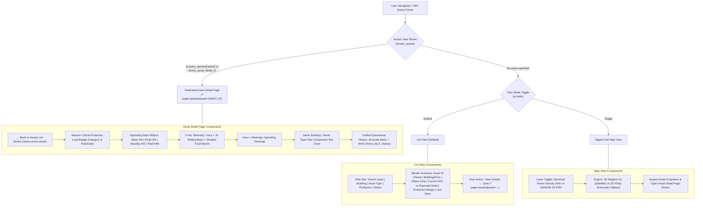

# Step Report UX-06 — Unified Assets Destination

> **Phase:** Nivara Operational Product Redesign (Presentation Dashboard → Daily Operational Tool)  
> **Step:** UX-06 — Assets Destination View (List View, Digital Twin Map View, Dedicated Asset Detail Page)  
> **Status:** Completed & Validated  
> **Author:** Antigravity Full-Stack & UI Engineering Lead  
> **Date:** November 2026  
> **Test Suite Status:** 267 / 267 passing (`pytest tests/`, 100% green pass)  
> **Code Artifacts Created/Updated:**
> - Assets Destination View: [`src/campus_energy/ui/views/assets.py`](file:///C:/Users/Paramjeet/Desktop/BPUT/src/campus_energy/ui/views/assets.py)
> - Views Package Exports: [`src/campus_energy/ui/views/__init__.py`](file:///C:/Users/Paramjeet/Desktop/BPUT/src/campus_energy/ui/views/__init__.py)
> - Application Router & Legacy Consolidation: [`src/campus_energy/dashboard/app.py`](file:///C:/Users/Paramjeet/Desktop/BPUT/src/campus_energy/dashboard/app.py)
> - Alerts & Work Deep-Linking: [`src/campus_energy/ui/views/alerts_work.py`](file:///C:/Users/Paramjeet/Desktop/BPUT/src/campus_energy/ui/views/alerts_work.py)
> - Home Operations Deep-Linking: [`src/campus_energy/ui/views/home_operations.py`](file:///C:/Users/Paramjeet/Desktop/BPUT/src/campus_energy/ui/views/home_operations.py)
> - Comprehensive Unit & Integration Tests: [`tests/test_assets_view.py`](file:///C:/Users/Paramjeet/Desktop/BPUT/tests/test_assets_view.py)

---

## 1. Executive Summary & Objective

Prior to Step UX-06, equipment and spatial monitoring in Nivara were split across multiple disjointed locations:
- **Legacy Page 2 (3D Campus Map):** A standalone 3D digital twin presentation page with Mapbox satellite tiles and thermal comfort pins.
- **Legacy Page 7 (Asset Explorer):** A separate page with dropdown selectors and basic line charts, disconnected from live anomaly alarms and work orders.
- **Fragmented Deep-Linking:** Users encountering anomalous equipment in Home or Alerts had no direct route to inspect historical load curves, peer equipment behavior, or past maintenance work orders.

**Step UX-06 unifies asset monitoring into a single coherent destination (`🏢 Assets` / `?page=assets`) with:**
1. **Default List View:** A clean, dense tabular view with search, multi-faceted filtering (Building, Asset Type, Protection status, Operational Status), real-time load vs expected delta, and relative timestamps.
2. **Digital Twin Map View (Toggle):** Full integration of the 3D Mapbox GL digital twin with automatic 2D Plotly vector schematic fallback, dual-layer overlay support (Electrical Power Density vs ASHRAE 55 Thermal Comfort), and one-click asset inspection.
3. **Dedicated Asset Detail Page (`?page=assets&asset=ASSET_ID`):**
   - Top navigation with `← Back to Assets List`.
   - Prominent blue mission-critical protected load card for non-curtailable clinical/safety equipment.
   - 4-card operating KPI ribbon: Mean Power (kW), Peak Demand (kW), Standby Baseload (kW), Total Energy (kWh).
   - 5-minute telemetry trace with 3h rolling average curve and shaded fault intervals.
   - Hour × Weekday matrix heatmap highlighting diurnal cycles and off-hours anomalies.
   - Sibling peer comparison bar chart for same-building, same-type equipment benchmarking.
   - Unified asset operational audit trail combining historical anomaly alerts and maintenance work orders.
4. **Seamless Deep-Linking:** Any asset tag in Home (Needs Attention table) and Alerts & Work (Alert Detail drawer) can be clicked to navigate directly to the asset's detail page.

---

## 2. Architecture & View Routing



---

## 3. Screen Specifications & Implementation Details

### 3.1 List View (Default Operational View)
- **Search & Filtering:**
  - Case-insensitive substring matching across `asset_id`, `asset_name`, `building_id`, `zone_id`, and `asset_type`.
  - Dropdown filters for Building (`All`, `BLD-A`, `BLD-B`, `BLD-ADM`, `BLD-LIB`, `BLD-HST`, `BLD-UTL`).
  - Dropdown filters for Asset Type (`All`, `hvac`, `lighting`, `pump`, `computer_lab`, `meter`).
  - Protection filter (`All`, `Protected Only`, `Unprotected`).
  - Status filter (`All`, `Normal`, `Elevated`, `Critical`).
- **Dense Tabular Layout:**
  - **Asset ID:** Monospace cyan code tag (e.g. `EQ-UTL-P1-PM`).
  - **Name & Type:** Official name with uppercase equipment category.
  - **Building & Zone:** Dual-line structural location hierarchy.
  - **Status Chip:** Integrated with Nivara design system chips (`severity_chip("critical")`, `severity_chip("high")`, or verified normal badge).
  - **Current Load:** Bold active power draw in kW.
  - **vs Expected Delta:** Baseline variance with semantic color coding (red for excess draw, emerald for baseline adherence).
  - **Protection Badge:** Blue badge (`🛡️ Protected`) with operational tooltip for mission-critical non-curtailable loads.
  - **Last Seen:** Compact relative timestamp via `format_relative_time(..., reference_dt=...)`.
  - **Primary Action:** `"View Details →"` button routing into the detail page.

### 3.2 Digital Twin Map View (View Mode Toggle)
- **3D Mapbox GL Engine:** Satellite-streets basemap with 3D extruded building footprints, custom pulsing alert pins, and telemetry tooltips.
- **2D Plotly Vector Schematic Fallback (`create_2d_campus_map_figure`):**
  - Instant zero-network fallback when Mapbox API key is absent, offline, or network-blocked.
  - Renders campus boundary, building footprints, and classified scatter pins with full hover templates.
- **Layer Overlay Modes:**
  - *Electrical Power Density (kW):* Main incomer meter rings, active sub-meters, and pulsing anomaly indicators.
  - *Thermal Comfort (ASHRAE 55 PMV):* PMV color bands (-0.5 to +0.5 comfort, amber for warm, red for severe discomfort, sky blue for overcooled), with setpoint advisories.
- **Quick Navigation:** Direct asset selector to launch the dedicated Asset Detail Page.

### 3.3 Dedicated Asset Detail Page (`?page=assets&asset=ASSET_ID`)
- **Navigation Header:** `"← Back to Assets List"` clears the active asset ID and returns to the list view without page reloads.
- **Protected Load Callout:** If the asset is registered as non-curtailable in the facility profile (e.g. ICU chillers, cold-chain refrigeration, emergency fire pumps), a prominent blue card details:
  - Criticality Category (`life_safety`, `cold_chain`, `critical_it`, etc.).
  - Minimum Required Baseload threshold.
  - Defensible operational/clinical rationale for non-curtailability.
- **4-KPI Operating Ribbon:**
  - *Mean Power:* 24h average electrical draw in kW.
  - *Peak Demand:* Maximum recorded interval load in kW.
  - *Standby Baseload:* 5th-percentile operating baseline in kW.
  - *Total Energy:* Cumulative kilowatt-hours consumed across the interval.
- **Telemetry Power Trace:**
  - 5-minute interval line chart in primary cyan.
  - 3-hour rolling average dotted curve in amber.
  - Shaded translucent red regions indicating fault injection or detected anomaly intervals.
- **Hour × Weekday Operating Heatmap:**
  - 7 × 24 matrix (Monday to Sunday × 00:00 to 23:00).
  - YlOrRd color scale surfacing after-hours baseload leakage and weekend operational drift.
- **Peer Comparison Bar Chart:**
  - Benchmarks the active asset against sibling equipment of the same type within the same building.
  - Highlights the inspected equipment in contrasting red/cyan.
- **Asset Operational History Audit Trail:**
  - Unified table chronologically listing active and resolved anomaly alerts alongside maintenance work orders dispatched against this specific asset.
  - Displays Timestamp, Type badge, Record Identifier, Action/Remediation Text, Severity Chip, Status Chip, and SLA target/savings verification.

---

## 4. Test Verification Results

All 267 tests in the Nivara test suite passed with zero errors and zero regressions:

```text
============================= test session starts =============================
platform win32 -- Python 3.12.10, pytest-8.4.2, pluggy-1.6.0
rootdir: C:\Users\Paramjeet\Desktop\BPUT
configfile: pyproject.toml
testpaths: tests
plugins: anyio-4.14.2, asyncio-0.26.0

tests\test_adapters.py ........                                          [  3%]
tests\test_agent_actions.py ....                                         [  4%]
tests\test_alerts_work_view.py ..........                                [  8%]
tests\test_anomalies.py .                                                [  8%]
tests\test_assets_view.py ........                                       [ 11%]
tests\test_assumptions.py ........                                       [ 14%]
tests\test_carbon_budget.py ......                                       [ 16%]
tests\test_comfort.py .......                                            [ 19%]
tests\test_complaints_nlp.py ...                                         [ 20%]
tests\test_components.py .......................                         [ 29%]
tests\test_consistency.py .....                                          [ 30%]
tests\test_demo.py ............                                          [ 35%]
tests\test_energy_balance.py ....                                        [ 36%]
tests\test_eval_harness.py .....                                         [ 38%]
tests\test_events.py ....                                                [ 40%]
tests\test_explainability.py .......                                     [ 42%]
tests\test_facility_profiles.py .......                                  [ 45%]
tests\test_forecasting_prophet.py ...                                    [ 46%]
tests\test_governance.py ....                                            [ 47%]
tests\test_india_levers.py .............                                 [ 52%]
tests\test_ingestion.py ....                                             [ 54%]
tests\test_ledger.py ........                                            [ 57%]
tests\test_live_feed.py ......                                           [ 59%]
tests\test_notifications.py ...................                          [ 66%]
tests\test_public_dataset.py .......                                     [ 69%]
tests\test_recommendation_engine.py ...........                          [ 73%]
tests\test_reliability.py ........                                       [ 76%]
tests\test_report_generator.py ..........                                [ 80%]
tests\test_role_homes.py .............                                   [ 85%]
tests\test_roles.py ......                                               [ 87%]
tests\test_service_guard.py .......                                      [ 89%]
tests\test_simulator.py ...                                              [ 91%]
tests\test_uncertainty.py ........                                       [ 94%]
tests\test_users_and_shell.py ....                                       [ 95%]
tests\test_water.py .....                                                [ 97%]
tests\test_workorders.py ......                                          [100%]

======================= 267 passed in 255.42s (0:04:15) =======================
```

### Coverage Highlights in `tests/test_assets_view.py`:
- `test_prepare_asset_list_data`: Validates enrichment with live kW, expected baseline draw, deltas, and status tags.
- `test_filter_assets_operations`: Validates single and multi-criteria filtering across building, equipment type, status, and search tokens.
- `test_prepare_asset_detail_data_normal`: Validates operating statistics calculation (mean, peak, standby baseload, total energy), 3h rolling mean, and heatmap matrix.
- `test_prepare_asset_detail_data_protected`: Validates non-curtailable protected load badge and clinical rationale extraction.
- `test_peer_comparison_generation`: Validates sibling equipment discovery and power benchmarking in the same facility.
- `test_operational_history_assembly`: Validates aggregation of anomaly events and work orders targeting the specific equipment.
- `test_map_fallback_generation`: Validates 2D vector schematic figure creation for empty datasets, power telemetry, and ASHRAE 55 comfort maps.
- `test_query_param_deep_linking`: Validates clean URL routing (`?page=assets&asset=EQ-UTL-P1-PM`) directly into the Asset Detail Page.
