# Step Report UX-08 — Reports and Settings Destinations

> **Phase:** Nivara Operational Product Redesign (Presentation Dashboard → Daily Operational Tool)  
> **Step:** UX-08 — Reports and Settings Destinations (Statutory Compliance, Executive Audit PDF, Multi-Campus Benchmarking, Administration, Proof Layer & Assumptions)  
> **Status:** Completed & Validated  
> **Author:** Antigravity Full-Stack & ML/UI Engineering Lead  
> **Date:** November 2026  
> **Test Suite Status:** 285 / 285 passing (`pytest tests/`, 100% green pass)  
> **Code Artifacts Created/Updated:**
> - Reports Destination View: [`src/campus_energy/ui/views/reports.py`](file:///C:/Users/Paramjeet/Desktop/BPUT/src/campus_energy/ui/views/reports.py)
> - Settings Destination View: [`src/campus_energy/ui/views/settings.py`](file:///C:/Users/Paramjeet/Desktop/BPUT/src/campus_energy/ui/views/settings.py)
> - Views Package Exports: [`src/campus_energy/ui/views/__init__.py`](file:///C:/Users/Paramjeet/Desktop/BPUT/src/campus_energy/ui/views/__init__.py)
> - Application Router & Consolidation: [`src/campus_energy/dashboard/app.py`](file:///C:/Users/Paramjeet/Desktop/BPUT/src/campus_energy/dashboard/app.py)
> - Comprehensive Integration Tests: [`tests/test_reports_settings_views.py`](file:///C:/Users/Paramjeet/Desktop/BPUT/tests/test_reports_settings_views.py)

---

## 1. Executive Summary & Objective

In accordance with Sections 5.9, 5.10, and 10 of the Nivara Redesign Specification (`docs/REDESIGN_SPEC.md`), Step UX-08 accomplishes a foundational architectural transformation: **clearing all non-operational clutter from daily monitoring views and establishing dedicated, structured destinations for institutional reporting and platform administration**.

Prior to UX-08, statutory compliance checklists, research proof tables, synthetic fault injection controls, and assumptions displays were scattered across presentation pages (e.g. Page 1, Page 1B, Page 2). This distracted facility operators from high-priority daily actions. 

Step UX-08 establishes two clean, purpose-built destinations:
1. **`📊 Reports` (`?page=reports`):** A statutory and executive reporting hub containing:
   - One-click institutional Executive Audit PDF generation via ReportLab.
   - Statutory compliance benchmarking against Bureau of Energy Efficiency (BEE) Star Ratings, ECBC 2017 chapter mandates, and NAPCC 20% carbon reduction trajectories.
   - Multi-campus cross-facility benchmarking matrix gated by user role authorization (`current_user.has_facility_access`).
   - Scheduled automated report configuration.
2. **`⚙️ Settings` (`?page=settings`):** A centralized platform administration and scientific proof center containing:
   - Facility profile, active tariff schedules, ASHRAE 55 comfort bounds, and a Mission-Critical Protected Loads registry.
   - Telemetry ingestion status, Bring-Your-Own-Data (BYOD) Smart CSV ingestion console with a 5-rule Data Quality Engine (DQE) scorecard, and relocated live packet replay controls.
   - Multi-channel notification routing matrix (Email/Telegram) with a live diagnostic test probe.
   - Searchable Assumptions Registry cataloging all 49 governed parameters with regulatory citations.
   - Scientific Proof Layer and Model Details (anomaly engine recall, ablation tables, Ridge vs Prophet vs Naive benchmarks, BDG2 real-world transfer validation, and stated scientific limitations).
   - Simulator Controls with the Live Fault Injection Studio relocated cleanly out of operational views.
   - Institutional Users & Roles directory loaded from `config/users.yaml`.

---

## 2. Architecture & View Routing

```mermaid
flowchart TD
    Sidebar["Nivara Navigation<br/>(Streamlit Shell)"] --> Router{"Destination Router<br/>(app.py)"}

    Router -->|"📊 Reports (?page=reports)"| ReportsView["render_reports()<br/>(src/campus_energy/ui/views/reports.py)"]
    Router -->|"⚙️ Settings (?page=settings)"| SettingsView["render_settings()<br/>(src/campus_energy/ui/views/settings.py)"]

    subgraph ReportsTabs["Reports Destination — 4 Structured Tabs"]
        R1["Tab 1: Executive Audit Report<br/>• 7d / 28d / Custom Period Selector<br/>• In-Browser Executive KPI Summary<br/>• 1-Click ReportLab Institutional PDF Download"]
        R2["Tab 2: Statutory Compliance<br/>• BEE Star Rating (1–5★) & EPI (kWh/m²/yr)<br/>• ECBC 2017 Chapter Audit Checklist<br/>• NAPCC 20% Carbon Burndown Trajectory"]
        R3["Tab 3: Cross-Facility Benchmarking<br/>• Multi-Campus Matrix (Univ, Hosp, Govt, Ind)<br/>• Gated by current_user.has_facility_access<br/>• Single-Facility Advisory Banner"]
        R4["Tab 4: Scheduled Reports<br/>• Cadence: Weekly / Monthly<br/>• Multi-Recipient Email & Telegram Routing<br/>• Format: PDF / Excel / CSV"]
        
        ReportsView --> R1
        ReportsView --> R2
        ReportsView --> R3
        ReportsView --> R4
    end

    subgraph SettingsTabs["Settings Destination — 7 Administration Tabs"]
        S1["Tab 1: Facility Profile<br/>• Metadata, Conditioned Area, Tariff<br/>• Protected Mission-Critical Loads Registry<br/>• ASHRAE 55 PMV Comfort Bounds"]
        S2["Tab 2: Data Sources & Ingestion<br/>• 5-Min Telemetry Stream Status & Gateways<br/>• BYOD Smart CSV Ingest & DQE 5-Rule Scorecard<br/>• Relocated Live Packet Feed & Replay Scrubber"]
        S3["Tab 3: Notifications<br/>• Role & Severity Routing Matrix<br/>• SMTP & Telegram Channel Diagnostics<br/>• 1-Click Send Test Alert Probe & Delivery Audit"]
        S4["Tab 4: Assumptions Registry<br/>• Searchable Catalog of all 49 Parameters<br/>• Regulatory Citations, Dates, Confidence Tags<br/>• Domain Filtering (tariff, emissions, policy)"]
        S5["Tab 5: Model Details & Proof Layer<br/>• Layered Anomaly Engine Scorecard & Ablation<br/>• Dual Forecaster Benchmarks (Ridge vs Prophet)<br/>• BDG2 Real Data Transfer (UnivClass_Mary)<br/>• Stated Limitations & Research Assumptions"]
        S6["Tab 6: Simulator Controls<br/>• 'Simulated Data Source' Status Tag<br/>• Live Fault Injection Studio (Lights, Sensor Drift, HVAC)<br/>• Active Faults Registry & 1-Click Reset"]
        S7["Tab 7: Users & Roles<br/>• Institutional Directory (config/users.yaml)<br/>• Role Capabilities Matrix & Facility Access Grants"]

        SettingsView --> S1
        SettingsView --> S2
        SettingsView --> S3
        SettingsView --> S4
        SettingsView --> S5
        SettingsView --> S6
        SettingsView --> S7
    end
```



---

## 3. Reports Destination Deep-Dive (`src/campus_energy/ui/views/reports.py`)

### 3.1 Tab 1: Executive Audit Report (PDF)
- **Period Selection:** Quick toggles for `Last 7 Days`, `Last 28 Days (Monthly Audit)`, and `Custom Date Range`.
- **In-Browser Summary Card:** Highlights key aggregated metrics for the selected audit window:
  - Total Electrical Consumption (kWh)
  - Estimated Energy Cost (₹) based on active commercial tariff
  - Avoidable Energy Waste (kWh and ₹)
  - Carbon Footprint ($t\text{CO}_2e$ at $0.82\text{ kg CO}_2/\text{kWh}$)
- **One-Click Institutional PDF Generation:** Invokes `generate_facility_pdf()` from `campus_energy.reports.pdf_generator`, powered by ReportLab. The resulting PDF includes cover metadata, executive KPIs, anomaly breakdowns, and institutional sign-off sections.

### 3.2 Tab 2: Statutory Compliance
- **Bureau of Energy Efficiency (BEE) Star Rating & EPI:**
  - Evaluates annualized Energy Performance Index:
    $$\text{EPI} = \frac{\text{Annualized Energy (kWh)}}{\text{Conditioned Area (m}^2\text{)}}$$
  - Categorizes into BEE 1–5 Stars based on climate zone (Composite) and building typology standards.
  - Displays gap analysis metric showing exact kWh/m²/yr reduction required to advance to the next star rating tier.
- **Energy Conservation Building Code (ECBC 2017) Checklist:**
  - Audits statutory parameters against ECBC compliance thresholds:
    - §4 Building Envelope & WWR ($\le 40\%$)
    - §5.2 Interior Lighting Power Density ($\le 0.8\text{ W/sq.ft}$)
    - §5.3 Chiller Minimum COP ($\ge 5.80$)
    - §7.1 Electrical Power Factor ($\ge 0.92$, current $0.94$)
    - §7.2 Mandatory Sub-metering ($\ge 90\%$ connected load)
- **NAPCC 20% Carbon Burndown Trajectory:**
  - Tracks campus decarbonization against India's National Action Plan on Climate Change (NAPCC) 2030 targets.
  - Interactive Plotly trajectory comparing baseline, statutory glidepath, and actual cumulative performance.

### 3.3 Tab 3: Cross-Facility Benchmarking
- **Authorization Gating:** Automatically checks `current_user.has_facility_access(...)`. If a user only has single-facility access (e.g. `bput_campus`), an informational security banner is rendered explaining that cross-institutional comparisons require multi-facility credentials.
- **Multi-Facility Comparison Matrix:** When authorized (e.g. System Administrator or Institutional Director), displays a comparative matrix across 4 diverse facility types:
  1. *University Campus (BPUT Technical University)* — 34,200 m², Academic/R&D
  2. *Tertiary Hospital (AIIMS Regional Trauma Center)* — 45,000 m², 24/7 Clinical
  3. *Government Secretariat (Min. Power Complex)* — 22,500 m², Administrative
  4. *Industrial Research Park (BioTech Innovation Hub)* — 28,000 m², Cleanrooms/Pilot Plant
- **Benchmark KPIs:** Floor Area, Peak Occupancy, Annualized Energy Cost, EPI, BEE Rating, Carbon per Capita, and Non-Curtailable Protected Loads.

### 3.4 Tab 4: Scheduled Reports
- **Automation Form:** Allows administrators to configure automated dispatch frequencies (Weekly Executive Summary, Monthly Statutory Filing, Quarterly Governance Audit).
- **Recipient Management:** Multi-select recipient roles (Sustainability Lead, Chief Engineer, Registrar, Energy Auditor).
- **Format & Delivery Channels:** Export options for PDF, Excel, and CSV across Email (SMTP) and Telegram Bot webhooks.

---

## 4. Settings Destination Deep-Dive (`src/campus_energy/ui/views/settings.py`)

### 4.1 Tab 1: Facility Profile & Mission-Critical Protected Loads
- **Facility Metadata:** Location, climate classification, conditioned floor area ($34,200\text{ m}^2$), peak occupancy ($4,500$ occupants), and active tariff card details.
- **Mission-Critical Protected Loads Registry:** Exhaustive inventory of critical assets that cannot be curtailed by automated or manual demand-response algorithms, including:
  - Substation Main Incomer (`EQ-UTL-P1-PM`, $350\text{ kW}$) — Grid safety & synchronization
  - Server Farm & Data Center UPS (`EQ-DAT-SRV-P1`, $45\text{ kW}$) — Campus computing & exams
  - Central Cold Storage / Blood Bank (`EQ-CLD-MED-R1`, $22\text{ kW}$) — Temperature-sensitive biological storage
  - Emergency Fire Protection Pumps (`EQ-UTL-FRP-01`, $75\text{ kW}$) — Life safety compliance
  - Cleanroom Ventilation AHU (`EQ-LAB-AHU-C1`, $18\text{ kW}$) — Positive pressure containment
- **ASHRAE 55 Comfort Bounds:** Specifies acceptable PMV (Predicted Mean Vote: -0.5 to +0.5) and zone temperature bounds ($24.0 \pm 1.5^\circ\text{C}$).

### 4.2 Tab 2: Data Sources, Ingestion & Live Replay
- **Stream Status:** Real-time indicator of 5-minute telemetry cadence, total active sub-meters ($12$ meters), and gateway health ($99.8\%$ uptime).
- **Bring-Your-Own-Data (BYOD) Smart Ingestion:**
  - Upload interface supporting CSV / Parquet formats.
  - Automated column name mapping (timestamp, meter_id, power_kw, voltage, current).
  - **Data Quality Engine (DQE) 5-Rule Scorecard:**
    1. Null rate check ($\le 2\%$)
    2. Monotonicity validation on energy accumulators
    3. Range & physical plausibility checks ($0 \le P \le P_{\text{rated}}$)
    4. Sampling jitter & timestamp regularity
    5. Duplicate record detection
- **Relocated Packet Feed & Scrubber:** Live streaming telemetry packet viewer and historical scrubber controls cleanly housed in Settings rather than cluttering operational dashboards.

### 4.3 Tab 3: Notifications
- **Routing Rules Matrix:** Configurable alert routing rules matching alert severity (Critical, High, Medium, Low) and asset category to target recipient roles (`operations`, `sustainability`, `administrator`).
- **Channel Diagnostics:** Real-time health status for SMTP Email and Telegram Bot gateways.
- **Live Diagnostic Probe:** Interactive "Send Test Alert Message" button that generates a sample operational notification, executes `notif_router.dispatch(msg)`, and renders the resulting delivery audit trail.

### 4.4 Tab 4: Assumptions Registry
- **Comprehensive Catalog:** Formats all 49 governed parameters defined in `config/assumptions.yaml` into an interactive, searchable table.
- **Governed Attributes:**
  - Key identifier (e.g. `emissions.grid_factor`, `tariff.electricity_commercial`, `policy.napcc_reduction_target_pct`)
  - Value and Measurement Unit
  - Official Regulatory Citation (e.g. CEA CO2 Baseline v19, OERC MYT Tariff Schedule FY24-25, BEE Star Rating Manual)
  - Citation Source Date and Uncertainty Bounds
  - Confidence Rating Tag (Governed Statutory vs Calibrated Operational)
- **Domain Filter:** Instant filtering across `all`, `tariff`, `emissions`, `policy`, `waste`, `weather`, and `comfort`.

### 4.5 Tab 5: Model Details & Proof Layer
Relocates scientific documentation, evaluation scorecards, and research benchmarks out of the operational flow into 4 structured sub-tabs:
1. **Anomaly Engine Scorecard:** Performance metrics for the 3-layer anomaly detection architecture (Physical Rules, Stat Baselines, Isolation Forest) achieving $80\%$ empirical recall and $0$ false alarms on physical constraints.
2. **Dual Forecaster Benchmarks:** Comparative evaluation of Ridge Regression Residual Forecaster vs Facebook Prophet vs Seasonal-Naive baselines, showing $8.2\%$ MAPE for the production hybrid model vs $38.4\%$ for unanchored models.
3. **BDG2 Real-World Validation:** External transfer evaluation on Building Data Genome 2 (`UnivClass_Mary`), demonstrating generalization to external real-world university building telemetry.
4. **Stated Scientific Limitations:** Transparent disclosure of operational constraints, sensor degradation assumptions, and microclimate limitations.

### 4.6 Tab 6: Simulator Controls
- **Context Banner:** Prominently displays a "Simulated Data Source (Synthetic Telemetry Engine)" badge.
- **Live Fault Injection Studio:** Allows operators and test engineers to inject controlled anomalies into live telemetry:
  - *Fault Types:* Lights Left On Overnight, Sensor Calibration Drift, Degraded Chiller Heat Transfer, Short-Cycling Compressor.
  - *Target Asset Selection & Duration:* Adjustable fault duration (1h to 24h) and severity multiplier.
- **State Reset:** 1-click "Reset Simulation State & Clear Active Faults" button calling `clear_fault_registry()`.

### 4.7 Tab 7: Users & Roles
- **Institutional Directory:** Renders all configured users loaded from `config/users.yaml` (`usr_admin_01`, `usr_ops_01`, `usr_sust_01`, `usr_dir_01`).
- **Role Capabilities:** Displays role definitions, assigned facilities, default view routing, and communication channels.

---

## 5. Application Router Integration & Legacy Code Elimination

In `src/campus_energy/dashboard/app.py`:
1. Updated navigation mappings and query parameter handlers (`?page=reports` and `?page=settings`) to route directly to `render_reports(...)` and `render_settings(...)`.
2. Consolidated imports via `src/campus_energy/ui/views/__init__.py`.
3. Eliminated legacy Page 1, Page 1B, and Page 2 code sections (~1,160 lines of fragmented presentation code), streamlining `app.py` into a lean, modular application shell.

---

## 6. Testing & Quality Verification

Comprehensive unit and integration tests were implemented in [`tests/test_reports_settings_views.py`](file:///C:/Users/Paramjeet/Desktop/BPUT/tests/test_reports_settings_views.py):

| Test Case | Description | Result |
|:---|:---|:---:|
| `test_render_reports_smoke` | Verifies Reports destination initializes all 4 tabs without exceptions | ✅ PASSED |
| `test_pdf_report_generator_direct` | Validates ReportLab institutional PDF generator produces valid PDF bytes | ✅ PASSED |
| `test_bee_star_rating_and_gap_analysis` | Validates BEE star rating categorization and gap analysis calculations | ✅ PASSED |
| `test_cross_facility_benchmarking_authorization` | Tests role-based authorization gating for cross-facility benchmarking | ✅ PASSED |
| `test_render_settings_smoke` | Verifies Settings destination initializes all 7 administration tabs | ✅ PASSED |
| `test_assumptions_registry_integrity` | Verifies all 49 governed assumptions are present with valid keys and citations | ✅ PASSED |
| `test_users_directory_and_role_matrix` | Validates institutional user directory loading and facility access controls | ✅ PASSED |
| `test_simulator_fault_injection_lifecycle` | Validates injecting, registering, and clearing simulated live faults | ✅ PASSED |
| `test_notification_probe_dispatch` | Tests notification router test probe dispatch and delivery audit logging | ✅ PASSED |

### Full Test Suite Execution
```
============================= test session starts =============================
platform win32 -- Python 3.12.10, pytest-8.4.2, pluggy-1.6.0
rootdir: C:\Users\Paramjeet\Desktop\BPUT
configfile: pyproject.toml
testpaths: tests
plugins: anyio-4.14.2, asyncio-0.26.0
collected 285 items

tests\test_adapters.py ........                                          [  2%]
tests\test_agent_actions.py ....                                         [  4%]
tests\test_alerts_work_view.py ..........                                [  7%]
tests\test_anomalies.py .................                                [ 13%]
tests\test_api.py ...........                                            [ 17%]
tests\test_assumptions.py ..............                                 [ 22%]
tests\test_billing_integration.py .......                                [ 24%]
tests\test_byod.py ...........                                           [ 28%]
tests\test_cop_calculator.py .......                                     [ 31%]
tests\test_data_loader.py ....................                           [ 38%]
tests\test_decision_engine.py ..............                             [ 43%]
tests\test_energy_water_views.py ...........                             [ 47%]
tests\test_equipment_view.py ..........                                  [ 50%]
tests\test_fault_injection.py ...........                                [ 54%]
tests\test_forecasting.py .................                              [ 60%]
tests\test_hardening.py .............                                    [ 65%]
tests\test_models.py .............                                       [ 69%]
tests\test_notifications.py .............                                [ 74%]
tests\test_optimizer.py .............                                    [ 78%]
tests\test_overview_view.py ...........                                  [ 82%]
tests\test_pdf_report.py ......                                          [ 84%]
tests\test_reports_settings_views.py .........                           [ 87%]
tests\test_rule_engine.py ...........                                    [ 91%]
tests\test_savings_ledger.py ............                                [ 95%]
tests\test_savings_verifier.py .........                                 [ 98%]
tests\test_synthetic.py .....                                            [100%]

============================= 285 passed in 4m 32s ============================
```

---

## 7. Conclusion

Step UX-08 completes the operational restructuring of Nivara by providing authoritative destinations for institutional governance, statutory compliance, audit reporting, platform administration, and scientific transparency. Operators now have distraction-free daily monitoring views, while executives and compliance officers have direct access to official reporting, statutory verification, and transparent mathematical proof layers.
