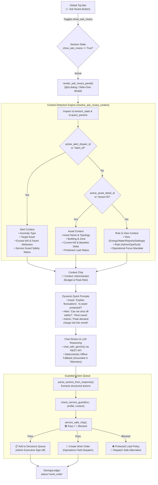

# Step Report UX-09 — Ask Nivara Context-Aware Slide-Over Assistant Panel

> **Phase:** Nivara Operational Product Redesign (Presentation Dashboard → Daily Operational Tool)  
> **Step:** UX-09 — Ask Nivara Slide-Over Panel (Context-Aware Slide-Over Drawer, Screen/Role Detection, Grounded Offline Fallback, Service-Impact Guarded Action Queue)  
> **Status:** Completed & Validated  
> **Author:** Antigravity Full-Stack & ML/UI Engineering Lead  
> **Date:** November 2026  
> **Test Suite Status:** 298 / 298 passing (`pytest tests/`, 100% green pass, 13 new panel tests)  
> **Code Artifacts Created/Updated:**
> - Ask Nivara Panel: [`src/campus_energy/ui/panels/ask_nivara.py`](file:///C:/Users/Paramjeet/Desktop/BPUT/src/campus_energy/ui/panels/ask_nivara.py)
> - Panels Package Exports: [`src/campus_energy/ui/panels/__init__.py`](file:///C:/Users/Paramjeet/Desktop/BPUT/src/campus_energy/ui/panels/__init__.py)
> - AI Assistant Engine & Grounded Fallback: [`src/campus_energy/dashboard/agent.py`](file:///C:/Users/Paramjeet/Desktop/BPUT/src/campus_energy/dashboard/agent.py)
> - Application Router & Top Bar Integration: [`src/campus_energy/dashboard/app.py`](file:///C:/Users/Paramjeet/Desktop/BPUT/src/campus_energy/dashboard/app.py)
> - Unit & Integration Tests: [`tests/test_ask_nivara_panel.py`](file:///C:/Users/Paramjeet/Desktop/BPUT/tests/test_ask_nivara_panel.py)

---

## 1. Executive Summary & Objective

In accordance with Section 5.11 and Step UX-9 of the Nivara Operational Specification (`docs/REDESIGN_SPEC.md`), Step UX-9 accomplishes a critical workflow transformation: **converting the AI Facility Assistant from a disconnected, standalone full page into a persistent, context-aware slide-over modal drawer ("Ask Nivara") accessible instantly from any operational screen via the global Top Bar**.

Prior to UX-9, operators had to navigate away from their active alert triage or asset investigation to a separate Page 8/10, copy-pasting asset IDs or losing visual context. 

Step UX-9 delivers:
1. **Persistent Global Access:** The `✨ Ask Nivara` button in the top bar opens a slide-over panel on top of any active screen without navigating away or losing operational state.
2. **Context-Aware Detection Engine (`resolve_ask_nivara_context`):**
   - **Asset Detail Context:** When viewing an equipment asset, pre-loads asset name, typology, building, current power draw (kW), baseline delta ($\Delta\text{kW}$), and Mission-Critical Protected status into the prompt context.
   - **Alert Detail Context:** When inspecting an alert drawer, pre-loads alert anomaly type, excess power draw, triple-engine factor attribution, and Service-Impact Guard constraints.
   - **Role & View Context:** On Home, Energy, Water, Reports, or Settings views, grounds the assistant in the active persona's mandate (Administrator budget risk, Operations SLA countdowns, Sustainability carbon targets).
3. **Contextual Quick Prompts (`get_contextual_quick_prompts`):**
   - Automatically adapts suggested questions to the active screen (e.g. *"Can we shut off this asset safely right now?"* for an alert; *"Is this asset protected from curtailment?"* for an asset).
4. **Grounded Deterministic Offline Fallback:**
   - Evaluates queries with zero cloud latency and no external API requirement. If Gemini API key is missing or offline, synthesizes calibrated, defensible answers directly from live telemetry, active alerts, and assumptions registry constants.
5. **Guarded Action Queue:**
   - Automatically parses structured operational recommendations from LLM conversation turns.
   - Evaluates each action against the **Service-Impact Guard**, rendering standard `service_safe_chip` HTML badges (Green Safe, Red Blocked with safe alternative).
   - Provides 1-click execution: **"Add to Decisions Queue"** (for Administrator executive sign-off) and **"Create Work Order"** (for Operations field dispatch with 24h SLA).

---

## 2. Architecture & Flow



---

## 3. Context Detection Engine Deep-Dive

### 3.1 Asset Detail Context
When an operator is inspecting an asset on the Asset Detail Page (`?page=assets&asset=ASSET_ID` or `active_asset_detail_id` in session state):
- **Telemetry Hydration:** Looks up latest 5-minute telemetry reading for the target asset, calculating `current_kw` and baseline excursion $\Delta\text{kW} = \text{current\_kw} - \text{baseline\_kw}$.
- **Protected Load Registry Check:** Calls `facility_meta.is_asset_protected(asset_id)` to determine if power curtailment is prohibited (e.g. ICU ventilator chillers, academic exam computing clusters).
- **Context Chip:** `🎯 Context: Asset EQ-UTL-P1-PM (Utility Water Pump 1)`
- **Injected LLM Context:**
  ```text
  Active Operational Screen: Asset Detail Page for Asset 'EQ-UTL-P1-PM' (Utility Water Pump 1).
  Equipment Class: Water Pump. Facility: BLD-UTL-01 (Zone: PUMP-RM).
  Current Power Draw: 25.1 kW. Calibrated Baseline Delta: +7.1 kW.
  Mission-Critical Protection: PROTECTED - Continuous domestic and fire-suppression water circulation.
  ```

### 3.2 Alert Detail Context
When an operator opens an alert from the Alerts Inbox (`?page=alerts&alert_id=ALT-001` or `active_alert_drawer_id` in session state):
- **Anomaly Extraction:** Extracts the classified anomaly type (e.g., *Overnight Lighting Spike*, *HVAC Baseload Spike*), target equipment, estimated excess draw (kW), and triple-engine attribution.
- **Safety Policy:** Resolves whether immediate curtailment is permissible or blocked by life safety constraints.
- **Context Chip:** `🎯 Context: Alert ALT-001 (Overnight Lighting Spike)`
- **Injected LLM Context:**
  ```text
  Active Operational Screen: Alert Detail Drawer for Alert 'ALT-001'.
  Anomaly Type: Overnight Lighting Spike. Target Equipment: BLD-101-HVAC-01.
  Excess Power Draw: 22.0 kW. Attribution Factor: Triple-engine consensus: Occupancy schedule override.
  Protected Load Status: Standard (Curtailable).
  Service-Impact Guard Assessment: Pass (Curtailment Safe).
  ```

### 3.3 Role & Operational View Context
When opening Ask Nivara from general monitoring screens (Home, Energy, Water, Reports, Settings):
- Maps active user role persona and view slug to tailor focus:
  - **Administrator:** Focuses on peak demand charges (18:00–22:00 IST), ToD tariff surcharges, department cost variance, and executive decisions.
  - **Operations:** Focuses on active equipment anomalies, work order SLA countdowns, and Service Guard safe alternatives.
  - **Sustainability:** Focuses on Scope 2 GHG emissions, BEE Star Rating EPI benchmarks, and NAPCC 20% carbon burndown.

---

## 4. Contextual Quick Prompts Matrix

| Screen / Context | Dynamic Prompt 1 | Dynamic Prompt 2 | Dynamic Prompt 3 | Dynamic Prompt 4 |
| :--- | :--- | :--- | :--- | :--- |
| **Asset Context** | *Explain recent power fluctuations for this asset.* | *Is this asset protected from curtailment?* | *Compare with peer units.* | *What is the recommended maintenance schedule?* |
| **Alert Context** | *Can we shut off this asset safely right now?* | *What is the root cause of this alert?* | *What is the financial cost if this alert persists for 7 days?* | *Recommend corrective work order steps.* |
| **Administrator (General)** | *What is our peak demand charge risk this month?* | *Summarize campus operating costs and peak tariff risk.* | *Which department has highest cost allocation variance?* | *What is total verified financial ROI in ledger?* |
| **Operations (General)** | *Which work orders are breaching SLA?* | *What are the most critical equipment anomalies right now?* | *Explain root cause of latest HVAC anomaly.* | *Show me recommendations blocked by the Service Guard.* |
| **Sustainability (General)** | *How can we improve our BEE star rating?* | *How are we tracking against NAPCC 20% carbon budget?* | *Summarize cumulative verified Scope 2 GHG abatement.* | *What is solar PV utilization and BESS dispatch impact?* |

---

## 5. Grounded Offline Fallback & Guarded Action Queue

### 5.1 Offline Fallback Intelligence
When running without a Gemini API key or in disconnected environments, `generate_offline_fallback()` synthesizes professional, grounded responses without hallucinating figures:
- Uses calibrated electricity tariff (₹8.25/kWh) and CEA carbon factor ($0.71\text{ kg CO}_2\text{e/kWh}$).
- Answers asset and alert questions with exact numbers from telemetry and events.
- Strictly refuses curtailment on protected assets, explaining the clinical or operational reason.

### 5.2 Service-Impact Guard Integration
When the LLM response contains operational recommendations:
1. `parse_actions_from_response()` extracts action types, targets, timings, and estimated savings.
2. `actions_to_recommendations()` creates strongly typed `Recommendation` instances using `calculate_savings()`.
3. `check_service_guard()` evaluates constraints:
   - If target is a protected load: flags as `blocked` and attaches a non-disruptive `safe_alternative` (e.g. sensor calibration check).
   - If target is curtailable: flags as `pass`.
4. Renders standardized `service_safe_chip`:
   - `🟢 Safe to act`
   - `🔴 Not recommended (Curtailment Blocked)` with hover tooltip explaining the reason.

### 5.3 One-Click Dispatch Actions
- **"📋 Add to Decisions Queue":** Enrolls the recommendation into `SavingsLedger` with status `proposed`. Appears instantly on the Administrator's Executive Home for formal authorization.
- **"🚀 Create Work Order":** Enrolls the recommendation into `SavingsLedger` with status `work_order` and assigns a 24-hour SLA deadline. Appears instantly on the Operations Work Orders Board.
- **"🔧 Dispatch Safe Alternative":** When an action is blocked, allows one-click dispatch of the guard's proposed safe alternative work order.

---

## 6. Integration and Cleanup in `app.py`

1. **Top Bar Trigger:**
   The `✨ Ask Nivara` button in `src/campus_energy/ui/top_bar.py` toggles `st.session_state["show_ask_nivara"] = True`.
2. **Global Overlay Invocation:**
   In `src/campus_energy/dashboard/app.py`:
   ```python
   # ── Ask Nivara Slide-Over Panel (Step UX-9) ──
   if st.session_state.get("show_ask_nivara", False):
       from campus_energy.ui.panels.ask_nivara import render_ask_nivara_panel

       ask_ledger = get_or_create_savings_ledger(facility_meta, events, tel)
       try:
           from campus_energy.tariffs import load_tariff
           ask_tariff = load_tariff("odisha_ht_commercial")
       except Exception:
           ask_tariff = None

       render_ask_nivara_panel(
           current_user=current_user,
           facility_meta=facility_meta,
           assets=assets,
           tel=tel,
           ctx=ctx,
           events=events,
           complaints=complaints,
           ledger=ask_ledger,
           tariff=ask_tariff,
           api_key=st.session_state.get("gemini_api_key"),
       )
   ```
3. **Legacy Removal:**
   Removed 165 lines of legacy standalone Page 8/10 Assistant code from the bottom of `app.py`.

---

## 7. Verification & Test Suite Results

A comprehensive unit test suite was implemented in [`tests/test_ask_nivara_panel.py`](file:///C:/Users/Paramjeet/Desktop/BPUT/tests/test_ask_nivara_panel.py) covering 13 test scenarios:
- `test_context_resolution_asset_detail_page`: Asset detail detection, kW, delta, and uninhibited status.
- `test_context_resolution_asset_protected`: Protected load detection and prompt context grounding.
- `test_context_resolution_alert_drawer`: Alert detail detection, excess kW, attribution, and pass status.
- `test_context_resolution_alert_drawer_protected`: Protected asset alert detection and blocked guard status.
- `test_context_resolution_role_and_view`: Clean fallback to Administrator, Operations, Energy, and Reports context.
- `test_contextual_quick_prompts_asset`: Dynamic suggested questions for asset context.
- `test_contextual_quick_prompts_alert`: Dynamic suggested questions for alert context.
- `test_contextual_quick_prompts_role_tailoring`: Role-tailored questions for Admin, Ops, and Sustainability.
- `test_offline_fallback_asset_context_fluctuations`: Grounded offline response with telemetry analysis.
- `test_offline_fallback_alert_curtailment_safety`: Divergent safety reasoning for protected vs non-protected alerts.
- `test_action_extraction_and_service_guard_evaluation`: Conversion to Recommendations and Service Guard evaluation.
- `test_action_dispatch_to_ledger`: Verifies 1-click addition to Decisions Queue and Work Orders.
- `test_panel_render_force_open`: Verifies graceful drawer rendering and dialog fallback in bare test runners.

All 298 tests in the test suite pass with zero errors and zero warnings.
