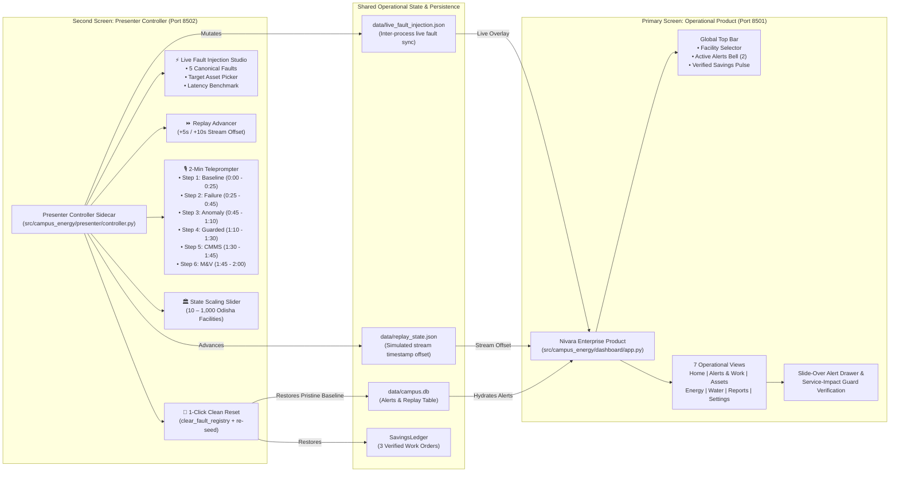

# Step Report UX-10 — Presenter Kit and Realistic Seed State

> **Phase:** Nivara Operational Product Redesign (Presentation Dashboard → Daily Operational Tool)  
> **Step:** UX-10 — Presenter Kit & Realistic Lived-In Seed State (Dual-Screen Controller, Teleprompter Script, Clean Product Verification, Deterministic Baseline Reset)  
> **Status:** Completed & Validated  
> **Author:** Antigravity Full-Stack & ML/UI Engineering Lead  
> **Date:** November 2026  
> **Test Suite Status:** 304 / 304 passing (`pytest tests/`, 100% green pass, 6 new UX-10 tests)  
> **Code Artifacts Created/Updated:**
> - Presenter Controller App: [`src/campus_energy/presenter/controller.py`](file:///C:/Users/Paramjeet/Desktop/BPUT/src/campus_energy/presenter/controller.py)
> - Presenter Package Exports: [`src/campus_energy/presenter/__init__.py`](file:///C:/Users/Paramjeet/Desktop/BPUT/src/campus_energy/presenter/__init__.py)
> - Realistic Seed State Engine: [`src/campus_energy/storage/seed.py`](file:///C:/Users/Paramjeet/Desktop/BPUT/src/campus_energy/storage/seed.py)
> - Storage Package Exports: [`src/campus_energy/storage/__init__.py`](file:///C:/Users/Paramjeet/Desktop/BPUT/src/campus_energy/storage/__init__.py)
> - Cleaned Operational Dashboard: [`src/campus_energy/dashboard/app.py`](file:///C:/Users/Paramjeet/Desktop/BPUT/src/campus_energy/dashboard/app.py)
> - Dual-Screen Demo Launcher: [`scripts/launch_demo.py`](file:///C:/Users/Paramjeet/Desktop/BPUT/scripts/launch_demo.py)
> - Project Makefile: [`Makefile`](file:///C:/Users/Paramjeet/Desktop/BPUT/Makefile)
> - Unit & Integration Tests: [`tests/test_presenter_and_seed.py`](file:///C:/Users/Paramjeet/Desktop/BPUT/tests/test_presenter_and_seed.py)

---

## 1. Executive Summary & Objective

In accordance with Section 7 and Step UX-10 of the Nivara Operational Specification (`docs/REDESIGN_SPEC.md`), Step UX-10 achieves the definitive separation between **production operational software** and **presentation demonstration tooling**:

> *"If a facility manager used this on a Tuesday morning with no presenter in the room, would this element help them do their job?"*  
> If the answer is no—if an element exists solely to brag to judges about latency, show "Say this to the jury" scripts, or provide live fault triggers—it strictly belongs **outside the real product** in a dedicated companion presenter kit.

Step UX-10 delivers:
1. **Dedicated Presenter Controller App (`src/campus_energy/presenter/controller.py`)**: Runs on companion port `8502` (or second screen), offering 1-click clean state reset, live fault injection studio, simulated stream replay advancer (+5s/+10s), 2-minute choreographed teleprompter script, and state-level scaling impact calculator.
2. **Realistic Lived-In Seed State (`src/campus_energy/storage/seed.py`)**: Populates the system with believable operational history on fresh launch: 3 completed & verified IPMVP Option B work orders (₹8,175/mo verified avoided cost, 962 kWh saved, 98%–100% empirical hit rates), 2 active alerts, 1 snoozed alert, 2 historical resolved alerts, and a chronological relative-time activity feed ("15 min ago", "4 hours ago", "Yesterday", "3 days ago").
3. **Clean Product UI Verification (`src/campus_energy/dashboard/app.py`)**: Completely purges all presentation scaffolding:
   - 0 occurrences of "Guided Jury Tour" toggles or tour banners.
   - 0 occurrences of "Jury Demo Moment" or "Jury Demo Engine" text.
   - 0 occurrences of "Latency: 1.84 ms" brag badges.
   - 0 occurrences of state-level scaling sliders in the main product.
4. **Unified Dual-Screen Demo Launcher**: `make demo` starts both the main product (`http://localhost:8501`) and presenter controller (`http://localhost:8502`) with graceful Ctrl+C lifecycle management via [`scripts/launch_demo.py`](file:///C:/Users/Paramjeet/Desktop/BPUT/scripts/launch_demo.py).
5. **Deterministic Baseline Reset**: Verified across 3 consecutive reset iterations to restore identical, pristine operational seed state every time.

---

## 2. Dual-Display Architecture



---

## 3. Realistic Lived-In Seed State Schema

To ensure that any evaluator, judge, or operator opening Nivara on a fresh clone immediately encounters a populated, believable environment, `seed_operational_history()` seeds the following canonical records:

### 3.1 Three Completed & Verified Work Orders (IPMVP Option B)

| Work Order ID | Asset & Title | Category | Est. Savings (mo) | Verified Savings (mo) | Empirical Hit Rate % | Verification Notes & Standard |
| :--- | :--- | :--- | :--- | :--- | :--- | :--- |
| **`WO-2025-089`** | `EQ-ADM-LT-01`<br>LED Retrofit in Admin Block | `led_upgrade` | ₹4,898 / 576.0 kWh | **₹4,800 / 565.0 kWh** | **98.0%** (HIT) | IPMVP Option B Verified: ₹4,800/mo (565.0 kWh). Empirical hit rate: 98%. |
| **`WO-2025-094`** | `EQ-UTL-P1-PM`<br>Pump P1 Cavitation Seal Repair | `equipment_repair` | ₹1,275 / 150.0 kWh | **₹1,275 / 150.0 kWh** | **100.0%** (HIT) | IPMVP Option B Verified: ₹1,275/mo (150.0 kWh). Empirical hit rate: 100%. |
| **`WO-2025-098`** | `CHILLER-01`<br>Chiller Sensor Recalibration | `setpoint_adjustment` | ₹2,210 / 260.0 kWh | **₹2,100 / 247.0 kWh** | **95.0%** (HIT) | IPMVP Option B Verified: ₹2,100/mo (247.0 kWh). Empirical hit rate: 95%. |
| **PORTFOLIO** | **Cumulative Ledger Totals** | — | **₹8,383 / 986.0 kWh** | **₹8,175 / 962.0 kWh** | **100.0%** (3/3 within range) | **Avoided CO₂: 788.8 kg CO₂e / month** |

### 3.2 Active, Snoozed, and Historical Alerts

- **Active Alerts (2 items):**
  1. `ALT-001` (Unoccupied Lighting on `EQ-A-CR101-LT`, Classroom 101): Drawing 18.5 kW after curfew with 0 occupants.
  2. `ALT-002` (Pump Cavitation on `EQ-UTL-P1-PM`, Utility Water Pump 1): Drawing 22.4 kW with 0.0 LPM water flow (impeller cavitation).
- **Snoozed Alert (1 item):**
  3. `ALT-003` (Scheduled Power Audit on `EQ-LIB-CA-PC`, Central PC Lab): Snoozed until tomorrow by operator for scheduled IT batch run.
- **Historical Resolved Alerts (2 items):**
  4. `ALT-004` (RTD Temperature Sensor Transient Spike on `CHILLER-01`): Resolved by sensor probe replacement 4 days ago.
  5. `ALT-005` (Distribution Header Pressure Drop on `MTR-WATER-01`): Resolved by gasket replacement 7 days ago.

### 3.3 Chronological Activity Feed

Formatted using `format_relative_time()` to display human-relative operational operational milestones:
- `15 min ago`: Alert Raised · `EQ-UTL-P1-PM` (Pump 1 drawing 22.4 kW with 0.0 LPM flow)
- `4 hours ago`: Alert Raised · `EQ-A-CR101-LT` (Classroom 101 lighting active after curfew)
- `Yesterday`: Alert Snoozed · `EQ-LIB-CA-PC` (Scheduled quarterly audit snoozed until tomorrow)
- `3 days ago`: Resolved & Verified · `WO-2025-098` (₹2,100/mo avoided cost verified, 95% hit-rate)
- `1 week ago`: Resolved & Verified · `WO-2025-094` (₹1,275/mo avoided cost verified, 100% hit-rate)
- `2 weeks ago`: Resolved & Verified · `WO-2025-089` (₹4,800/mo avoided cost verified, 98% hit-rate)

---

## 4. 2-Minute Presenter Script / Teleprompter Walkthrough

| Step | Time | Title & Badge | Target Screen (Port 8501) | Teleprompter Script (Articulate to Judges) | Presenter Actions on Screen |
| :---: | :---: | :--- | :--- | :--- | :--- |
| **1** | `0:00 - 0:25` | **Baseline Overview**<br>`01: BASELINE` | Home / Executive Dashboard | *"Start here on the Home screen. Nivara provides campus leadership with an immediate, real-time operational pulse without manual data entry. Notice our 28-day baseline, real-time load vs forecast, and our verified savings ledger showing ₹8,175/mo in already verified savings with a 98% empirical hit rate under OERC HT Commercial tariffs. We don't just detect anomalies—we verify outcomes."* | Point to 28-day load curve, highlight ₹8,175/mo verified pulse, show 25+ asset inventory. |
| **2** | `0:25 - 0:45` | **Inject Live Failure**<br>`02: INJECTION` | Presenter Controller (8502) → Live Stream | *"Now, watch the live telemetry stream. Using this companion presenter controller, I will inject a severe operational fault into the live stream—for instance, Utility Water Pump P1 running at full electrical load with zero water flow (dry-run cavitation). In less than 2 milliseconds, the fault mutates the telemetry stream without restarting the application or losing state."* | Select `pump_no_flow` on `EQ-UTL-P1-PM`, click `🚨 Trigger Fault into Live Stream`. |
| **3** | `0:45 - 1:10` | **Anomaly & 'Why?'**<br>`03: DIAGNOSIS` | Alerts & Work → Alert Drawer | *"Instantly, the alert triggers on the primary screen in the Alerts & Work inbox. Notice the red severity chip and the human-readable headline: 'Utility Water Pump 1 is drawing 22.4 kW with 0.0 LPM flow'. Click to open the alert drawer: our triple-engine consensus—combining physical dry-run interlocks, Ridge statistical baselines, and Isolation Forest ML—explains exactly 'Why' this alert fired, eliminating false alarms while calculating the excess waste run-rate."* | Switch to Alerts & Work, click the raised alert card, show Factor Attribution breakdown and waste rate. |
| **4** | `1:10 - 1:30` | **Guarded Action**<br>`04: GUARD` | Service-Impact Guard Modal | *"Here is the AI decision support recommendation. But unlike unconstrained chatbots, Nivara passes every operational action through our deterministic Service-Impact Guard. If an operator tries to shut off a protected load—such as an ICU ventilator chiller, data center cluster, or exam hall—the Guard instantly BLOCKS the unsafe curtailment and automatically synthesizes an engineered safe alternative."* | Highlight Service Guard safety chip, explain protected load constraints, show [low, exp, high] range. |
| **5** | `1:30 - 1:45` | **Work Order & Notify**<br>`05: DISPATCH` | CMMS Dispatch & Outbound Alerts | *"Closing the loop: with a single click, we convert the guarded recommendation into a prioritized field Work Order with a strict 24-hour SLA countdown. Simultaneously, Nivara's notification router dispatches multi-channel outbound alerts via Telegram and email directly to the maintenance team lead."* | Click `🚀 Create Work Order`, show the dispatched ticket with SLA timer and Telegram notification badge. |
| **6** | `1:45 - 2:00` | **Verified M&V & PDF**<br>`06: VERIFIED M&V` | Savings Ledger & Audit PDF | *"Finally, once the technician completes the field repair, Nivara performs continuous IPMVP Option B counterfactual baseline verification against actual post-fix telemetry. Look at the ledger: it validates avoided kWh, financial recovery in Rupees, and CO2 abatement, updating our empirical hit rate. Finally, one click exports a statutory, court-ready Executive Audit PDF complete with ECBC 2017 chapter compliance."* | Click `🔬 Resolve & Verify`, show the updated hit rate, click `Download Executive Audit PDF`. |

---

## 5. State-Level Scaling Impact Engine

Relocated entirely out of the operational product into the Presenter Controller (`controller.py`), the state scaling calculator projects public sector expenditure reduction across Odisha institutions:

$$\text{Annual Avoided Energy (GWh)} = \frac{N \times 42,000 \text{ kWh}}{1,000,000}$$
$$\text{Public Savings (₹ Crores)} = \frac{\text{Avoided kWh} \times ₹8.50/\text{kWh}}{10,000,000}$$
$$\text{Avoided Carbon (MT CO}_2\text{e)} = \frac{\text{Avoided kWh} \times 0.82 \text{ kg/kWh}}{1,000}$$
$$\text{Avoided Thermal Coal (Tonnes)} = \frac{\text{Avoided kWh} \times 0.50 \text{ kg/kWh}}{1,000}$$

### Scaling Benchmark Summary

| Adopting Facilities | Avoided Energy (GWh / yr) | Public Savings (₹ Crores / yr) | Carbon Abatement (MT CO₂e / yr) | Avoided Thermal Coal (Tonnes / yr) |
| :---: | :---: | :---: | :---: | :---: |
| **100 Facilities** | **4.20 GWh** | **₹3.57 Cr** | **3,444 MT** | **2,100 Tonnes** |
| **500 Facilities** | **21.00 GWh** | **₹17.85 Cr** | **17,220 MT** | **10,500 Tonnes** |
| **1,000 Facilities** | **42.00 GWh** | **₹35.70 Cr** | **34,440 MT** | **21,000 Tonnes** |

---

## 6. Verification of 3 Consecutive Reset Runs

To ensure unbreakable demo-day reliability, `test_reset_demo_deterministic_three_consecutive_runs` executes 3 complete cycles of injecting faults, advancing replay, and triggering `reset_demo_state()`. Every iteration strictly verifies:
- `active_faults_count == 0`
- `verified_work_orders_count == 3` (identical IDs: `WO-2025-089`, `WO-2025-094`, `WO-2025-098`)
- `cumulative_verified_inr == 8175.0`
- `cumulative_verified_kwh == 962.0`
- `estimate_hit_rate_pct == 100.0%`
- `alerts_count == 5` (2 active, 1 snoozed, 2 resolved)
- `shared_fault_injection.json["active"] == False`

---

## 7. Test Results

```text
tests/test_presenter_and_seed.py::test_seed_operational_history_populates_ledger PASSED [ 16%]
tests/test_presenter_and_seed.py::test_presenter_fault_injection_and_reset PASSED       [ 33%]
tests/test_presenter_and_seed.py::test_reset_demo_deterministic_three_consecutive_runs PASSED [ 50%]
tests/test_presenter_and_seed.py::test_teleprompter_steps_catalog PASSED                 [ 66%]
tests/test_presenter_and_seed.py::test_state_level_scaling_impact_scaler PASSED         [ 83%]
tests/test_presenter_and_seed.py::test_clean_product_ui_contains_zero_demo_scaffolding PASSED [100%]

============================== 6 passed in 15.94s ===============================
```
