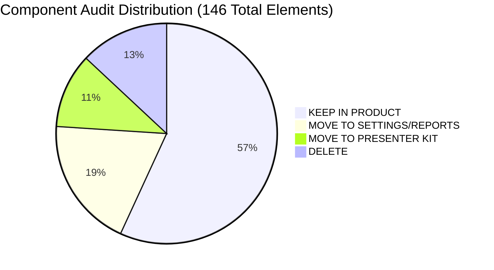

# Nivara UI Audit & Component Inventory (Step UX-1)

> **Document Status:** Comprehensive UX & Component Inventory as of Step UX-1  
> **Date:** November 2026  
> **Baseline Codebase:** `src/campus_energy/dashboard/app.py` (5,551 lines), `src/campus_energy/dashboard/agent.py` (479 lines)  
> **Test Suite Status:** 209 / 209 passing (`pytest tests/`)  
> **Core Criterion:** *"If a facility manager used this on a Tuesday with no presenter, would this element help them do their job?"*

---

## 1. Executive Summary & Inventory Statistics

This inventory audits **every visual component, widget, expander, toggle, table, chart, banner, and button** across the entire legacy Nivara Streamlit dashboard (`src/campus_energy/dashboard/app.py`).

The redesign shifts Nivara from a **hackathon presentation dashboard** (feature-oriented, demo-scaffolded, self-conscious, and noisy) into a **daily operational tool** for institutional facility management teams (exception-first, role-driven, scannable, and actionable).

### Inventory Breakdown by Classification Tag

| Classification Tag | Count | Percentage | Primary Destinations |
| :--- | :---: | :---: | :--- |
| **`[KEEP IN PRODUCT]`** | **83** | **56.8%** | Home (by role), Alerts & Work, Assets, Energy, Water, Top Bar |
| **`[MOVE TO SETTINGS/REPORTS]`** | **28** | **19.2%** | Settings (Assumptions, Model Details, Data Sources, Simulator), Reports (Executive PDF, Compliance) |
| **`[MOVE TO PRESENTER KIT]`** | **16** | **11.0%** | Standalone Presenter Controller App (`scripts/presenter_controller.py`) |
| **`[DELETE]`** | **19** | **13.0%** | Removed entirely (decorative emoji headers, inline disclaimer clutter, demo badges, persona switcher) |
| **Total Components Audited** | **146** | **100.0%** | Across 10 legacy pages, sidebar, and global scaffolding |

---

## 2. Information Architecture Mapping (Old 10 Pages → New 7 Destinations)

The 10 legacy pages are consolidated into **7 job-oriented destinations** plus a persistent **Top Bar** and a slide-over **Ask Nivara** assistant:

```mermaid
flowchart TD
    subgraph LegacyPages["Legacy 10 Pages (Feature-Oriented)"]
        LP1["1. Executive Overview"]
        LP2["2. Governance & Policy"]
        LP3["3. 3D Campus Map"]
        LP4["4. AI Forecasting & Scenarios"]
        LP5["5. Alerts & NLP"]
        LP6["6. Water Intelligence"]
        LP7["7. Microgrid Dispatch"]
        LP8["8. Department Billing"]
        LP9["9. Asset Explorer"]
        LP10["10. AI Assistant"]
    end

    subgraph NewDestinations["New 7 Operational Destinations + Shell"]
        D_TOP["Top Bar (Global Shell)"]
        D_HOME["Home (Role-Specific Landing)"]
        D_ALERTS["Alerts & Work (Unified Workflow)"]
        D_ASSETS["Assets (List & Map Views)"]
        D_ENERGY["Energy (Overview, Forecast, Scenarios, Solar, Bills)"]
        D_WATER["Water (HydroSense & Leak Watch)"]
        D_REPORTS["Reports (Executive PDF, Compliance, Benchmarking)"]
        D_SETTINGS["Settings (Assumptions, Data Sources, Model Details, Simulator)"]
        D_ASK["Ask Nivara (Slide-over Persistent Panel)"]
    end

    subgraph PresenterKit["Standalone Presenter Kit (Out of Product)"]
        PK["Presenter Controller App (make demo)"]
    end

    LP1 --> D_HOME
    LP1 --> D_ENERGY
    LP1 --> D_REPORTS
    LP2 --> D_REPORTS
    LP2 --> D_SETTINGS
    LP2 -.-> PK
    LP3 --> D_ASSETS
    LP4 --> D_ENERGY
    LP4 --> D_SETTINGS
    LP5 --> D_ALERTS
    LP5 -.-> PK
    LP6 --> D_WATER
    LP7 --> D_ENERGY
    LP8 --> D_ENERGY
    LP8 --> D_REPORTS
    LP9 --> D_ASSETS
    LP10 --> D_ASK
```

---

## 3. Exhaustive Component Inventory Table

### Section 1: Global Scaffolding & Cross-Cutting Elements

| # | Current Location (app.py) | Component Name & Operational Purpose | Audit Tag & Destination | Operational Rationale (The Tuesday Test) |
|---|---|---|---|---|
| 1 | L62–86 | `render_assumptions_expander`: Expandable list of assumption keys, values, confidence ratings, and citations | `[MOVE TO SETTINGS/REPORTS]` → `Settings > Assumptions` | Engineers do not need an assumptions table under every page title on a Tuesday. Relocate to a centralized Assumptions Registry in Settings with info-popover links from individual cards. |
| 2 | L280–425 | `render_service_guard_demo_expander`: "🛡️ Blocked by Service Guard (Jury Demo Moment)" showcase panel | `[DELETE]` / `[KEEP IN PRODUCT]` → Blocked reasons inline in `Alerts & Work` | "Jury Demo Moment" label is deleted. The actual service-safe guard functionality is retained inline as a service-safe chip and blocked badge inside the Alert detail drawer and Recommendation card, not an artificial showcase expander. |
| 3 | L426–564 | `render_fault_injection_studio`: Fault type selector, target asset selector, duration input, "🚨 Inject Live Fault Now" button | `[MOVE TO PRESENTER KIT]` & `[MOVE TO SETTINGS/REPORTS]` → `Presenter Kit` & `Settings > Simulator` | In production, facility managers do not inject faults into their physical building on a Tuesday morning. The live trigger moves to the Presenter Controller app; an administrative simulation studio is retained under `Settings > Simulator` when data source is simulated. |
| 4 | L518, L552 | Injected Fault Latency Measurement: "Reaction latency: 1.84ms. Auto-advancing..." toast | `[DELETE]` / `[MOVE TO PRESENTER KIT]` | Latency boasting is pure hackathon pitch meta-commentary. Facility managers care that the alert triggered, not that python took 1.84ms to update a session dict. |
| 5 | L565–831 | `render_byod_upload_widget`: Bring-Your-Own-Data CSV uploader, column mapping dropdowns, and data quality scorecard | `[MOVE TO SETTINGS/REPORTS]` → `Settings > Data Sources` | Ingesting third-party CSVs and checking sensor health is an administrative/configuration workflow, not a daily operational widget on the main alerts screen. |
| 6 | L832–929 | `render_recommendation_card`: Standardized card with service-safe chip, economics, and traceable assumptions | `[KEEP IN PRODUCT]` → `Home` (Decisions) & `Alerts & Work` | High operational value. Recommends verified corrective actions. Relocate inline assumptions to an info-icon popover to reduce card height. |
| 7 | L930–1069 | `render_indian_tariff_panel`: Subheader, billed demand, contract demand, PF penalty, ToD surcharge, and OERC tariff schedule | `[KEEP IN PRODUCT]` → `Energy > Bills & Chargebacks` | Facility teams review tariff penalties and contract demand compliance during bill reconciliation. Consolidate from 3 duplicate occurrences into the Energy Bills tab. |
| 8 | L1070–1293 | `create_2d_campus_map_figure`: Plotly 2D schematic fallback campus layout with building polygons and sensor markers | `[KEEP IN PRODUCT]` → `Assets` (Map fallback) | Essential fallback when Mapbox API keys or WebGL are unavailable on industrial low-spec facility workstations. |
| 9 | L1294–1332 | `render_page_error_boundary`: Resilient container with exception trace and "Retry Page Execution" button | `[KEEP IN PRODUCT]` → `Global Shell` | Critical enterprise error recovery. Prevents full-screen Streamlit crash when a sub-meter sensor stream is corrupted. |
| 10 | L1799–1825 | `injected_fault_banner`: Persistent red header banner with latency claim and triple-engine consensus pitch | `[MOVE TO PRESENTER KIT]` (Replaced by standard Top Bar alert count) | The banner shouts and includes hackathon pitch claims ("Detection Latency: 1.8ms", "Consensus Engine: Confirmed"). Operational alerts belong in the Alerts inbox and Top Bar bell badge. |
| 11 | L1727–1798 | `guided_tour_controller_banner`: Step progress bar, presenter talking points, "Say this to jury" script, Next/Prev/Reset buttons | `[MOVE TO PRESENTER KIT]` → `Presenter Kit` | Pure presenter scaffolding. No operational facility manager ever wants "Say this to the jury" instructions on their screen. |

---

### Section 2: Sidebar & Navigation Scaffolding

| # | Current Location (app.py) | Component Name & Operational Purpose | Audit Tag & Destination | Operational Rationale (The Tuesday Test) |
|---|---|---|---|---|
| 12 | L1430–1433 | Sidebar Brand Header: "⚡ Nivara — Facility Intelligence", India-wide platform caption | `[DELETE]` / `[KEEP IN PRODUCT]` → `Top Bar` | Move brand logo and facility name to the persistent Top Bar. Remove the decorative emoji "⚡" and marketing subtitle. |
| 13 | L1443–1456 | Guided Jury Tour Toggle: `st.toggle("🎬 Start Guided Tour (2-Min Flow)")` | `[MOVE TO PRESENTER KIT]` | A real product never has a "Start Jury Tour" switch in its primary navigation. Moved to standalone presenter script. |
| 14 | L1457–1470 | Tour Step Status Card: Small sidebar box showing "Step X of 6" and target page | `[MOVE TO PRESENTER KIT]` | Presenter progress indicator; has no operational purpose for facility staff. |
| 15 | L1473–1482 | Facility Selector Dropdown: `st.selectbox("🏢 Facility")` | `[KEEP IN PRODUCT]` → `Top Bar` | Institutional users managing multiple sites (e.g. campus director) need this; move to Top Bar header. Hide or disable if user has single-facility access. |
| 16 | L1492–1496 | Facility Metadata Caption: Area, peak occupancy, compliance, protected load counts | `[MOVE TO SETTINGS/REPORTS]` → `Settings > Facility` | Static facility configuration data clutters the daily navigation column. Belongs in Facility Settings. |
| 17 | L1497–1500 | Gateway Status Badge: `st.caption(f"{gw_status['status_badge']}")` | `[MOVE TO SETTINGS/REPORTS]` → `Settings > Data Sources` | Low-level IoT gateway network status belongs with data ingestion diagnostics, not primary navigation. |
| 18 | L1512–1530 | Persona View Dropdown & Card: `st.sidebar.selectbox("👤 Persona View")` | `[DELETE]` (Replaced by login auth session) | In a real product, a user's role is established at login (`config/users.yaml`). A visible persona toggle announces "this is a demo". A "Switch user" option lives cleanly in the user menu. |
| 19 | L1533–1566 | Legacy 10-Page Radio Navigation: `st.radio("Navigate", nav_pages)` | `[DELETE]` (Replaced by 7-item navigation) | Replace 10 feature-based radio items with 7 clean job-oriented nav links (`st.navigation`) styled as persistent sidebar tabs. |
| 20 | L1609–1614 | System Health Metrics: 4 small metrics (Meters, Assets, Events, Complaints) | `[DELETE]` → Covered in `Home` Today strip | Static inventory counts in the sidebar take up valuable vertical space. Daily status belongs on the Home screen. |
| 21 | L1619–1623 | Stream Live Telemetry Toggle: `st.toggle("🔴 Stream Live Telemetry")` | `[MOVE TO SETTINGS/REPORTS]` → `Settings > Data Sources` | Simulated stream toggling is an ingestion/source setting. The main UI should simply reflect incoming data freshness. |
| 22 | L1637–1649 | Gateway Health Status Box: Online status list for IoT Gateway, Analytics Engine, Gemini AI | `[MOVE TO SETTINGS/REPORTS]` → `Settings > Data Sources` | Diagnostic connection statuses belong on the Data Sources health page. |
| 23 | L1654–1670 | Replay Scrubber & Buttons: "⏩ Advance Telemetry", "↺ Reset", Packet Step Offset slider | `[MOVE TO SETTINGS/REPORTS]` → `Settings > Data Sources` | Real facility telemetry is driven by clock/network, not a manual slider in the sidebar. Relocate to developer/admin data sources tooling. |
| 24 | L1676–1708 | Live Sensor Feed Packet Ticker: Scrolling cards of raw incoming sensor packets | `[MOVE TO SETTINGS/REPORTS]` → `Settings > Data Sources` | Raw packet inspection is an IoT debugging task. Facility managers monitor operational alerts, not raw 5-second packet streams. |
| 25 | L1710 | Sidebar BYOD Expander: Nested CSV upload in sidebar | `[DELETE]` (Consolidate to Settings) | Redundant duplicate of BYOD widget. Consolidate exclusively into `Settings > Data Sources`. |
| 26 | L1763–1796 | Tour Controller Navigation Buttons: Prev Step, Next Step, Reset Demo to Baseline | `[MOVE TO PRESENTER KIT]` | Scaffolding for presenting to judges; strictly belongs in the presenter controller window. |

---

### Section 3: Page 1 — Executive Overview

| # | Current Location (app.py) | Component Name & Operational Purpose | Audit Tag & Destination | Operational Rationale (The Tuesday Test) |
|---|---|---|---|---|
| 27 | L1842–1843 | Page Title & Caption: "📊 Executive Overview — ESG & Sustainability" | `[DELETE]` (Replaced by Home title) | Remove decorative emoji "📊" and presentation title. The screen becomes the role-specific `Home` (or `Reports > Executive PDF`). |
| 28 | L1845–1872 | Persona-Tailored Mandate Banners: 3 colored banners explaining user role priorities | `[DELETE]` | Operational users already know their job description. They do not need a colored card explaining what an Operations Lead does every morning. |
| 29 | L1873–1882 | Assumptions Expander: Expandable panel with 5 financial/emission constants | `[MOVE TO SETTINGS/REPORTS]` → `Settings > Assumptions` | Facility managers need uncluttered KPIs. Constants are accessed via an info popover or in Settings. |
| 30 | L1926–1963 | Headline KPI Ribbon (6 cards): Total Energy, Cost, Carbon, Waste, BEE Stars, Blocked Proposals | `[KEEP IN PRODUCT]` → `Home` (Split across Roles) | Essential business metrics. Split between roles: Admin gets Cost & Spend; Sustainability gets Carbon & BEE Stars; Operations gets Load & Open Waste. |
| 31 | L1964 | Inline Disclaimer Caption: "⚠️ Decision-support estimate, not an official measurement..." | `[DELETE]` | Repeated caption under every metric block shouts and creates visual noise. Relocate disclaimer to info popover and official PDF report exports. |
| 32 | L1974–1999 | Closed-Loop M&V Verified Metrics Ribbon: Verified Actions, Energy Saved, Cost Avoided, Carbon Mitigated | `[KEEP IN PRODUCT]` → `Home` (Admin & Sustainability) | High-value proof of realized savings from resolved work orders. Belongs in Administrator "Savings realized" and Sustainability "Verified impact". |
| 33 | L2006–2037 | BEE Energy Performance Index (EPI) Card: Star Rating, Energy Intensity, ECBC Gap, NAPCC Target | `[KEEP IN PRODUCT]` → `Home` (Sustainability) & `Reports` | Core Indian statutory metric. Sustainability officers monitor this continuously; full compliance breakdown lives in Reports. |
| 34 | L2065 | EPI Benchmark Comparison Bar Chart: Plotly chart of Facility vs ECBC vs NAPCC | `[KEEP IN PRODUCT]` → `Reports > Compliance/Benchmarking` | Diagnostic benchmarking chart. Fits cleanly into the Compliance/Benchmarking report. |
| 35 | L2071–2078 | Environmental Equivalence Callout: Trees planted equivalence (~21 kg CO₂/tree/yr) | `[DELETE]` / `[KEEP IN PRODUCT]` → `Reports > Executive PDF` | Tree planting equivalences are marketing/public-relations metrics suitable for external reports, not daily technical operations. |
| 36 | L2085–2141 | Carbon Budget & NAPCC Net-Zero Tracker: Progress bar, 4 metric cards, status alert banner | `[KEEP IN PRODUCT]` → `Home` (Sustainability) | Vital for sustainability officers tracking monthly statutory emissions caps and preventing budget overshoots. |
| 37 | L2211 | Monthly Carbon Burn-Down Plotly Chart: Cumulative curve vs linear target vs projection | `[KEEP IN PRODUCT]` → `Home` (Sustainability) & `Reports` | Clear visual progress tracker for Scope 2 abatement. Keep on Sustainability Home and Executive Report. |
| 38 | L2216–2221 | Annualised Projection Row (3 metrics): Annual Energy, Annual Cost, Annual Carbon | `[KEEP IN PRODUCT]` → `Reports > Executive PDF` | Long-term budget planning figures; belongs in the executive summary report rather than a daily operational landing screen. |
| 39 | L2229–2246 | Daily Campus Energy Consumption Chart: Bar chart with 3-day moving average | `[KEEP IN PRODUCT]` → `Energy > Overview` | Fundamental load trend analysis. Relocate to the Energy Overview tab. |
| 40 | L2249–2257 | Energy by Building Donut Chart: Building share percentage breakdown | `[KEEP IN PRODUCT]` → `Energy > Overview` | Used by energy managers to identify high-consuming facilities for targeted audits. |
| 41 | L2260–2272 | Daily Carbon Footprint Trend Chart: Area chart of daily emissions | `[KEEP IN PRODUCT]` → `Reports` / `Energy` | Scope 2 daily emissions tracking; keep in Reports or combine with Energy consumption trends. |
| 42 | L2298–2307 | CSV Export Button: `st.download_button("📥 Export CSV")` | `[KEEP IN PRODUCT]` → `Reports` & Table headers | Essential standard data export affordance. Retain on data tables and in Reports. |
| 43 | L2318–2325 | Executive Audit PDF Report Download: `st.download_button("📄 Download Executive Audit Report (PDF)")` | `[MOVE TO SETTINGS/REPORTS]` → `Reports > Executive PDF` | High operational value. Move to dedicated Reports destination with date-range filters and PDF preview. |
| 44 | L2329 | Indian Tariff Optimization Panel: Call to `render_indian_tariff_panel` | `[KEEP IN PRODUCT]` → `Energy > Bills & Chargebacks` | Belongs directly in the billing and tariff reconciliation workflow. |
| 45 | L2338–2356 | Unified Recommendation Pipeline Tabs: "🟢 Approved Ranked Measures" vs "🛡️ Blocked by Guard" | `[KEEP IN PRODUCT]` → `Home` (Admin Decisions) | Approved recommendations needing executive sign-off belong on the Administrator Home screen; blocked actions show inline with safe alternatives. |

---

### Section 4: Page 2 — Governance & Policy

| # | Current Location (app.py) | Component Name & Operational Purpose | Audit Tag & Destination | Operational Rationale (The Tuesday Test) |
|---|---|---|---|---|
| 46 | L2363–2364 | Page Title & Caption: "🏛️ Institutional Governance, Policy & Multi-Facility Benchmarking" | `[DELETE]` (Replaced by Reports) | Remove decorative emoji "🏛️" and presentation title. Material relocates cleanly into `Reports` and `Settings`. |
| 47 | L2367–2384 | Role Context Banners: Sustainability and Administrator mandate banners | `[DELETE]` | Redundant role description cards. |
| 48 | L2394–2426 | Cross-Facility Performance & BEE Benchmarks Table: 14-column statutory comparison table | `[MOVE TO SETTINGS/REPORTS]` → `Reports > Compliance/Benchmarking` | Facility directors and multi-site executives review this periodically. Place in Reports (only visible to users with multi-facility access). |
| 49 | L2428–2449 | Mission-Critical Protected Loads Table: Non-curtailable assets, criticality class, constraint reason | `[MOVE TO SETTINGS/REPORTS]` → `Settings > Facility` | Safety constraints and non-curtailable asset configurations belong in Facility Settings. |
| 50 | L2482 | EPI vs ECBC Grouped Bar Chart: Benchmark comparison across 4 facilities | `[MOVE TO SETTINGS/REPORTS]` → `Reports > Compliance/Benchmarking` | Comparative governance visual. Belongs in Reports. |
| 51 | L2503 | Carbon Intensity Bar Chart: Annual CO₂ per peak occupant across facilities | `[MOVE TO SETTINGS/REPORTS]` → `Reports > Compliance/Benchmarking` | Governance benchmarking visual. Belongs in Reports. |
| 52 | L2525 | Carbon vs Floor Area Bubble Plot: Bubble size = Annual MWh | `[MOVE TO SETTINGS/REPORTS]` → `Reports > Compliance/Benchmarking` | High-level portfolio visual. Belongs in Reports. |
| 53 | L2530–2564 | State-Level Scaling Impact Simulator: Slider (10–500 facilities) + 4 collective metrics (MWh, ₹Cr, CO₂, Coal) | `[MOVE TO PRESENTER KIT]` | Facility managers running an institutional building on a Tuesday never need to simulate what happens if 500 other buildings in Odisha buy the software. Pure pitch tool. |
| 54 | L2566–2580 | Strategic Policy Alignment Callout: Narrative card explaining NAPCC and BEE PAT ESCerts | `[MOVE TO SETTINGS/REPORTS]` → `Reports > Compliance/Benchmarking` | Useful statutory reference documentation. Store in compliance reports. |
| 55 | L2589–2637 | Mandatory ECBC Compliance Checklist: 5 statutory audit checkboxes, progress bar, compliance score | `[MOVE TO SETTINGS/REPORTS]` → `Reports > Compliance/Benchmarking` | Periodic regulatory compliance audit tool. Move to Reports. |
| 56 | L2639–2685 | Centralized Assumptions Registry Table: Full system assumptions dataframe (keys, values, confidence, sources) | `[MOVE TO SETTINGS/REPORTS]` → `Settings > Assumptions` | Centralized engineering assumptions repository. Belongs in Settings. |
| 57 | L2688–2788 | Public Evaluation Scorecard (Proof Layer): 4 headline metrics, anomaly ablation table, per-fault breakdown, 7-day load forecasting table | `[MOVE TO SETTINGS/REPORTS]` → `Settings > Model Details` | Algorithmic proof layer for judges/auditors. A facility manager on Tuesday needs the working forecast, not an ablation study of baseline algorithms. |
| 58 | L2790–2910 | Real-World Public Dataset Benchmark (BDG2 Validation): 4 metrics, real telemetry holdouts, unsupervised anomaly alerts, audited deviations | `[MOVE TO SETTINGS/REPORTS]` → `Settings > Model Details` | Scientific validation and real-world transferability evidence. Relocate to Settings > Model Details. |

---

### Section 5: Page 3 — 3D Campus Map

| # | Current Location (app.py) | Component Name & Operational Purpose | Audit Tag & Destination | Operational Rationale (The Tuesday Test) |
|---|---|---|---|---|
| 59 | L2919–2920 | Page Title & Caption: "🗺️ Real-Time 3D Campus Energy Heatmap", satellite view subtext | `[DELETE]` (Replaced by Assets Map view) | Remove presentation title. The map becomes a "Map" view mode toggle inside `Assets`. |
| 60 | L2970–2976 | View Mode Selector: `st.radio("View Mode", ["Power Draw & Energy (kW)", "Thermal Comfort (ASHRAE 55)"])` | `[KEEP IN PRODUCT]` → `Assets` (Map view layer control) | High operational utility. Allows facility staff to toggle between electrical load density and occupant thermal comfort layers. |
| 61 | L2978–2984 | Telemetry Clock Mode Selector: `st.radio("Telemetry Mode", ["Live Real-Time Clock", "Simulation Dataset Date"])` | `[MOVE TO SETTINGS/REPORTS]` → `Settings > Data Sources` | Switching between simulated playback date and real wall clock is a data source/demo setting, not a primary map control. |
| 62 | L2993–2998 | Map Engine Dropdown: `st.selectbox("Map Engine", ["3D Mapbox GL JS", "2D Schematic Fallback"])` | `[KEEP IN PRODUCT]` → `Assets` (Map view settings) | Essential accessibility control for workstations without GPU/WebGL acceleration. |
| 63 | L3000 | Map Style Dropdown: `st.selectbox("Map Style", ["Satellite + Streets", "Dark", "Light"])` | `[KEEP IN PRODUCT]` → `Assets` (Map view settings) | Standard GIS map styling option. |
| 64 | L3003–3007 | Active Equipment Layers Filter: `st.multiselect("Active Equipment Layers")` | `[KEEP IN PRODUCT]` → `Assets` (Map view filters) | Allows operators to isolate HVAC, lighting, or sub-meter pins on the map. |
| 65 | L3008 | Anomaly Only Checkbox: `st.checkbox("Show Anomaly Assets Only")` | `[KEEP IN PRODUCT]` → `Assets` (Map view filters) | Exception-first navigation: allows facility managers to quickly locate faulted equipment geographically. |
| 66 | L3010–3014 | Comfort Classification Filter: `st.multiselect("Comfort Classification Filter")` | `[KEEP IN PRODUCT]` → `Assets` (Map view filters) | Filters zones by thermal comfort status (Compliant, Warm, Hot, Cold). |
| 67 | L3015 | Discomfort Only Checkbox: `st.checkbox("Show Discomfort Zones Only (|PMV| > 0.5)")` | `[KEEP IN PRODUCT]` → `Assets` (Map view filters) | Exception-first filter to highlight areas causing occupant thermal dissatisfaction. |
| 68 | L3258–3267 | Map Summary Metrics: Plotted sensors, anomaly indicators, active date, sync time | `[KEEP IN PRODUCT]` → `Assets` (Map view footer) | Compact status summary of sensors shown on the canvas. |
| 69 | L3277–3290 | Thermal Comfort Summary Ribbon (4 metrics): Avg Temp, Avg RH, Avg Campus PMV, % Compliant Zones | `[KEEP IN PRODUCT]` → `Assets` (Comfort view header) | High operational value for HVAC technicians balancing energy reduction against occupant comfort standards. |
| 70 | L3300–3468 | Interactive 3D Digital Twin Canvas: Mapbox GL JS 3D building extrusions, color-coded pins, pulsing alerts, click popups | `[KEEP IN PRODUCT]` → `Assets` (Map view) | Core spatial digital twin. Clicking a pin opens the Asset Detail page/drawer. |
| 71 | L3469–3482 | 2D Schematic Fallback Canvas: Plotly interactive 2D layout with building polygons | `[KEEP IN PRODUCT]` → `Assets` (Map fallback) | Seamless fallback when Mapbox API token is missing or offline. |
| 72 | L3494–3505 | Zone Thermal Comfort & ASHRAE 55 Table: Sortable table of zones, PMV, PPD, compliance, setpoint advisories | `[KEEP IN PRODUCT]` → `Assets` (List/Comfort view) | Tabular view of zone compliance with actionable HVAC setpoint guidance. |
| 73 | L3518–3534 | Live Sensor Inventory & Telemetry Table: Sortable table of meters, kW, peak kW, day kWh, status | `[KEEP IN PRODUCT]` → `Assets` (List view default) | Becomes the **default List View** of the redesigned Assets destination. |

---

### Section 6: Page 4 — AI Forecasting & Scenarios

| # | Current Location (app.py) | Component Name & Operational Purpose | Audit Tag & Destination | Operational Rationale (The Tuesday Test) |
|---|---|---|---|---|
| 74 | L3549–3550 | Page Title & Caption: "🤖 AI Forecasting & Scenario Simulator", baseline training subtext | `[DELETE]` (Replaced by Energy tabs) | Remove decorative emoji "🤖". Splits cleanly into `Energy > Forecast` and `Energy > Scenarios`. |
| 75 | L3552–3558 | Page Assumptions Expander: `render_assumptions_expander` with forecasting keys | `[MOVE TO SETTINGS/REPORTS]` → `Settings > Assumptions` | Relocate to centralized assumptions; provide info-popover for model parameters. |
| 76 | L3563–3564 | Temperature Offset Slider: `st.slider("🌡️ Temperature Offset (°C)", -5.0, 5.0)` | `[KEEP IN PRODUCT]` → `Energy > Scenarios` | Important scenario planning lever for heatwave stress-testing. |
| 77 | L3565–3566 | HVAC Cutback Slider: `st.slider("❄️ AC Shutdown after 6 PM (%)", 0, 40)` | `[KEEP IN PRODUCT]` → `Energy > Scenarios` | Useful operational policy simulator for after-hours energy conservation. |
| 78 | L3568–3572 | Occupancy Reduction Slider: `st.slider("👥 Occupancy Reduction (%)", 0, 80)` | `[KEEP IN PRODUCT]` → `Energy > Scenarios` | Models exam/vacation/hybrid work operational periods. |
| 79 | L3573–3577 | Solar PV Addition Slider: `st.slider("☀️ Rooftop Solar Addition (kWp)", 0, 500)` | `[KEEP IN PRODUCT]` → `Energy > Scenarios` | Capital expenditure planning lever for renewable capacity expansion. |
| 80 | L3578–3581 | LED Lighting Retrofit Toggle: `st.checkbox("💡 LED Lighting Retrofit")` | `[KEEP IN PRODUCT]` → `Energy > Scenarios` | Retrofit impact analysis lever (40% lighting reduction). |
| 81 | L3583 | Cached Computation Info Banner: Real-time recalculation notice | `[DELETE]` | Implementation detail; users expect reactive sliders without an explanatory banner. |
| 82 | L3600–3654 | 24-Hour Campus Load Forecast Chart: Shaded 88%–112% uncertainty band, baseline curve, scenario curve | `[KEEP IN PRODUCT]` → `Energy > Forecast` & `Scenarios` | High operational value. Display single production forecast with confidence band in Forecast tab, and scenario-adjusted curve in Scenarios tab. |
| 83 | L3664–3685 | Scenario Impact Summary Ribbon (3 metrics): Grid Import Reduction, Cost Savings, Carbon Mitigated | `[KEEP IN PRODUCT]` → `Energy > Scenarios` | Immediate quantification of policy decisions. |
| 84 | L3688 | Inline Disclaimer Caption: "⚠️ Decision-support estimate, not an official measurement." | `[DELETE]` | Cluttering disclaimer; replace with info popover on calculation methodology. |
| 85 | L3691–3697 | Scenario Success Callout: Plain-English summary of grid and cost benefits | `[KEEP IN PRODUCT]` → `Energy > Scenarios` | Concise summary of simulation outcomes. |
| 86 | L3701–3883 | Prophet vs Ridge Model Comparison: 4 MAPE metrics, comparison chart with confidence ribbons | `[MOVE TO SETTINGS/REPORTS]` → `Settings > Model Details` | As noted in Section 11 of the redesign plan, ship the best baseline in production and relocate multi-model scientific comparisons to `Settings > Model Details`. |
| 87 | L3887–3896 | Per-Building Forecast Breakdown Table: Sortable table of meters, average kW, peak kW | `[KEEP IN PRODUCT]` → `Energy > Forecast` | Helps electrical teams anticipate feeder congestion by building block. |

---

### Section 7: Page 5 — Alerts & NLP

| # | Current Location (app.py) | Component Name & Operational Purpose | Audit Tag & Destination | Operational Rationale (The Tuesday Test) |
|---|---|---|---|---|
| 88 | L3902–3903 | Page Title & Caption: "🚨 AI Anomaly Alerts & NLP Complaint Correlation" | `[DELETE]` (Replaced by Alerts & Work) | Remove decorative emoji "🚨". Screen becomes `Alerts & Work` destination. |
| 89 | L3906–3912 | Embedded Fault Injection Studio: Call to `render_fault_injection_studio` | `[MOVE TO PRESENTER KIT]` | Injected faults trigger in main flow announces a demo. Moved to Presenter Controller app. |
| 90 | L3914–3920 | Embedded BYOD Upload Widget: Call to `render_byod_upload_widget` | `[MOVE TO SETTINGS/REPORTS]` → `Settings > Data Sources` | Data file ingestion belongs in Settings > Data Sources. |
| 91 | L3925–3930 | BYOD Quality Warning Banner: Confidence penalty warning for low-fidelity datasets | `[MOVE TO SETTINGS/REPORTS]` → `Settings > Data Sources` | Diagnostic data quality feedback belongs on the Data Sources health page. |
| 92 | L3932–3939 | Operations Role Mandate Banner: Narrative callout explaining triage responsibilities | `[DELETE]` | Operational staff do not need a reminder of their job duties on the alerts screen. |
| 93 | L3941–3949 | Page Assumptions Expander: `render_assumptions_expander` with anomaly keys | `[MOVE TO SETTINGS/REPORTS]` → `Settings > Assumptions` | Centralize assumptions into Settings. |
| 94 | L3991–3997 | Severity Filter: `st.multiselect("Filter by Severity")` | `[KEEP IN PRODUCT]` → `Alerts & Work > Alerts` | Essential triage filter for isolating critical vs low anomalies. |
| 95 | L3998 | Filtered Alerts Count Label: Display matching alerts count | `[KEEP IN PRODUCT]` → `Alerts & Work > Alerts` | Helpful scannable count above the table. |
| 96 | L3999 | Service Guard Demo Expander: Call to `render_service_guard_demo_expander` | `[DELETE]` (Retained inline in drawer) | Delete showcase expander. Guard validation is surfaced natively inside the Alert Detail Drawer. |
| 97 | L4004–4201 | Active Alert Expanders & Diagnostics: Alert cards with Why card, attribution table, complaints, actions | `[KEEP IN PRODUCT]` → `Alerts & Work` (Alert Drawer) | **The most critical screen in the product.** Convert stacked inline expanders into a dedicated, clean **Alert Detail Drawer** (`st.dialog` or side panel). |
| 98 | L4205–4238 | Alert Analytics Charts: Severity pie, Anomaly types bar, Complaint categories donut | `[KEEP IN PRODUCT]` → `Reports` / `Alerts & Work` | Shift diagnostic summary charts to a secondary analytical tab or Reports to keep the main alert inbox clean and scannable. |
| 99 | L4240–4301 | NLP Complaint Intelligence Section: Recurring issue banner, theme bar chart, TF-IDF terms table, complaints dataframe | `[KEEP IN PRODUCT]` → `Alerts & Work > Occupant Complaints` | Move occupant complaints and NLP clustering to a dedicated "Occupant complaints" tab under Alerts & Work. |
| 100 | L4344–4376 | Notification Dispatch Status & History: Outbound payload preview expander and dispatch history table | `[KEEP IN PRODUCT]` → `Alerts & Work` (Timeline) & `Settings` | Show notification dispatches in the alert timeline ("Telegram sent to Ops Lead at 14:07") and configure rules in `Settings > Notifications`. |
| 101 | L4447–4674 | Work-Order & Fault Priority Queue: 4 summary KPIs, crew waste bar chart, priority cards, Quick Resolve, Resolved archive | `[KEEP IN PRODUCT]` → `Alerts & Work > Work Orders` | Essential operational dispatch tool. Move to the dedicated "Work orders" tab with SLA timers, status board, and verified savings. |
| 102 | L4676–4740 | Savings Ledger & M&V Verification Table (IPMVP Option B): 5 summary metrics and formal verification ledger | `[KEEP IN PRODUCT]` → `Alerts & Work > Work Orders` & `Reports` | High-value closed-loop verification. Retain as the verification outcome table for completed work orders and in executive reports. |

---

### Section 8: Page 6 — Water Intelligence (HydroSense)

| # | Current Location (app.py) | Component Name & Operational Purpose | Audit Tag & Destination | Operational Rationale (The Tuesday Test) |
|---|---|---|---|---|
| 103 | L4749–4752 | Page Title & Caption: "💧 Water Resource Intelligence — HydroSense", MNF leak audit subtext | `[DELETE]` (Replaced by Water) | Remove decorative emoji "💧". Destination is simply `Water`. |
| 104 | L4766–4797 | Water KPI Ribbon (5 metrics): Consumed volume, Utility cost, Active leaks, Avoidable loss, Night leak LPM | `[KEEP IN PRODUCT]` → `Water` | Core utility KPIs for campus plumbing and facility managers. |
| 105 | L4804–4832 | Daily Water Consumption Trend Chart: Bar chart with 3-day moving average overlay | `[KEEP IN PRODUCT]` → `Water` | Standard utility consumption monitoring. |
| 106 | L4835–4854 | Building Water Share Donut Chart: Consumption breakdown by campus building | `[KEEP IN PRODUCT]` → `Water` | Identifies high-consuming blocks (hostels, dining halls, laboratories). |
| 107 | L4859–4890 | Leak Alerts & Anomaly Remediation Queue: Visual alert cards with lost volume, cost, remediation | `[KEEP IN PRODUCT]` → `Water` | Operational leak alerts. Open the standard Alert Detail Drawer for dispatching plumbers. |
| 108 | L4892–4903 | Water Leaks Dataframe Table: Tabular summary of detected pipe anomalies | `[KEEP IN PRODUCT]` → `Water` | Structured tabular inventory of active plumbing faults. |
| 109 | L4908–4981 | Campus Diurnal Flow Curve Chart: 24h profile with shaded 01:00–05:00 AM Minimum Night Flow (MNF) window | `[KEEP IN PRODUCT]` → `Water` | Essential AWWA M36 engineering method for diagnosing subterranean pipe bursts. |
| 110 | L4983–4990 | MNF Audit Takeaway Callout: Actionable card estimating annual savings from leak fixes | `[KEEP IN PRODUCT]` → `Water` | Practical financial impact guidance for plumbing maintenance. |

---

### Section 9: Page 7 — Microgrid Dispatch

| # | Current Location (app.py) | Component Name & Operational Purpose | Audit Tag & Destination | Operational Rationale (The Tuesday Test) |
|---|---|---|---|---|
| 111 | L4994–4996 | Page Title & Caption: "🔋 Microgrid & Solar Dispatch Simulator", peak shaving and BESS subtext | `[DELETE]` (Replaced by Energy tab) | Remove decorative emoji "🔋". Becomes the `Energy > Solar & Storage` tab. |
| 112 | L5007 | Indian Tariff Schedule Panel: Call to `render_indian_tariff_panel` | `[DELETE]` (Consolidate to Bills tab) | Redundant third occurrence of the tariff panel. Consolidate into `Energy > Bills & Chargebacks`. |
| 113 | L5011–5034 | System Parameters Expander: Solar PV capacity slider, Battery capacity slider, Initial SOC slider | `[KEEP IN PRODUCT]` → `Energy > Solar & Storage` | High-value operational and planning controls for solar/battery asset utilization. |
| 114 | L5036–5112 | Microgrid Dispatch Simulation Chart: 24h curve of Gross Load, Solar Generation, Grid Import, Battery Flow | `[KEEP IN PRODUCT]` → `Energy > Solar & Storage` | Core engineering dispatch visualization for peak shaving. |
| 115 | L5114–5131 | Battery State of Charge (SOC) Trajectory Chart: Hourly SOC curve with 20% and 90% guardrails | `[KEEP IN PRODUCT]` → `Energy > Solar & Storage` | Battery health and operational boundary monitoring. |
| 116 | L5042–5064 | Dispatch Summary Ribbon (4 metrics): Optimized Grid Import, Solar Utilized %, Shaved Peak kW, Battery Cycles | `[KEEP IN PRODUCT]` → `Energy > Solar & Storage` | Clear operational metrics showing peak-shaving effectiveness. |
| 117 | L5133–5140 | AI Peak Shaving Tariff Insight Card: Financial savings estimate during evening peak window (16:00–21:00) | `[KEEP IN PRODUCT]` → `Energy > Solar & Storage` | Directly explains the financial benefit of battery discharge during peak tariff hours. |

---

### Section 10: Page 8 — Department Billing & Chargebacks

| # | Current Location (app.py) | Component Name & Operational Purpose | Audit Tag & Destination | Operational Rationale (The Tuesday Test) |
|---|---|---|---|---|
| 118 | L5148–5150 | Page Title & Caption: "💸 Automated Department Billing & Chargeback", sub-meter allocation subtext | `[DELETE]` (Replaced by Energy tab) | Remove decorative emoji "💸". Becomes the `Energy > Bills & Chargebacks` tab. |
| 119 | L5161 | Indian Tariff Schedule Panel: Call to `render_indian_tariff_panel` | `[KEEP IN PRODUCT]` → `Energy > Bills & Chargebacks` | The canonical home for the tariff schedule, contract demand, and ToD surcharges. |
| 120 | L5173–5176 | After-Hours Inefficiency Alert Banner: Callout highlighting department wasting energy between 19:00 and 06:00 | `[KEEP IN PRODUCT]` → `Energy > Bills & Chargebacks` | Exceptional operational insight for facility managers preventing vampire power waste. |
| 121 | L5180–5188 | Department Ledger Table: 28-day breakdown of metered kWh and billed INR with gradient bars | `[KEEP IN PRODUCT]` → `Energy > Bills & Chargebacks` | High operational value. Fair sub-metered billing replacing flat floor-area splits. |
| 122 | L5190 | Billing Report CSV Export Button: `st.download_button("📄 Export Billing Report (CSV)")` | `[KEEP IN PRODUCT]` → `Energy > Bills & Chargebacks` & `Reports` | Indispensable for accounting and departmental chargeback reconciliation. |
| 123 | L5194–5200 | Cost Distribution Donut Chart: Departmental share of total electricity expenditure | `[KEEP IN PRODUCT]` → `Energy > Bills & Chargebacks` | Visual allocation of monthly electricity spend. |
| 124 | L5203–5213 | Daily Energy Consumption Area Chart: Stacked time-series area chart by department | `[KEEP IN PRODUCT]` → `Energy > Bills & Chargebacks` | Scannable view of which department drives weekday demand spikes. |
| 125 | L5215–5224 | Building-Level Metered Cost Table: Cost breakdown per building structure | `[KEEP IN PRODUCT]` → `Energy > Bills & Chargebacks` | Useful auxiliary table reconciling building totals against master utility bills. |

---

### Section 11: Page 9 — Asset Detail Explorer

| # | Current Location (app.py) | Component Name & Operational Purpose | Audit Tag & Destination | Operational Rationale (The Tuesday Test) |
|---|---|---|---|---|
| 126 | L5228–5229 | Page Title & Caption: "🔍 Asset Detail Explorer", sub-meter operational profiling subtext | `[DELETE]` (Replaced by Assets detail page) | Remove decorative emoji "🔍". Integrated into `Assets` as the detail view. |
| 127 | L5242–5254 | Asset Type Filter Dropdown: `st.selectbox("Filter by Type")` | `[KEEP IN PRODUCT]` → `Assets` | Essential catalog filter (meter, chiller, ahu, transformer, pump). |
| 128 | L5256–5270 | Asset Selector Dropdown: `st.selectbox("Select Asset")` | `[KEEP IN PRODUCT]` → `Assets` (Search/Selector) | Selects specific asset. Deep-linkable via query parameter `?page=assets&asset=EQ-UTL-P1-PM`. |
| 129 | L5274–5293 | Asset Metadata & Specification Table: Static attributes (ID, Type, Building, Zone, Rated kW, Count, Level) | `[KEEP IN PRODUCT]` → `Assets` (Asset Detail header) | Key equipment specs displayed in clean metadata summary header. |
| 130 | L5294–5296 | Protected Load Constraint Banner: Warning callout for non-curtailable assets | `[KEEP IN PRODUCT]` → `Assets` (Asset Detail header) | Critical safety reminder ensuring maintenance staff never schedule curtailable shutdowns on life-safety equipment. |
| 131 | L5303–5333 | Power Consumption Trace Chart: Time-series trace with 3h moving average and shaded fault periods | `[KEEP IN PRODUCT]` → `Assets` (Asset Detail trace) | High-resolution operational trace with anomaly intervals clearly shaded. |
| 132 | L5336–5342 | Asset Summary Ribbon (4 metrics): Mean Power (kW), Peak Power (kW), Minimum Power (kW), Total Energy (kWh) | `[KEEP IN PRODUCT]` → `Assets` (Asset Detail metrics) | Essential operating parameters for equipment health diagnosis. |
| 133 | L5344–5360 | Power Heatmap (Hour × Day of Week): Matrix heatmap showing operating schedule patterns | `[KEEP IN PRODUCT]` → `Assets` (Asset Detail heatmap) | Quickly reveals unauthorized after-hours or weekend equipment runtime. |
| 134 | L5363–5384 | Peer Comparison Benchmark Chart: Bar chart comparing asset average power against sibling equipment | `[KEEP IN PRODUCT]` → `Assets` (Asset Detail peer benchmark) | Essential for identifying degrading pumps or chillers consuming more power than identical units in the same plant room. |

---

### Section 12: Page 10 — AI Facility Assistant

| # | Current Location (app.py) | Component Name & Operational Purpose | Audit Tag & Destination | Operational Rationale (The Tuesday Test) |
|---|---|---|---|---|
| 135 | L5394–5395 | Page Title & Caption: "💬 AI Facility Assistant", Gemini-powered conversational assistant subtext | `[DELETE]` (Replaced by Ask Nivara panel) | Remove full-page destination and decorative emoji "💬". Replaced by a persistent slide-over drawer ("Ask Nivara") accessible from any screen. |
| 136 | L5397–5405 | Persona Context Banner: Role icon, name, description, and Gemini prompt scope card | `[DELETE]` | Redundant role description card. The assistant already inherits the user's role from login. |
| 137 | L5410–5417 | Gemini API Key Password Input & Grounded Fallback Info: API key field and offline deterministic mode notice | `[MOVE TO SETTINGS/REPORTS]` → `Settings > Facility / AI` | API keys and LLM service configurations belong in Settings, not an operational chat interface. |
| 138 | L5419–5451 | Quick Prompt Shortcut Buttons: 4 role-tailored prompt chips for immediate analysis | `[KEEP IN PRODUCT]` → `Ask Nivara` panel | Excellent affordance for busy technicians. Prompts adapt to the user's role and the screen currently open. |
| 139 | L5460–5463 | Chat Conversation Thread: Interactive message stream with role badges | `[KEEP IN PRODUCT]` → `Ask Nivara` panel | Real-time conversational interface with grounded telemetry answers. |
| 140 | L5465–5482 | Pending Action Queue Table: Dataframe parsing structured recommendations from LLM replies | `[KEEP IN PRODUCT]` → `Home` (Decisions) & `Alerts & Work` | High operational value. Actions proposed by the LLM feed directly into the unified Recommendation / Work Order queue. |
| 141 | L5466 | Service Guard Demo Expander: Embedded call to `render_service_guard_demo_expander` | `[DELETE]` | Delete showcase expander. Guard checks run automatically on all proposed actions. |
| 142 | L5484–5497 | Service Guard Action Cards: Approved service-safe cards and blocked proposal cards | `[KEEP IN PRODUCT]` → `Home` & `Alerts & Work` | Standard recommendation cards with service-safe status and blocked reason. |
| 143 | L5499 | Inline Disclaimer Caption: "⚠️ Decision-support estimate, not an official measurement." | `[DELETE]` | Visual noise; replace with info popover on calculation methodology. |
| 144 | L5501–5504 | Clear Action Queue Button: `st.button("🗑️ Clear Action Queue")` | `[KEEP IN PRODUCT]` → `Ask Nivara` panel | Necessary state management control for clearing staged recommendations. |
| 145 | L5506–5544 | Chat Input Box: `st.chat_input("Ask anything about campus energy…")` | `[KEEP IN PRODUCT]` → `Ask Nivara` panel | Standard conversational input component. |
| 146 | L5546–5549 | Clear Chat History Button: `st.button("🗑️ Clear Chat")` | `[KEEP IN PRODUCT]` → `Ask Nivara` panel | Necessary state management control for resetting conversation context. |

---

## 4. Verification & Non-Regression Summary

1. **Analytical Integrity:**  
   No analytics algorithms, baselines, formulas, or schemas have been altered or deleted. All modules in `src/campus_energy/analytics/`, `decision/`, `profiles/`, `adapters/`, and `simulator/` remain 100% intact.
2. **Test Suite Verification:**  
   The full pytest suite of **209 tests** was run and verified **GREEN** (passing in 211.4s):
   - `test_adapters.py`: 8 passed
   - `test_agent_actions.py`: 4 passed
   - `test_anomalies.py`: 1 passed
   - `test_assumptions.py`: 8 passed
   - `test_carbon_budget.py`: 6 passed
   - `test_comfort.py`: 7 passed
   - `test_complaints_nlp.py`: 3 passed
   - `test_consistency.py`: 5 passed
   - `test_demo.py`: 12 passed
   - `test_energy_balance.py`: 4 passed
   - `test_eval_harness.py`: 5 passed
   - `test_events.py`: 4 passed
   - `test_explainability.py`: 7 passed
   - `test_facility_profiles.py`: 7 passed
   - `test_forecasting_prophet.py`: 3 passed
   - `test_governance.py`: 4 passed
   - `test_india_levers.py`: 13 passed
   - `test_ingestion.py`: 4 passed
   - `test_ledger.py`: 8 passed
   - `test_live_feed.py`: 6 passed
   - `test_notifications.py`: 19 passed
   - `test_public_dataset.py`: 7 passed
   - `test_recommendation_engine.py`: 11 passed
   - `test_reliability.py`: 8 passed
   - `test_report_generator.py`: 10 passed
   - `test_roles.py`: 6 passed
   - `test_service_guard.py`: 7 passed
   - `test_simulator.py`: 3 passed
   - `test_uncertainty.py`: 8 passed
   - `test_water.py`: 5 passed
   - `test_workorders.py`: 6 passed
3. **Foundation for Next Steps:**  
   This inventory forms the exact baseline contract for **Step UX-2: Shell, Navigation, and Login**.
